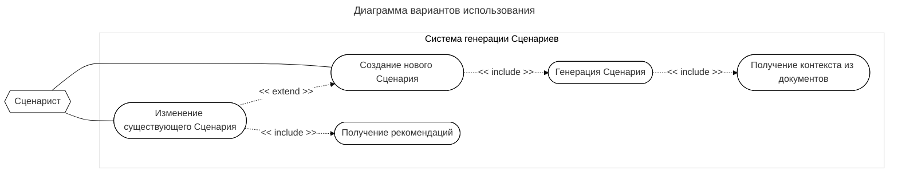

# 1. Диаграмма вариантов использования

## Таблица ... / Краткое описание ВИ «Создание нового сценария»

| Название варианта | Создание нового Сценария                                                                                 |
| ----------------- | -------------------------------------------------------------------------------------------------------- |
| Цель              | Генерация Сценария на основе документов по запросу Сценариста                                            |
| Действующие лица  | Сценарист                                                                                                |
| Тип варианта      | Основной                                                                                                 |
| Краткое описание  | Пред-условие: Сценарист ввёл первичные данные.  Пост-условие: новый Сценарий сохранён в хранилище. |

## Таблица ... / Типичный ход событий для ВИ «Создание нового сценария»

| Действие исполнителя                                       | Отклик системы                                                 |
| ---------------------------------------------------------- | -------------------------------------------------------------- |
| 1. Сценарист инициирует создание нового Сценария.          | 2. Система предоставляет форму для ввода параметров генерации. |
| 3. Сценарист заполняет поля формы и подтверждает создание. | 4. Система инициирует ВИ «Генерация сценария».                 |
|                                                            | 5. Система сохраняет новый Сценарий в хранилище.               |

## Таблица ... / Краткое описание ВИ «Генерация сценария»

| Название варианта | Генерация сценария                                                             |
| ----------------- | ------------------------------------------------------------------------------ |
| Цель              | Генерация контента Сценария и формирование его структуры                       |
| Действующие лица  | Сценарист                                                                      |
| Тип варианта      | Вспомогательный (Include)                                                      |
| Краткое описание  | Пред-условие: параметры генерации.  Пост-условие: новый объект Сценария. |

## Таблица ... / Типичный ход событий для ВИ «Генерация сценария»

| Действие исполнителя                        | Отклик системы                                                      |
| ------------------------------------------- | ------------------------------------------------------------------- |
| 1. Сценарист инициирует генерацию Сценария. | 2. Система инициирует ВИ «Получение контекста из документов».       |
|                                             | 3. Система генерирует сценарий на основе полученного контекста.     |
|                                             | 4. Система приводит результат генерации в выходной формат Сценария. |
|                                             | 5. Система возвращает Сценарий в вызывающий ВИ.                     |

## Таблица ... / Краткое описание ВИ «Получение контекста из документов»

| Название варианта | Получение контекста из документов                                                                                            |
| ----------------- | ---------------------------------------------------------------------------------------------------------------------------- |
| Цель              | Формирование списка всех близких по смыслу данных                                                                            |
| Действующие лица  | Сценарист                                                                                                                    |
| Тип варианта      | Вспомогательный (Include)                                                                                                    |
| Краткое описание  | Пред-условие: переданы пути к документам и запрос Сценариста.  Пост-условие: список данных, близких по смыслу запроса. |

  

## Таблица ... / Типичный ход событий для ВИ «Получение контекста из документов»

| Действие исполнителя                                       | Отклик системы                                                                            |
| ---------------------------------------------------------- | ----------------------------------------------------------------------------------------- |
| 1. Сценарист инициирует получение контекста из документов. | 2. Система обращается к хранилищу документов.                                             |
|                                                            | 3. Система приводит документы в состояние, пригодное для использования моделью генерации. |
|                                                            | 3. Система формирует перечень близких по смыслу данных.                                   |
|                                                            | 4. Система возвращает контекст в вызывающий ВИ.                                           |

  
## Таблица ... / Краткое описание ВИ «Изменение существующего сценария»

| Название варианта | Изменение существующего Сценария                                                                                                                     |
| ----------------- | ---------------------------------------------------------------------------------------------------------------------------------------------------- |
| Цель              | Внесение правок в уже созданный Сценарий                                                                                                             |
| Действующие лица  | Сценарист                                                                                                                                            |
| Тип варианта      | Расширение функционала (Extend)                                                                                                                      |
| Краткое описание  | Пред-условие: исходный Сценарий существует в хранилище.  Пост-условие: новая версия Сценария с учётом всех рекомендаций сохранена в хранилище. |

## Таблица ... / Типичный ход событий для ВИ «Изменение существующего сценария»

| Действие исполнителя                                        | Отклик системы                                                 |
| ----------------------------------------------------------- | -------------------------------------------------------------- |
| 1. Сценарист инициирует изменение сценария.                 | 2. Система инициирует ВИ «Получение рекомендаций».             |
|                                                             | 3. Система предоставляет форму для ввода параметров генерации. |
| 4. Сценарист заполняет поля формы и подтверждает изменение. | 5. Система инициирует ВИ «Генерация сценария».                 |
|                                                             | 6. Система сохраняет новый Сценарий в хранилище.               |

## Таблица ... / Краткое описание ВИ «Получение рекомендаций»

| Название варианта | Получение рекомендаций                                                            |
| ----------------- | --------------------------------------------------------------------------------- |
| Цель              | Учитывание рекомендаций Сценариста при «Изменении Сценария»                       |
| Действующие лица  | Сценарист                                                                         |
| Тип варианта      | Вспомогательный (Include)                                                         |
| Краткое описание  | Пред-условие: Сценарий для анализа.  Пост-условие: Рекомендации к Сценарию. |

## Таблица ... / Типичный ход событий для ВИ «Получение рекомендаций»

| Действие исполнителя                                           | Отклик системы                                         |
| -------------------------------------------------------------- | ------------------------------------------------------ |
| 1. Сценарист инициирует ввод рекомендаций.                     | 2. Система предоставляет форму для ввода рекомендаций. |
| 3. Сценарист заполняет поля формы и подтверждает рекомендации. | 4. Система возвращает рекомендации Сценариста.         |
