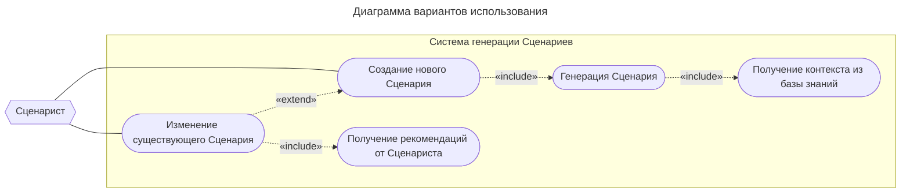

# Диаграмма вариантов использования

## Таблица ... / Краткое описание ВИ «Создание нового сценария»

| Название варианта | Создание нового Сценария                                                                                                          |
| ----------------- | --------------------------------------------------------------------------------------------------------------------------------- |
| Цель              | Создание Сценария на основе предоставленных документов и параметров генерации.                                                    |
| Действующие лица  | Сценарист                                                                                                                         |
| Тип варианта      | Основной                                                                                                                          |
| Краткое описание  | Предусловие: Сценарист располагает документами для генерации. Постусловие: новый Сценарий сгенерирован и сохранён в хранилище. |

## Таблица ... / Типичный ход событий для ВИ «Создание нового сценария»

| Действие исполнителя                                                | Отклик системы                                                |
| ------------------------------------------------------------------- | ------------------------------------------------------------- |
| 1. Сценарист инициирует создание нового Сценария.                   | 2. Система отображает форму создания с параметрами генерации. |
| 3. Сценарист заполняет параметры генерации и подтверждает создание. | 4. Система инициирует ВИ «Генерация Сценария».                |
|                                                                     | 5. Система сохраняет результат в хранилище.                   |
|                                                                     | 6. Система уведомляет об успешном создании.                   |

## Таблица ... / Краткое описание ВИ «Генерация сценария»

| Название варианта | Генерация сценария                                                                                                                                                                                |
| ----------------- | ------------------------------------------------------------------------------------------------------------------------------------------------------------------------------------------------- |
| Цель              | Формирование структуры и содержимого Сценария на основе заданных параметров генерации и контекста документов.                                                                                     |
| Действующие лица  | Система (ВИ — «Создание нового сценария»).                                                                                                                                                        |
| Тип варианта      | Вспомогательный (include)                                                                                                                                                                         |
| Краткое описание  | Предусловие: получены параметры генерации, база знаний доступна для извлечения контекста. Постусловие: сформирован объект Cценария, содержащий сгенерированный контент определённой структуры. |
	
## Таблица ... / Типичный ход событий для ВИ «Генерация сценария»

| Действие исполнителя | Отклик системы                                                                           |
| -------------------- | ---------------------------------------------------------------------------------------- |
|                      | 1. Система инициирует ВИ «Получение контекста из базы знаний».                           |
|                      | 2. Система генерирует содержимое на основе параметров генерации и полученного контекста. |
|                      | 3. Система формирует структуру в соответствии с выходным форматом.                       |
|                      | 4. Система возвращает сформированный объект Сценария в вызывающий ВИ.                    |

## Таблица ... / Краткое описание ВИ «Получение контекста из базы знаний»

| Название варианта | Получение контекста из базы знаний                                                                                                                                               |
| ----------------- | -------------------------------------------------------------------------------------------------------------------------------------------------------------------------------- |
| Цель              | Извлечение из базы знаний фрагментов документов, семантически близких к переданному запросу, для использования при генерации.                                                    |
| Действующие лица  | Система (ВИ — «Генерация сценария»).                                                                                                                                             |
| Тип варианта      | Вспомогательный (include)                                                                                                                                                        |
| Краткое описание  | Пред-условие: получены исходный запрос для поиска контекста и ссылки на документы, доступные в базе знаний. Пост-условие: список данных, близких по смыслу исходного запроса. |

## Таблица ... / Типичный ход событий для ВИ «Получение контекста из базы знаний»

| Действие исполнителя | Отклик системы                                                                                  |
| -------------------- | ----------------------------------------------------------------------------------------------- |
|                      | 1. Система получает запрос и ссылки на документы.                                               |
|                      | 2. Система извлекает содержимое документов из базы знаний.                                      |
|                      | 3. Система предобрабатывает содержимое документов для последующего семантического поиска.       |
|                      | 4. Система формирует список после поиска фрагментов документов, семантически близких к запросу. |
|                      | 6. Система возвращает полученный контекст в вызывающий ВИ.                                      |

## Таблица ... / Краткое описание ВИ «Изменение существующего сценария»

| Название варианта | Изменение существующего Сценария                                                                                                          |
| ----------------- | ----------------------------------------------------------------------------------------------------------------------------------------- |
| Цель              | Внесение правок в уже созданный Сценарий                                                                                                  |
| Действующие лица  | Сценарист                                                                                                                                 |
| Тип варианта      | Расширяющий (extend).                                                                                                                     |
| Краткое описание  | Предусловие: исходный Сценарий существует в хранилище. Постусловие: новая версия Сценария с учётом рекомендаций сохранена в хранилище. |

## Таблица ... / Типичный ход событий для ВИ «Изменение существующего сценария»

| Действие исполнителя                                                             | Отклик системы                                                   |
| -------------------------------------------------------------------------------- | ---------------------------------------------------------------- |
| 1. Сценарист выбирает существующий сценарий для изменения.                       | 2. Система загружает выбранный Сценарий из хранилища.            |
|                                                                                  | 3. Система инициирует ВИ «Получение рекомендаций от Сценариста». |
| 4. Сценарист задаёт дополнительные параметры изменения и подтверждает изменение. | 5. Система инициирует ВИ «Генерация сценария».                   |
|                                                                                  | 6. Система сохраняет результат в хранилище.                      |
|                                                                                  | 7. Система уведомляет об успешном создании.                      |

## Таблица ... / Краткое описание ВИ «Получение рекомендаций от Сценариста»

| Название варианта | Получение рекомендаций от Сценариста                                                                 |
| ----------------- | ---------------------------------------------------------------------------------------------------- |
| Цель              | Получение рекомендаций от Сценариста для изменения существующего Сценария.                           |
| Действующие лица  | Сценарист                                                                                            |
| Тип варианта      | Вспомогательный (include)                                                                            |
| Краткое описание  | Предусловие: существует Сценарий, доступный для изменения.  Постусловие: рекомендации Сценариста. |

## Таблица ... / Типичный ход событий для ВИ «Получение рекомендаций от Сценариста»

| Действие исполнителя                                           | Отклик системы                                                      |
| -------------------------------------------------------------- | ------------------------------------------------------------------- |
|                                                                | 1. Система предоставляет форму для ввода рекомендаций по изменению. |
| 2. Сценарист заполняет поля формы и подтверждает рекомендации. | 3. Система формириует список рекомендаций.                          |
|                                                                | 4. Система возвращает принятые рекомендации в вызывающий ВИ.        |
