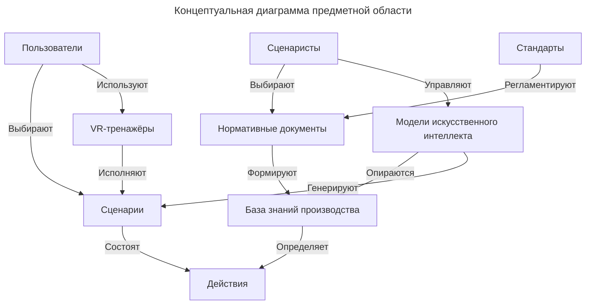

# Контекстная диаграмма классов

## Краткое описание классов

| Наименование сущности    | Описание сущности                                                                                                                              |
| ------------------------ | ---------------------------------------------------------------------------------------------------------------------------------------------- |
| Стандарты                | Совокупность нормативно-технических документов, устанавливающих требования, правила и положения, применимые к производственным процессам.      |
| Нормативные документы    | Документы, содержащие внутренние требования, регламенты, инструкции и положения производства.                                                  |
| База знаний производства | Совокупность нормативных документов, инструкций и иных данных, используемых для формирования контекста при разработке Сценариев.               |
| Сценаристы               | Сотрудники отдела 3D-визуализации и аддитивных технологий АО «НИУИФ», ответственные за создание и редактирование Сценариев для VR-тренажёра.   |
| Действия                 | Конкретные шаги и операции, выполняемые Пользователями в процессе прохождения обучения в VR-тренажёре.                                         |
| Модель ИИ                | Программные компоненты, анализирующие предоставленный контекст из Базы знаний производства и генерирующие Сценарии по запросам Сценаристов.    |
| Сценарий                 | Последовательности действий и учебных ситуаций, предназначенные для воспроизведения в VR-тренажёре.                                            |
| VR-тренажёр              | Программно-аппаратные комплексы, использующие технологии виртуальной реальности для имитации производственных процессов и проведения обучения. |
| Пользователи             | Сотрудники производства, проходящие обучение с использованием VR-тренажёров.                                                                   |

Сценаристы используют Модели искусственного интеллекта для генерации и редактирования Сценариев, формируя запросы и выбирая необходимые источники информации из Базы знаний производства.

База знаний производства включает Нормативные документы и другие информационные материалы, сформированные с учётом применимых Стандартов. Содержимое Базы знаний определяет требования и ограничения, которые должны учитываться при разработке Сценариев и входящих в них Действий.

Сценарии представляют собой последовательности Действий и учебных ситуаций, предназначенных для прохождения Пользователями в VR-тренажёрах. Пользователи выбирают доступные Сценарии и проходят обучение посредством их воспроизведения в VR-тренажёрах.
