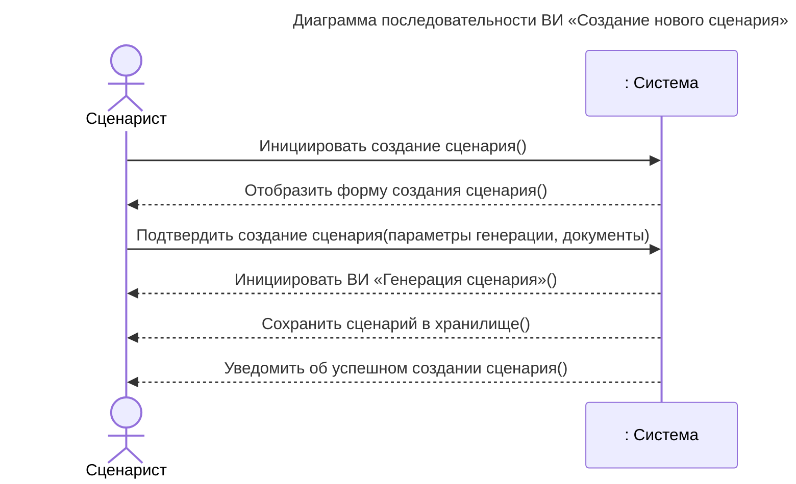
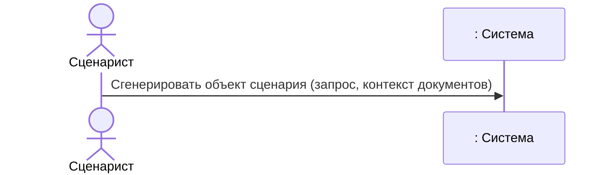
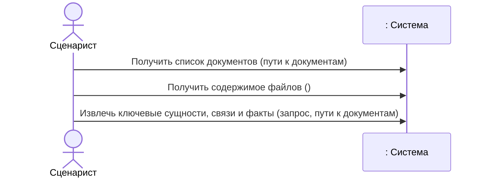
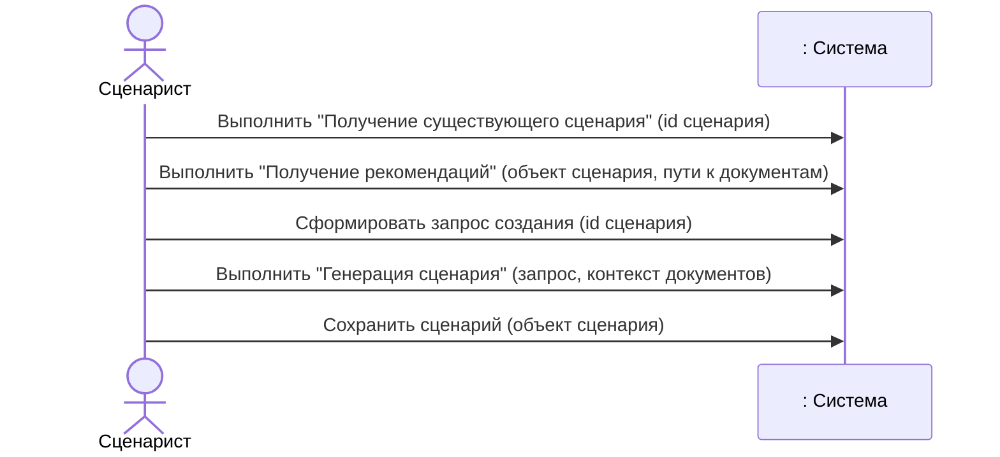
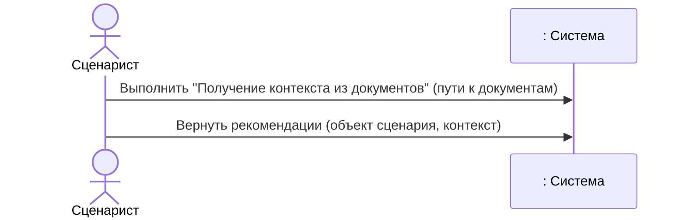

# Диаграмма последовательностей системы

## Шаблон описания операций системы

| Раздел      | Описание |
| ----------- | -------- |
| Имя         |          |
| Обязанности |          |
| Тип         |          |
| Ссылка      |          |
| Примечания  |          |
| Исключения  |          |
| Вывод       |          |
| Предусловие |          |
| Постусловие |          |

Правила заполнения

1. **Имя** - название операции, одной из многих в варианте использования
2. **Обязанности** - что делает операция, её основная функция
3. **Тип** - системная, пользовательская, техническая и т.д.
4. **Ссылка** - ссылка на соответствующий вариант использования
5. **Примечания** - дополнительные замечания, ограничения, особенности
6. **Исключения** - возможные исключительные ситуации и их обработка
7. **Вывод** - что возвращает операция (результат)
8. **Предусловие** - условия, которые должны быть выполнены перед выполнением операции
9. **Постусловие** - условия, которые будут выполнены после успешного выполнения операции

## Создание нового сценария

### Операция 1. Инициировать создание сценария

|Раздел|Описание|
|---|---|
|Имя|Инициировать создание сценария|
|Обязанности|Начать процесс создания нового сценария.|
|Тип|Системная операция|
|Ссылка|ВИ «Создание нового сценария»|
|Примечания|Вызывается Сценаристом для перехода к форме создания сценария.|
|Исключения|Отсутствие доступа к функции создания сценария.|
|Вывод|Форма создания сценария.|
|Предусловие|Сценарист авторизован в системе.|
|Постусловие|Отображена форма создания сценария.|

### Операция 2. Отобразить форму создание сценария

| Раздел      | Описание |
| ----------- | -------- |
| Имя         |          |
| Обязанности |          |
| Тип         |          |
| Ссылка      |          |
| Примечания  |          |
| Исключения  |          |
| Вывод       |          |
| Предусловие |          |
| Постусловие |          |

### Операция 3. Подтвердить создание сценария

|Раздел|Описание|
|---|---|
|Имя|Подтвердить создание сценария|
|Обязанности|Передать системе параметры генерации и документы, необходимые для создания сценария.|
|Тип|Пользовательская операция|
|Ссылка|ВИ «Создание нового сценария»|
|Примечания|Сценарист подтверждает введённые параметры и предоставленные документы.|
|Исключения|Некорректные параметры генерации; отсутствие обязательных документов.|
|Вывод|Параметры генерации и документы переданы системе.|
|Предусловие|Отображена форма создания сценария.|
|Постусловие|Система получила параметры генерации и документы.|

### Операция 4. Инициировать генерацию сценария

|Раздел|Описание|
|---|---|
|Имя|Инициировать генерацию сценария|
|Обязанности|Запустить процесс генерации сценария на основании предоставленных параметров и документов.|
|Тип|Системная операция|
|Ссылка|ВИ «Генерация сценария»|
|Примечания|Вызывается системой после подтверждения создания сценария.|
|Исключения|Ошибка запуска генерации; недостаточность исходных данных.|
|Вывод|Запущен процесс генерации сценария.|
|Предусловие|Система получила параметры генерации и документы.|
|Постусловие|Инициирован ВИ «Генерация сценария».|

### Операция 5. Сохранить сценарий в хранилище

|Раздел|Описание|
|---|---|
|Имя|Сохранить сценарий в хранилище|
|Обязанности|Сохранить сформированный сценарий в хранилище системы.|
|Тип|Системная операция|
|Ссылка|ВИ «Создание нового сценария»|
|Примечания|Сохранение выполняется после успешной генерации сценария.|
|Исключения|Ошибка сохранения; недоступность хранилища.|
|Вывод|Сохранённый сценарий.|
|Предусловие|Система получила сгенерированный сценарий.|
|Постусловие|Новый сценарий сохранён в хранилище.|

### Операция 6. Уведомить об успешном создании сценария

| Раздел      | Описание                                                      |
| ----------- | ------------------------------------------------------------- |
| Имя         | Уведомить об успешном создании сценария                       |
| Обязанности | Сообщить Сценаристу об успешном завершении создания сценария. |
| Тип         | Системная операция                                            |
| Ссылка      | ВИ «Создание нового сценария»                                 |
| Примечания  | Уведомление отправляется после успешного сохранения сценария. |
| Исключения  | Ошибка отправки уведомления.                                  |
| Вывод       | Уведомление об успешном создании сценария.                    |
| Предусловие | Новый сценарий успешно сохранён в хранилище.                  |
| Постусловие | Сценарист уведомлён об успешном создании сценария.            |

## Генерация сценария

### Операция 1: Сгенерировать сценарий

| Раздел      | Описание                                                                                              |
| ----------- | ----------------------------------------------------------------------------------------------------- |
| Имя         | Сгенерировать сценарий                                                                                |
| Обязанности | Пользователь запрашивает генерацию сценария на основе предоставленных запроса и контекста документов. |
| Тип         | Пользовательская                                                                                      |
| Ссылка      | "Генерация сценария"                                                                                  |
| Примечания  | Генерация выполняется с использованием ИИ-моделей, которые создают структурированный сценарий.        |
| Исключения  | Если запрос некорректен или контекст недостаточен, система возвращает ошибку.                         |
| Вывод       | Сгенерированный объект сценария.                                                                      |
| Предусловие | Запрос и контекст документов предоставлены.                                                           |
| Постусловие | Сценарий сгенерирован и может быть использован в других операциях.                                    |

## Получение контекста из документов

### Операция 1: Получить список документов

| Раздел      | Описание                                                                                         |
| ----------- | ------------------------------------------------------------------------------------------------ |
| Имя         | Получить список документов                                                                       |
| Обязанности | Пользователь указывает пути к документам, которые требуется обработать для извлечения контекста. |
| Тип         | Пользовательская                                                                                 |
| Ссылка      | "Получение контекста из документов"                                                              |
| Примечания  | Пути могут быть указаны как локальные файлы или URL. Система проверяет доступность.              |
| Исключения  | Если ни один из указанных файлов не доступен, система возвращает ошибку.                         |
| Вывод       | Список доступных документов для обработки.                                                       |
| Предусловие | Пользователь авторизован и имеет доступ к указанным ресурсам.                                    |
| Постусловие | Система готова к извлечению контекста из документов.                                             |

### Операция 2: Вернуть содержимое файлов

| Раздел      | Описание                                                                    |
| ----------- | --------------------------------------------------------------------------- |
| Имя         | Вернуть содержимое файлов                                                   |
| Обязанности | Пользователь инициирует чтение содержимого файлов для последующего анализа. |
| Тип         | Пользовательская                                                            |
| Ссылка      | "Получение контекста из документов"                                         |
| Примечания  | Чтение может включать распознавание текста (OCR) для изображений или PDF.   |
| Исключения  | Если файлы слишком большие или защищены, система может прервать операцию.   |
| Вывод       | Текстовое содержимое документов.                                            |
| Предусловие | Документы доступны для чтения.                                              |
| Постусловие | Содержимое документов подготовлено для извлечения контекста.                |

### Операция 3: Извлечь ключевые сущности, связи и факты

| Раздел      | Описание                                                                            |
| ----------- | ----------------------------------------------------------------------------------- |
| Имя         | Извлечь ключевые сущности, связи и факты                                            |
| Обязанности | Пользователь запускает процесс извлечения семантической информации из документов.   |
| Тип         | Пользовательская                                                                    |
| Ссылка      | "Получение контекста из документов"                                                 |
| Примечания  | Извлечение выполняется с использованием NLP-моделей и правил парсинга.              |
| Исключения  | Если документы имеют неподдерживаемый формат или повреждены, система пропускает их. |
| Вывод       | Структурированный контекст (сущности, связи, факты).                                |
| Предусловие | Список документов получен и доступен.                                               |
| Постусловие | Контекст извлечён и готов для использования в других операциях.                     |

## Изменение существующего сценария

### Операция 1: Выбрать "Изменить сценарий" (id сценария)

| Раздел      | Описание                                                                                                 |
| ----------- | -------------------------------------------------------------------------------------------------------- |
| Имя         | Выбрать "Изменить сценарий" (id сценария)                                                                |
| Обязанности | Пользователь выбирает существующий сценарий по его идентификатору для внесения изменений.                |
| Тип         | Пользовательская                                                                                         |
| Ссылка      | "Изменение существующего сценария"                                                                       |
| Примечания  | Идентификатор сценария может быть получен из списка сценариев или через поиск.                           |
| Исключения  | Если сценарий с указанным ID не существует или недоступен для редактирования, система отображает ошибку. |
| Вывод       | Открытие формы редактирования с предзаполненными текущими параметрами сценария.                          |
| Предусловие | Пользователь авторизован и имеет права на редактирование сценария. Сценарий существует.                  |
| Постусловие | Система загружает данные сценария и переходит в режим редактирования.                                    |

### Операция 2: Заполнить форму (параметры)

| Раздел      | Описание                                                                  |
| ----------- | ------------------------------------------------------------------------- |
| Имя         | Заполнить форму (параметры)                                               |
| Обязанности | Пользователь изменяет параметры сценария в форме редактирования.          |
| Тип         | Пользовательская                                                          |
| Ссылка      | "Изменение существующего сценария"                                        |
| Примечания  | Пользователь может изменить любое из полей, кроме системных (ID, версия). |
| Исключения  | Если новые данные не проходят валидацию, система отображает ошибки.       |
| Вывод       | Обновлённый объект сценария (в памяти).                                   |
| Предусловие | Форма редактирования открыта с загруженными данными.                      |
| Постусловие | Изменённые параметры готовы для сохранения.                               |

### Операция 3: Сохранить сценарий (объект сценария)

| Раздел      | Описание                                                                                                         |
| ----------- | ---------------------------------------------------------------------------------------------------------------- |
| Имя         | Сохранить сценарий (объект сценария)                                                                             |
| Обязанности | Пользователь подтверждает изменения, нажимая кнопку "Сохранить". Система сохраняет обновлённую версию сценария.  |
| Тип         | Пользовательская                                                                                                 |
| Ссылка      | "Изменение существующего сценария"                                                                               |
| Примечания  | Система создаёт новую версию сценария или перезаписывает существующую в зависимости от политики версионирования. |
| Исключения  | Если сохранение не удалось (конфликт версий, отсутствие прав), система уведомляет пользователя.                  |
| Вывод       | Сохранённая новая версия сценария.                                                                               |
| Предусловие | Параметры сценария изменены и прошли валидацию.                                                                  |
| Постусловие | Сценарий обновлён. История версий пополнена.                                                                     |

### Операция 1: Получить существующий сценарий

| Раздел      | Описание                                                                                       |
| ----------- | ---------------------------------------------------------------------------------------------- |
| Имя         | Получить существующий сценарий                                                                 |
| Обязанности | Пользователь указывает идентификатор сценария, который требуется загрузить для редактирования. |
| Тип         | Пользовательская                                                                               |
| Ссылка      | "Изменение существующего сценария", "Получение существующего сценария"                         |
| Примечания  | Идентификатор может быть выбран из списка или введён вручную.                                  |
| Исключения  | Если сценарий с указанным ID не существует или недоступен, система отображает ошибку.          |
| Вывод       | Загруженный объект сценария с текущими параметрами.                                            |
| Предусловие | Пользователь авторизован и имеет права на редактирование сценария.                             |
| Постусловие | Сценарий загружен и готов к модификации.                                                       |

### Операция 2: Запросить рекомендации

| Раздел      | Описание                                                                                                                    |
| ----------- | --------------------------------------------------------------------------------------------------------------------------- |
| Имя         | Запросить рекомендации                                                                                                      |
| Обязанности | Пользователь запрашивает рекомендации по улучшению сценария на основе его текущего содержимого и дополнительных документов. |
| Тип         | Пользовательская                                                                                                            |
| Ссылка      | "Изменение существующего сценария", "Получение рекомендаций"                                                                |
| Примечания  | Рекомендации могут включать предложения по структуре, содержанию или стилю.                                                 |
| Исключения  | Если не удалось получить рекомендации (например, из-за отсутствия документов), система уведомляет пользователя.             |
| Вывод       | Список рекомендаций для сценария.                                                                                           |
| Предусловие | Сценарий загружен, пользователь указал пути к документам (опционально).                                                     |
| Постусловие | Рекомендации готовы для просмотра и применения.                                                                             |

### Операция 3: Сформировать запрос создания

| Раздел      | Описание                                                                                                        |
| ----------- | --------------------------------------------------------------------------------------------------------------- |
| Имя         | Сформировать запрос создания                                                                                    |
| Обязанности | Пользователь формирует запрос на создание новой версии сценария на основе изменённых параметров и рекомендаций. |
| Тип         | Пользовательская                                                                                                |
| Ссылка      | "Изменение существующего сценария"                                                                              |
| Примечания  | Запрос включает идентификатор исходного сценария и все необходимые изменения.                                   |
| Исключения  | Если запрос противоречит правилам системы (например, нарушает целостность), система отказывает в выполнении.    |
| Вывод       | Запрос на генерацию новой версии сценария.                                                                      |
| Предусловие | Сценарий загружен, рекомендации получены (опционально).                                                         |
| Постусловие | Запрос готов для передачи в генерацию сценария.                                                                 |

### Операция 4: Запустить генерацию сценария

| Раздел      | Описание                                                                                                          |
| ----------- | ----------------------------------------------------------------------------------------------------------------- |
| Имя         | Запустить генерацию сценария                                                                                      |
| Обязанности | Пользователь инициирует генерацию новой версии сценария на основе сформированного запроса и контекста документов. |
| Тип         | Пользовательская                                                                                                  |
| Ссылка      | "Изменение существующего сценария", "Генерация сценария"                                                          |
| Примечания  | Генерация создаёт новую версию сценария, сохраняя историю изменений.                                              |
| Исключения  | Если генерация не удалась, система отображает сообщение об ошибке.                                                |
| Вывод       | Сгенерированный объект сценария (новая версия).                                                                   |
| Предусловие | Запрос создания сформирован, контекст документов подготовлен.                                                     |
| Постусловие | Новая версия сценария готова к сохранению.                                                                        |

## Получение рекомендаций

### Операция 1: Запросить контекст из документов

| Раздел | Описание |
| ----------- | -------- |
| Имя | Запросить контекст из документов |
| Обязанности | Пользователь указывает пути к документам, из которых требуется извлечь контекст для формирования рекомендаций. |
| Тип | Пользовательская |
| Ссылка | "Получение рекомендаций", "Получение контекста из документов" |
| Примечания | Контекст извлекается автоматически, пользователь может выбрать конкретные файлы. |
| Исключения | Если файлы повреждены или недоступны, система пропускает их и использует доступные. |
| Вывод | Контекст (структурированные данные) для анализа. |
| Предусловие | Запрос на рекомендации активен, пути к документам указаны. |
| Постусловие | Контекст готов для использования в алгоритме рекомендаций. |

### Операция 2: Получить рекомендации

| Раздел      | Описание                                                                                    |
| ----------- | ------------------------------------------------------------------------------------------- |
| Имя         | Получить рекомендации                                                                       |
| Обязанности | Пользователь запрашивает рекомендации на основе текущего сценария и извлечённого контекста. |
| Тип         | Пользовательская                                                                            |
| Ссылка      | "Получение рекомендаций"                                                                    |
| Примечания  | Рекомендации могут быть сгенерированы ИИ-моделью или на основе правил.                      |
| Исключения  | Если алгоритм не может сформировать рекомендации, система возвращает пустой список.         |
| Вывод       | Список рекомендаций (текстовые предложения, оценки, приоритеты).                            |
| Предусловие | Контекст документов подготовлен, сценарий загружен.                                         |
| Постусловие | Рекомендации отображены пользователю.                                                       |
