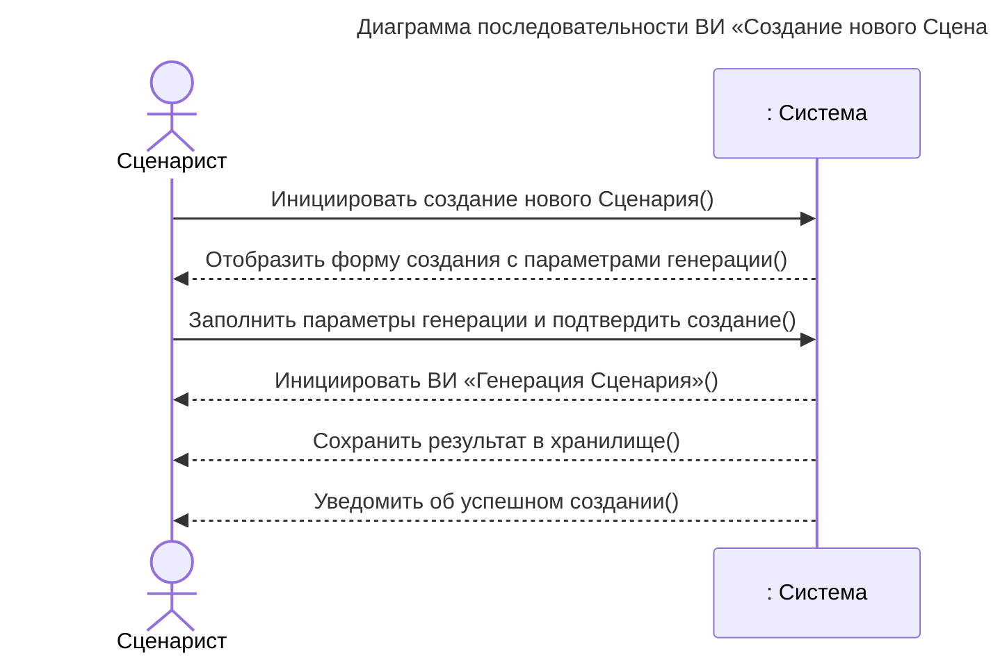
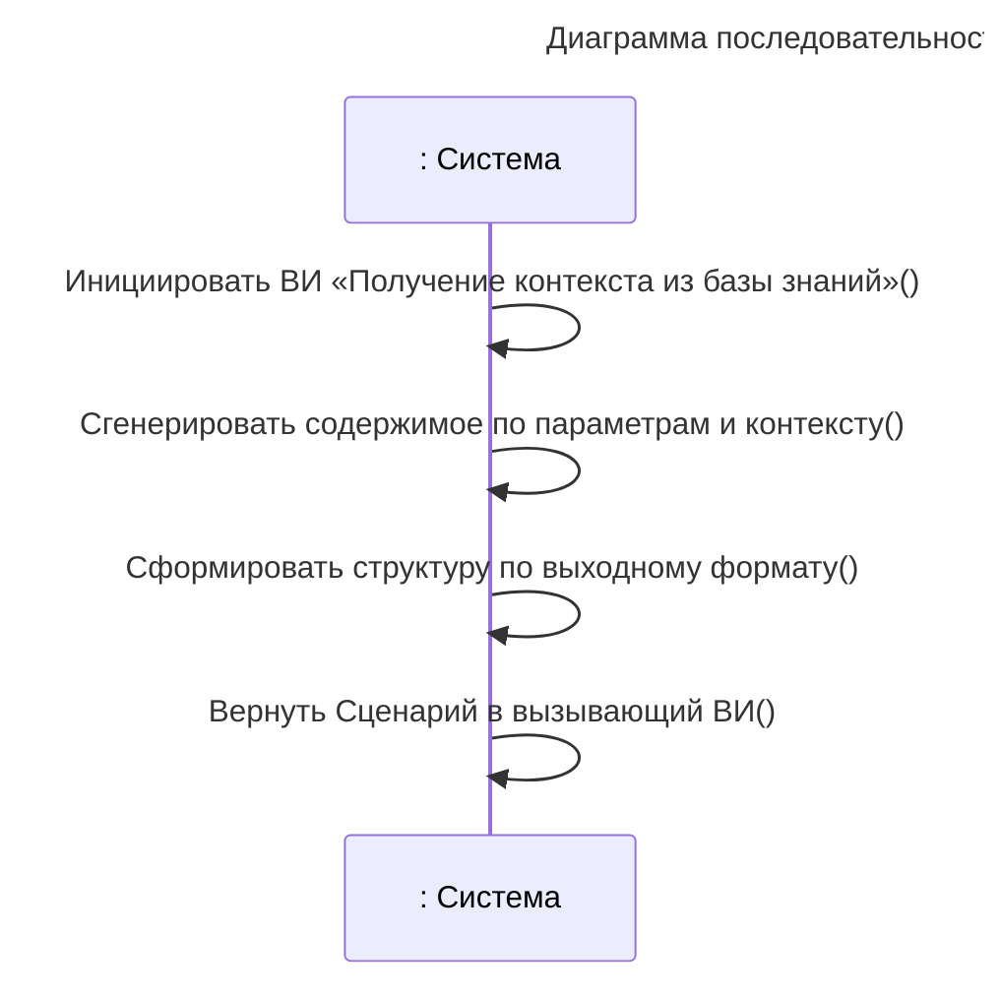
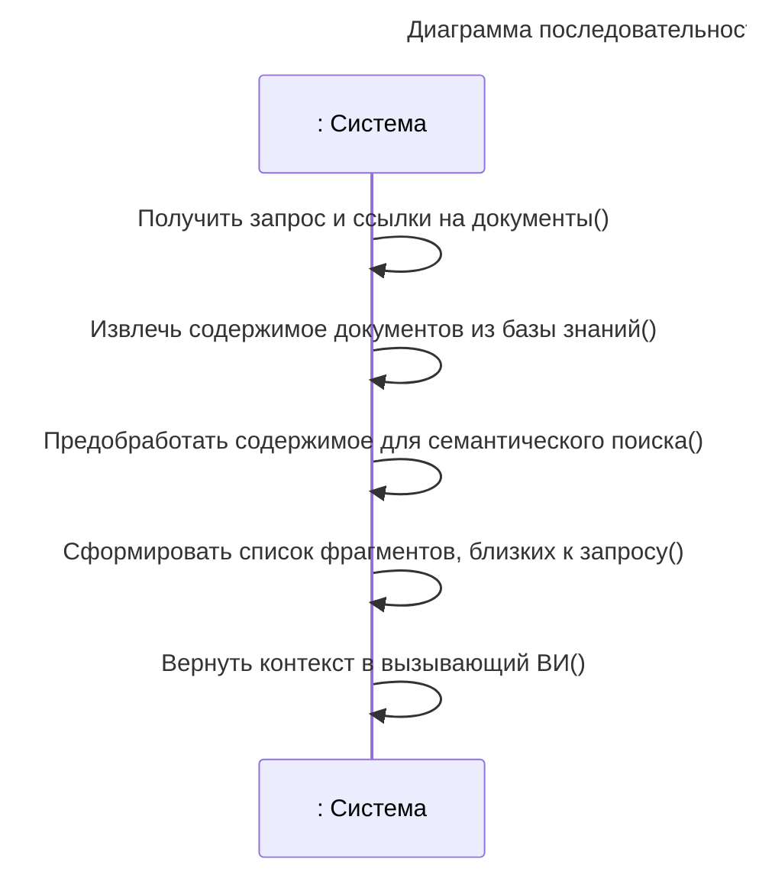
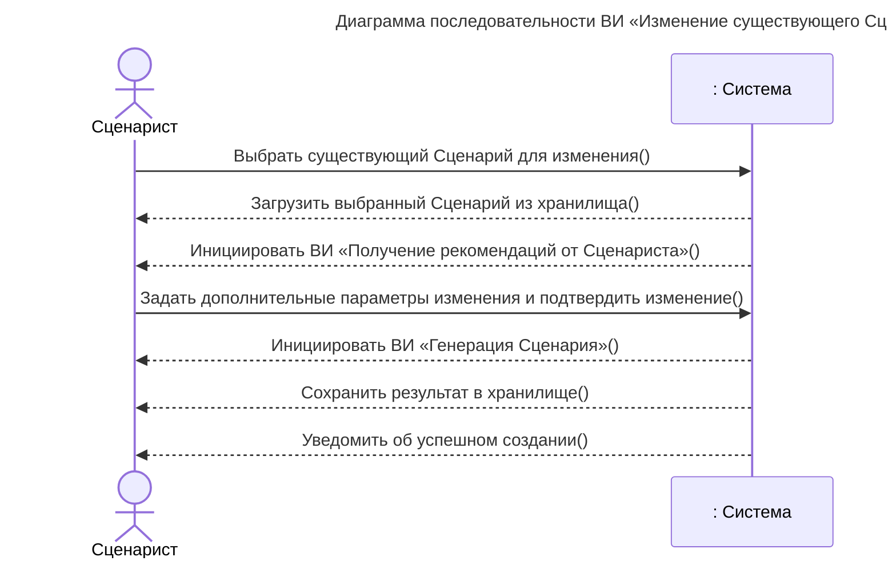
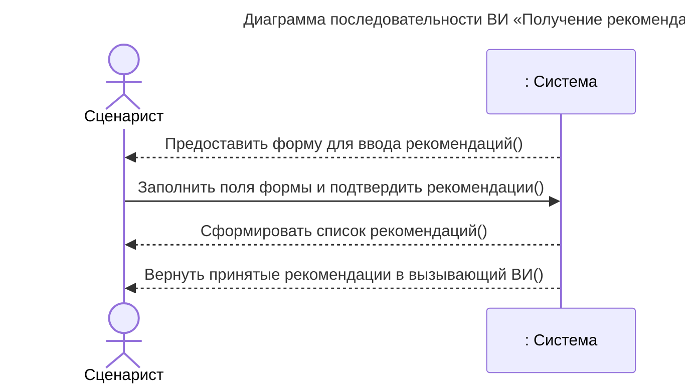

# Диаграмма последовательностей системы

## Шаблон описания операций системы

| Раздел      | Описание |
| ----------- | -------- |
| Имя         |          |
| Обязанности |          |
| Тип         |          |
| Ссылка      |          |
| Примечания  |          |
| Исключения  |          |
| Вывод       |          |
| Предусловие |          |
| Постусловие |          |

Правила заполнения

1. **Имя** - название операции, одной из многих в варианте использования
2. **Обязанности** - что делает операция, её основная функция
3. **Тип** - системная, пользовательская, техническая и т.д.
4. **Ссылка** - ссылка на соответствующий вариант использования
5. **Примечания** - дополнительные замечания, ограничения, особенности
6. **Исключения** - возможные исключительные ситуации и их обработка
7. **Вывод** - что возвращает операция (результат)
8. **Предусловие** - условия, которые должны быть выполнены перед выполнением операции
9. **Постусловие** - условия, которые будут выполнены после успешного выполнения операции

## ВИ «Создание нового Сценария»

Число операций `User->>System:` (2) соответствует числу действий исполнителя в ВИ «Создание нового Сценария».

### Операция 1. Инициировать создание нового Сценария

| Раздел      | Описание                                                          |
| ----------- | ----------------------------------------------------------------- |
| Имя         | Инициировать создание нового Сценария                             |
| Обязанности | Начать процесс создания нового Сценария.                          |
| Тип         | Пользовательская операция                                         |
| Ссылка      | ВИ «Создание нового Сценария»                                     |
| Примечания  | Выполняется Сценаристом для перехода к форме создания.            |
| Исключения  | Отсутствие доступа к функции создания Сценария.                   |
| Вывод       | Запрос на открытие формы создания Сценария.                       |
| Предусловие | Приложение запущено и доступно Сценаристу.                        |
| Постусловие | Система получила запрос на создание нового Сценария.              |

### Операция 2. Отобразить форму создания с параметрами генерации

| Раздел      | Описание                                                            |
| ----------- | ------------------------------------------------------------------- |
| Имя         | Отобразить форму создания с параметрами генерации                   |
| Обязанности | Показать Сценаристу форму создания с параметрами генерации.         |
| Тип         | Системная операция                                                  |
| Ссылка      | ВИ «Создание нового Сценария»                                       |
| Примечания  | Форма включает поля ввода запроса и выбор режима работы.            |
| Исключения  | Ошибка отрисовки интерфейса.                                        |
| Вывод       | Отображённая форма создания.                                        |
| Предусловие | Получен запрос на создание нового Сценария.                         |
| Постусловие | Форма создания с параметрами генерации отображена Сценаристу.       |

### Операция 3. Заполнить параметры генерации и подтвердить создание

| Раздел      | Описание                                                                      |
| ----------- | ----------------------------------------------------------------------------- |
| Имя         | Заполнить параметры генерации и подтвердить создание                          |
| Обязанности | Передать системе заполненный запрос и подтверждение создания.                 |
| Тип         | Пользовательская операция                                                     |
| Ссылка      | ВИ «Создание нового Сценария»                                                 |
| Примечания  | Сценарист подтверждает отправку запроса кнопкой или горячей клавишей.         |
| Исключения  | Пустой запрос; некорректно заполненные поля.                                  |
| Вывод       | Запрос и параметры генерации переданы системе.                                |
| Предусловие | Отображена форма создания с параметрами генерации.                            |
| Постусловие | Система получила запрос и параметры генерации.                                |

### Операция 4. Инициировать ВИ «Генерация Сценария»

| Раздел      | Описание                                                                     |
| ----------- | ---------------------------------------------------------------------------- |
| Имя         | Инициировать ВИ «Генерация Сценария»                                         |
| Обязанности | Запустить процесс генерации Сценария на основании запроса и параметров.      |
| Тип         | Системная операция                                                           |
| Ссылка      | ВИ «Создание нового Сценария», ВИ «Генерация Сценария»                       |
| Примечания  | Выполняется системой после подтверждения создания.                           |
| Исключения  | Ошибка запуска генерации; недостаточность исходных данных.                   |
| Вывод       | Запущенный процесс генерации Сценария.                                       |
| Предусловие | Система получила запрос и параметры генерации.                               |
| Постусловие | ВИ «Генерация Сценария» инициирован.                                         |

### Операция 5. Сохранить результат в хранилище

| Раздел      | Описание                                                            |
| ----------- | ------------------------------------------------------------------- |
| Имя         | Сохранить результат в хранилище                                     |
| Обязанности | Сохранить сформированный Сценарий в хранилище системы.              |
| Тип         | Системная операция                                                  |
| Ссылка      | ВИ «Создание нового Сценария»                                       |
| Примечания  | Сохранение выполняется после успешной генерации Сценария.           |
| Исключения  | Ошибка сохранения; недоступность хранилища.                         |
| Вывод       | Сохранённый Сценарий.                                               |
| Предусловие | Система получила сгенерированный Сценарий.                          |
| Постусловие | Новый Сценарий сохранён в хранилище.                                |

### Операция 6. Уведомить об успешном создании

| Раздел      | Описание                                                       |
| ----------- | -------------------------------------------------------------- |
| Имя         | Уведомить об успешном создании                                 |
| Обязанности | Сообщить Сценаристу об успешном завершении создания.           |
| Тип         | Системная операция                                             |
| Ссылка      | ВИ «Создание нового Сценария»                                  |
| Примечания  | Уведомление отправляется после успешного сохранения.           |
| Исключения  | Ошибка отправки уведомления.                                   |
| Вывод       | Уведомление об успешном создании Сценария.                     |
| Предусловие | Новый Сценарий успешно сохранён в хранилище.                   |
| Постусловие | Сценарист уведомлён об успешном создании Сценария.             |

## ВИ «Генерация Сценария»

Число операций `User->>System:` (0) соответствует числу действий исполнителя в ВИ «Генерация Сценария» (все шаги выполняются системой).

### Операция 1. Инициировать ВИ «Получение контекста из базы знаний»

| Раздел      | Описание                                                                     |
| ----------- | ---------------------------------------------------------------------------- |
| Имя         | Инициировать ВИ «Получение контекста из базы знаний»                         |
| Обязанности | Запросить контекст из базы знаний для последующей генерации.                 |
| Тип         | Системная операция                                                           |
| Ссылка      | ВИ «Генерация Сценария», ВИ «Получение контекста из базы знаний»             |
| Примечания  | Вспомогательный вызов (include).                                             |
| Исключения  | Недоступность базы знаний.                                                   |
| Вывод       | Полученный контекст документов.                                              |
| Предусловие | Получены параметры генерации, база знаний доступна.                          |
| Постусловие | Контекст из базы знаний получен.                                             |

### Операция 2. Сгенерировать содержимое по параметрам и контексту

| Раздел      | Описание                                                                     |
| ----------- | ---------------------------------------------------------------------------- |
| Имя         | Сгенерировать содержимое по параметрам и контексту                           |
| Обязанности | Сформировать содержимое Сценария на основе параметров и полученного контекста. |
| Тип         | Системная операция                                                           |
| Ссылка      | ВИ «Генерация Сценария»                                                      |
| Примечания  | Генерация выполняется с использованием моделей ИИ.                           |
| Исключения  | Ошибка модели; недостаточность контекста.                                    |
| Вывод       | Сгенерированное содержимое Сценария.                                         |
| Предусловие | Параметры генерации и контекст получены.                                     |
| Постусловие | Содержимое Сценария сгенерировано.                                           |

### Операция 3. Сформировать структуру по выходному формату

| Раздел      | Описание                                                                     |
| ----------- | ---------------------------------------------------------------------------- |
| Имя         | Сформировать структуру по выходному формату                                  |
| Обязанности | Привести сгенерированное содержимое к структуре выходного формата.           |
| Тип         | Системная операция                                                           |
| Ссылка      | ВИ «Генерация Сценария»                                                      |
| Примечания  | Формируется объект Сценария, содержащий Шаги.                                |
| Исключения  | Нарушение структуры выходного формата.                                       |
| Вывод       | Структурированный объект Сценария.                                           |
| Предусловие | Содержимое Сценария сгенерировано.                                           |
| Постусловие | Сформирован объект Сценария определённой структуры.                          |

### Операция 4. Вернуть Сценарий в вызывающий ВИ

| Раздел      | Описание                                                                     |
| ----------- | ---------------------------------------------------------------------------- |
| Имя         | Вернуть Сценарий в вызывающий ВИ                                             |
| Обязанности | Передать сформированный Сценарий вызывающему варианту использования.         |
| Тип         | Системная операция                                                           |
| Ссылка      | ВИ «Генерация Сценария»                                                      |
| Примечания  | Завершающая операция вспомогательного ВИ.                                    |
| Исключения  | Потеря результата при передаче.                                              |
| Вывод       | Сформированный объект Сценария.                                              |
| Предусловие | Сформирован объект Сценария определённой структуры.                          |
| Постусловие | Сценарий передан в вызывающий ВИ.                                            |

## ВИ «Получение контекста из базы знаний»

Число операций `User->>System:` (0) соответствует числу действий исполнителя в ВИ «Получение контекста из базы знаний» (все шаги выполняются системой).

### Операция 1. Получить запрос и ссылки на документы

| Раздел      | Описание                                                                     |
| ----------- | ---------------------------------------------------------------------------- |
| Имя         | Получить запрос и ссылки на документы                                        |
| Обязанности | Принять исходный запрос и ссылки на доступные документы базы знаний.         |
| Тип         | Системная операция                                                           |
| Ссылка      | ВИ «Получение контекста из базы знаний»                                      |
| Примечания  | Операция выполняется системой без участия исполнителя.                       |
| Исключения  | Отсутствие запроса; недоступность ссылок на документы.                       |
| Вывод       | Запрос и ссылки на документы.                                                |
| Предусловие | Вызывающий ВИ передал запрос для поиска контекста.                           |
| Постусловие | Запрос и ссылки на документы получены системой.                              |

### Операция 2. Извлечь содержимое документов из базы знаний

| Раздел      | Описание                                                                     |
| ----------- | ---------------------------------------------------------------------------- |
| Имя         | Извлечь содержимое документов из базы знаний                                 |
| Обязанности | Получить содержимое документов по ссылкам.                                   |
| Тип         | Системная операция                                                           |
| Ссылка      | ВИ «Получение контекста из базы знаний»                                      |
| Примечания  | Содержимое используется для семантического поиска.                           |
| Исключения  | Недоступность документов; неподдерживаемый формат.                           |
| Вывод       | Извлечённое содержимое документов.                                           |
| Предусловие | Запрос и ссылки на документы получены.                                       |
| Постусловие | Содержимое документов извлечено из базы знаний.                              |

### Операция 3. Предобработать содержимое для семантического поиска

| Раздел      | Описание                                                                     |
| ----------- | ---------------------------------------------------------------------------- |
| Имя         | Предобработать содержимое для семантического поиска                          |
| Обязанности | Подготовить содержимое документов к семантическому поиску.                   |
| Тип         | Системная операция                                                           |
| Ссылка      | ВИ «Получение контекста из базы знаний»                                      |
| Примечания  | Предобработка включает разбиение на фрагменты и индексацию.                  |
| Исключения  | Ошибка предобработки.                                                        |
| Вывод       | Подготовленные для поиска фрагменты.                                         |
| Предусловие | Содержимое документов извлечено.                                             |
| Постусловие | Содержимое подготовлено для семантического поиска.                           |

### Операция 4. Сформировать список фрагментов, близких к запросу

| Раздел      | Описание                                                                     |
| ----------- | ---------------------------------------------------------------------------- |
| Имя         | Сформировать список фрагментов, близких к запросу                            |
| Обязанности | Выполнить поиск и сформировать список семантически близких фрагментов.       |
| Тип         | Системная операция                                                           |
| Ссылка      | ВИ «Получение контекста из базы знаний»                                      |
| Примечания  | Поиск выполняется по векторному индексу базы знаний.                         |
| Исключения  | Пустой результат поиска.                                                     |
| Вывод       | Список фрагментов документов, близких к запросу.                             |
| Предусловие | Содержимое подготовлено для семантического поиска.                           |
| Постусловие | Список близких по смыслу фрагментов сформирован.                             |

### Операция 5. Вернуть контекст в вызывающий ВИ

| Раздел      | Описание                                                                     |
| ----------- | ---------------------------------------------------------------------------- |
| Имя         | Вернуть контекст в вызывающий ВИ                                             |
| Обязанности | Передать полученный контекст в вызывающий вариант использования.             |
| Тип         | Системная операция                                                           |
| Ссылка      | ВИ «Получение контекста из базы знаний»                                      |
| Примечания  | Завершающая операция вспомогательного ВИ.                                    |
| Исключения  | Потеря результата при передаче.                                              |
| Вывод       | Список данных, близких по смыслу исходному запросу.                          |
| Предусловие | Список близких по смыслу фрагментов сформирован.                             |
| Постусловие | Контекст передан в вызывающий ВИ.                                            |

## ВИ «Изменение существующего Сценария»

Число операций `User->>System:` (2) соответствует числу действий исполнителя в ВИ «Изменение существующего Сценария».

### Операция 1. Выбрать существующий Сценарий для изменения

| Раздел      | Описание                                                                     |
| ----------- | ---------------------------------------------------------------------------- |
| Имя         | Выбрать существующий Сценарий для изменения                                  |
| Обязанности | Указать системе Сценарий, который требуется изменить.                        |
| Тип         | Пользовательская операция                                                    |
| Ссылка      | ВИ «Изменение существующего Сценария»                                        |
| Примечания  | Выполняется Сценаристом в режиме изменения.                                  |
| Исключения  | Сценарий не существует или недоступен.                                       |
| Вывод       | Запрос на загрузку выбранного Сценария.                                      |
| Предусловие | Исходный Сценарий существует в хранилище.                                    |
| Постусловие | Система получила запрос на изменение выбранного Сценария.                    |

### Операция 2. Загрузить выбранный Сценарий из хранилища

| Раздел      | Описание                                                                     |
| ----------- | ---------------------------------------------------------------------------- |
| Имя         | Загрузить выбранный Сценарий из хранилища                                    |
| Обязанности | Загрузить данные выбранного Сценария из хранилища.                           |
| Тип         | Системная операция                                                           |
| Ссылка      | ВИ «Изменение существующего Сценария»                                        |
| Примечания  | Загруженный Сценарий предоставляется для изменения.                          |
| Исключения  | Ошибка чтения из хранилища.                                                  |
| Вывод       | Загруженный объект Сценария.                                                 |
| Предусловие | Получен запрос на изменение выбранного Сценария.                             |
| Постусловие | Выбранный Сценарий загружен из хранилища.                                    |

### Операция 3. Инициировать ВИ «Получение рекомендаций от Сценариста»

| Раздел      | Описание                                                                     |
| ----------- | ---------------------------------------------------------------------------- |
| Имя         | Инициировать ВИ «Получение рекомендаций от Сценариста»                       |
| Обязанности | Запустить вспомогательный ВИ для сбора рекомендаций по изменению.            |
| Тип         | Системная операция                                                           |
| Ссылка      | ВИ «Изменение существующего Сценария», ВИ «Получение рекомендаций от Сценариста» |
| Примечания  | Вспомогательный вызов (include).                                             |
| Исключения  | Сценарий недоступен для изменения.                                           |
| Вывод       | Принятые рекомендации Сценариста.                                            |
| Предусловие | Сценарий загружен и доступен для изменения.                                  |
| Постусловие | Рекомендации Сценариста получены.                                            |

### Операция 4. Задать дополнительные параметры изменения и подтвердить изменение

| Раздел      | Описание                                                                     |
| ----------- | ---------------------------------------------------------------------------- |
| Имя         | Задать дополнительные параметры изменения и подтвердить изменение            |
| Обязанности | Передать системе параметры изменения и подтверждение.                        |
| Тип         | Пользовательская операция                                                    |
| Ссылка      | ВИ «Изменение существующего Сценария»                                        |
| Примечания  | Параметры включают дополнительные инструкции к изменению.                    |
| Исключения  | Некорректные параметры изменения.                                            |
| Вывод       | Параметры изменения переданы системе.                                        |
| Предусловие | Рекомендации Сценариста получены.                                            |
| Постусловие | Система получила параметры изменения и подтверждение.                        |

### Операция 5. Инициировать ВИ «Генерация Сценария»

| Раздел      | Описание                                                                     |
| ----------- | ---------------------------------------------------------------------------- |
| Имя         | Инициировать ВИ «Генерация Сценария»                                         |
| Обязанности | Запустить генерацию новой версии Сценария по параметрам изменения.           |
| Тип         | Системная операция                                                           |
| Ссылка      | ВИ «Изменение существующего Сценария», ВИ «Генерация Сценария»               |
| Примечания  | Генерация создаёт новую версию существующего Сценария.                        |
| Исключения  | Ошибка генерации; недостаточность исходных данных.                           |
| Вывод       | Сгенерированная новая версия Сценария.                                       |
| Предусловие | Система получила параметры изменения и подтверждение.                        |
| Постусловие | ВИ «Генерация Сценария» инициирован.                                         |

### Операция 6. Сохранить результат в хранилище

| Раздел      | Описание                                                                     |
| ----------- | ---------------------------------------------------------------------------- |
| Имя         | Сохранить результат в хранилище                                              |
| Обязанности | Сохранить новую версию Сценария в хранилище системы.                         |
| Тип         | Системная операция                                                           |
| Ссылка      | ВИ «Изменение существующего Сценария»                                        |
| Примечания  | Сохранение выполняется после успешной генерации.                             |
| Исключения  | Ошибка сохранения; недоступность хранилища.                                  |
| Вывод       | Сохранённая новая версия Сценария.                                           |
| Предусловие | Новая версия Сценария сгенерирована.                                         |
| Постусловие | Новая версия Сценария сохранена в хранилище.                                 |

### Операция 7. Уведомить об успешном создании

| Раздел      | Описание                                                                     |
| ----------- | ---------------------------------------------------------------------------- |
| Имя         | Уведомить об успешном создании                                               |
| Обязанности | Сообщить Сценаристу об успешном изменении Сценария.                          |
| Тип         | Системная операция                                                           |
| Ссылка      | ВИ «Изменение существующего Сценария»                                        |
| Примечания  | Уведомление отправляется после успешного сохранения.                         |
| Исключения  | Ошибка отправки уведомления.                                                 |
| Вывод       | Уведомление об успешном изменении Сценария.                                  |
| Предусловие | Новая версия Сценария сохранена в хранилище.                                 |
| Постусловие | Сценарист уведомлён об успешном изменении Сценария.                          |

## ВИ «Получение рекомендаций от Сценариста»

Число операций `User->>System:` (1) соответствует числу действий исполнителя в ВИ «Получение рекомендаций от Сценариста».

### Операция 1. Предоставить форму для ввода рекомендаций

| Раздел      | Описание                                                                     |
| ----------- | ---------------------------------------------------------------------------- |
| Имя         | Предоставить форму для ввода рекомендаций                                    |
| Обязанности | Отобразить Сценаристу форму ввода рекомендаций по изменению.                 |
| Тип         | Системная операция                                                           |
| Ссылка      | ВИ «Получение рекомендаций от Сценариста»                                    |
| Примечания  | Форма предоставляется после загрузки изменяемого Сценария.                   |
| Исключения  | Ошибка отрисовки интерфейса.                                                 |
| Вывод       | Отображённая форма ввода рекомендаций.                                       |
| Предусловие | Существует Сценарий, доступный для изменения.                                |
| Постусловие | Форма ввода рекомендаций предоставлена Сценаристу.                           |

### Операция 2. Заполнить поля формы и подтвердить рекомендации

| Раздел      | Описание                                                                     |
| ----------- | ---------------------------------------------------------------------------- |
| Имя         | Заполнить поля формы и подтвердить рекомендации                              |
| Обязанности | Передать системе заполненные рекомендации по изменению.                      |
| Тип         | Пользовательская операция                                                    |
| Ссылка      | ВИ «Получение рекомендаций от Сценариста»                                    |
| Примечания  | Рекомендации фиксируются как дополнительные инструкции.                      |
| Исключения  | Пустые поля формы.                                                           |
| Вывод       | Рекомендации переданы системе.                                               |
| Предусловие | Форма ввода рекомендаций предоставлена.                                      |
| Постусловие | Система получила заполненные рекомендации.                                   |

### Операция 3. Сформировать список рекомендаций

| Раздел      | Описание                                                                     |
| ----------- | ---------------------------------------------------------------------------- |
| Имя         | Сформировать список рекомендаций                                             |
| Обязанности | Преобразовать введённые данные в список рекомендаций.                        |
| Тип         | Системная операция                                                           |
| Ссылка      | ВИ «Получение рекомендаций от Сценариста»                                    |
| Примечания  | Список формируется из полей формы.                                           |
| Исключения  | Некорректный формат введённых данных.                                        |
| Вывод       | Список рекомендаций.                                                         |
| Предусловие | Система получила заполненные рекомендации.                                   |
| Постусловие | Список рекомендаций сформирован.                                             |

### Операция 4. Вернуть принятые рекомендации в вызывающий ВИ

| Раздел      | Описание                                                                     |
| ----------- | ---------------------------------------------------------------------------- |
| Имя         | Вернуть принятые рекомендации в вызывающий ВИ                                |
| Обязанности | Передать принятые рекомендации в вызывающий вариант использования.           |
| Тип         | Системная операция                                                           |
| Ссылка      | ВИ «Получение рекомендаций от Сценариста»                                    |
| Примечания  | Завершающая операция вспомогательного ВИ.                                    |
| Исключения  | Потеря результата при передаче.                                              |
| Вывод       | Принятые рекомендации Сценариста.                                            |
| Предусловие | Список рекомендаций сформирован.                                             |
| Постусловие | Рекомендации переданы в вызывающий ВИ.                                       |
