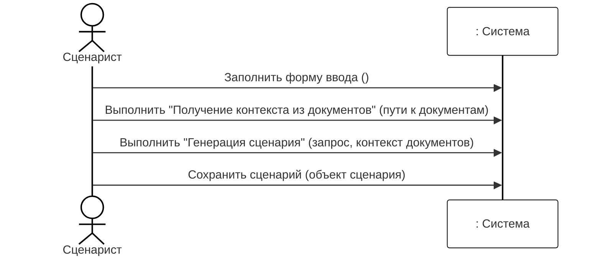
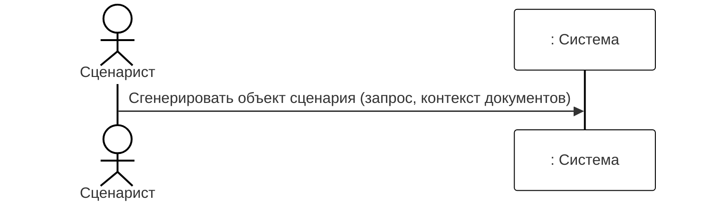
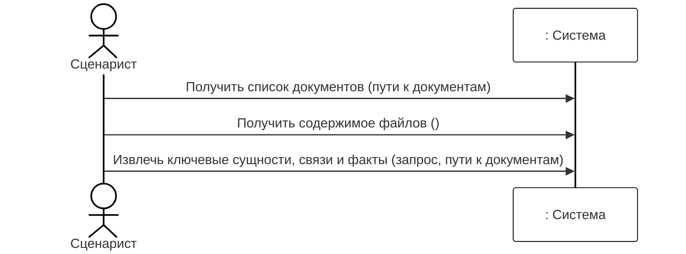
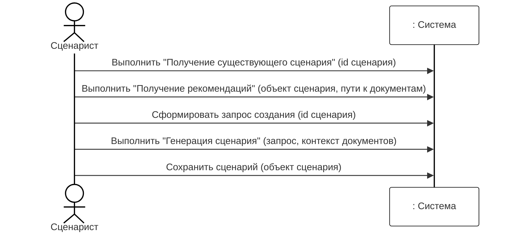
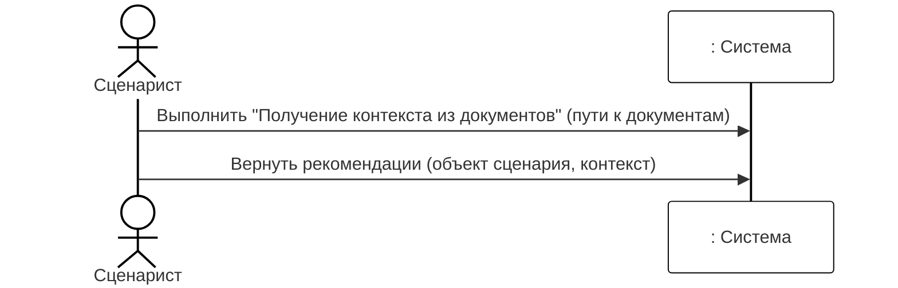

# 3. Диаграмма последовательностей системы

TODO

## Создание нового сценария

### Операция 1: Выбрать "Создать сценарий"

| Раздел      | Описание                                                                                                                              |
| ----------- | ------------------------------------------------------------------------------------------------------------------------------------- |
| Имя         | Выбрать "Создать сценарий"                                                                                                            |
| Обязанности | Пользователь инициирует процесс создания нового сценария, нажимая соответствующую кнопку или выбирая пункт меню в интерфейсе системы. |
| Тип         | Пользовательская                                                                                                                      |
| Ссылка      | "Создание нового сценария"                                                                                                            |
| Примечания  | Операция не требует дополнительных параметров.                                                                                        |
| Исключения  | Если у пользователя нет прав на создание сценария, система отображает сообщение об ошибке.                                            |
| Вывод       | Открытие формы для заполнения параметров сценария.                                                                                    |
| Предусловие | Пользователь авторизован в системе и имеет доступ к модулю управления сценариями.                                                     |
| Постусловие | Система переходит в состояние ожидания ввода параметров сценария.                                                                     |

### Операция 2: Заполнить форму (параметры)

| Раздел      | Описание                                                                                                                      |
| ----------- | ----------------------------------------------------------------------------------------------------------------------------- |
| Имя         | Заполнить форму (параметры)                                                                                                   |
| Обязанности | Пользователь вводит или выбирает параметры нового сценария (например, название, описание, настройки) в предоставленной форме. |
| Тип         | Пользовательская                                                                                                              |
| Ссылка      | "Создание нового сценария"                                                                                                    |
| Примечания  | Параметры могут включать обязательные и опциональные поля. Валидация данных выполняется системой.                             |
| Исключения  | Если обязательные поля не заполнены или данные не проходят валидацию, система отображает ошибки.                              |
| Вывод       | Объект сценария с введёнными параметрами (в памяти).                                                                          |
| Предусловие | Форма создания сценария открыта.                                                                                              |
| Постусловие | Параметры сценария готовы для сохранения.                                                                                     |

### Операция 3: Сохранить сценарий (объект сценария)

| Раздел      | Описание                                                                                                                |
| ----------- | ----------------------------------------------------------------------------------------------------------------------- |
| Имя         | Сохранить сценарий (объект сценария)                                                                                    |
| Обязанности | Пользователь подтверждает создание сценария, нажимая кнопку "Сохранить". Система сохраняет объект сценария в хранилище. |
| Тип         | Пользовательская                                                                                                        |
| Ссылка      | "Создание нового сценария"                                                                                              |
| Примечания  | После сохранения сценарий получает уникальный идентификатор и версию.                                                   |
| Исключения  | Если сохранение не удалось (например, из-за проблем с базой данных), система уведомляет пользователя.                   |
| Вывод       | Сохранённый сценарий с присвоенным ID.                                                                                  |
| Предусловие | Параметры сценария заполнены и прошли валидацию.                                                                        |
| Постусловие | Сценарий создан и доступен в системе. Пользователь может перейти к его редактированию или выполнению.                   |

| Раздел      | Описание                                                                                                        |
| ----------- | --------------------------------------------------------------------------------------------------------------- |
| Имя         | Заполнить форму ввода параметров сценария                                                                       |
| Обязанности | Пользователь вводит основные параметры нового сценария (название, описание, настройки) в предоставленной форме. |
| Тип         | Пользовательская                                                                                                |
| Ссылка      | "Создание нового сценария"                                                                                      |
| Примечания  | Параметры могут включать обязательные и опциональные поля. Валидация данных выполняется системой.               |
| Исключения  | Если обязательные поля не заполнены или данные не проходят валидацию, система отображает ошибки.                |
| Вывод       | Объект сценария с введёнными параметрами (в памяти).                                                            |
| Предусловие | Пользователь авторизован в системе и имеет доступ к модулю управления сценариями.                               |
| Постусловие | Параметры сценария готовы для дальнейших операций.                                                              |

### Операция 2: Запросить получение контекста из документов

| Раздел      | Описание                                                                                                        |
| ----------- | --------------------------------------------------------------------------------------------------------------- |
| Имя         | Запросить получение контекста из документов                                                                     |
| Обязанности | Пользователь указывает пути к документам, из которых требуется извлечь контекст для генерации сценария.         |
| Тип         | Пользовательская                                                                                                |
| Ссылка      | "Создание нового сценария", "Получение контекста из документов"                                                 |
| Примечания  | Документы могут быть в различных форматах (PDF, DOCX, TXT). Система извлекает ключевые сущности, связи и факты. |
| Исключения  | Если указанные файлы недоступны или повреждены, система уведомляет пользователя.                                |
| Вывод       | Контекст (структурированные данные) для использования в генерации сценария.                                     |
| Предусловие | Параметры сценария заполнены (или могут быть заполнены позже).                                                  |
| Постусловие | Контекст готов для передачи в генерацию сценария.                                                               |

### Операция 3: Запустить генерацию сценария

| Раздел      | Описание                                                                                                   |
| ----------- | ---------------------------------------------------------------------------------------------------------- |
| Имя         | Запустить генерацию сценария                                                                               |
| Обязанности | Пользователь инициирует процесс генерации сценария на основе введённых параметров и полученного контекста. |
| Тип         | Пользовательская                                                                                           |
| Ссылка      | "Создание нового сценария", "Генерация сценария"                                                           |
| Примечания  | Генерация может использовать ИИ-модели или шаблоны. Процесс может занять некоторое время.                  |
| Исключения  | Если генерация не удалась (например, из-за ошибки модели), система отображает сообщение об ошибке.         |
| Вывод       | Сгенерированный объект сценария (в памяти).                                                                |
| Предусловие | Параметры сценария и контекст документов подготовлены.                                                     |
| Постусловие | Сценарий сгенерирован и готов к сохранению.                                                                |

### Операция 4: Сохранить сценарий

| Раздел      | Описание                                                                                                                |
| ----------- | ----------------------------------------------------------------------------------------------------------------------- |
| Имя         | Сохранить сценарий                                                                                                      |
| Обязанности | Пользователь подтверждает создание сценария, нажимая кнопку "Сохранить". Система сохраняет объект сценария в хранилище. |
| Тип         | Пользовательская                                                                                                        |
| Ссылка      | "Создание нового сценария"                                                                                              |
| Примечания  | После сохранения сценарий получает уникальный идентификатор и версию.                                                   |
| Исключения  | Если сохранение не удалось (например, из-за проблем с базой данных), система уведомляет пользователя.                   |
| Вывод       | Сохранённый сценарий с присвоенным ID.                                                                                  |
| Предусловие | Сценарий сгенерирован и прошёл валидацию.                                                                               |
| Постусловие | Сценарий создан и доступен в системе. Пользователь может перейти к его редактированию или выполнению.                   |

## Генерация сценария

### Операция 1: Сгенерировать сценарий

| Раздел      | Описание                                                                                              |
| ----------- | ----------------------------------------------------------------------------------------------------- |
| Имя         | Сгенерировать сценарий                                                                                |
| Обязанности | Пользователь запрашивает генерацию сценария на основе предоставленных запроса и контекста документов. |
| Тип         | Пользовательская                                                                                      |
| Ссылка      | "Генерация сценария"                                                                                  |
| Примечания  | Генерация выполняется с использованием ИИ-моделей, которые создают структурированный сценарий.        |
| Исключения  | Если запрос некорректен или контекст недостаточен, система возвращает ошибку.                         |
| Вывод       | Сгенерированный объект сценария.                                                                      |
| Предусловие | Запрос и контекст документов предоставлены.                                                           |
| Постусловие | Сценарий сгенерирован и может быть использован в других операциях.                                    |

## Получение контекста из документов

### Операция 1: Получить список документов

| Раздел      | Описание                                                                                         |
| ----------- | ------------------------------------------------------------------------------------------------ |
| Имя         | Получить список документов                                                                       |
| Обязанности | Пользователь указывает пути к документам, которые требуется обработать для извлечения контекста. |
| Тип         | Пользовательская                                                                                 |
| Ссылка      | "Получение контекста из документов"                                                              |
| Примечания  | Пути могут быть указаны как локальные файлы или URL. Система проверяет доступность.              |
| Исключения  | Если ни один из указанных файлов не доступен, система возвращает ошибку.                         |
| Вывод       | Список доступных документов для обработки.                                                       |
| Предусловие | Пользователь авторизован и имеет доступ к указанным ресурсам.                                    |
| Постусловие | Система готова к извлечению контекста из документов.                                             |

### Операция 2: Вернуть содержимое файлов

| Раздел      | Описание                                                                    |
| ----------- | --------------------------------------------------------------------------- |
| Имя         | Вернуть содержимое файлов                                                   |
| Обязанности | Пользователь инициирует чтение содержимого файлов для последующего анализа. |
| Тип         | Пользовательская                                                            |
| Ссылка      | "Получение контекста из документов"                                         |
| Примечания  | Чтение может включать распознавание текста (OCR) для изображений или PDF.   |
| Исключения  | Если файлы слишком большие или защищены, система может прервать операцию.   |
| Вывод       | Текстовое содержимое документов.                                            |
| Предусловие | Документы доступны для чтения.                                              |
| Постусловие | Содержимое документов подготовлено для извлечения контекста.                |

### Операция 3: Извлечь ключевые сущности, связи и факты

| Раздел      | Описание                                                                            |
| ----------- | ----------------------------------------------------------------------------------- |
| Имя         | Извлечь ключевые сущности, связи и факты                                            |
| Обязанности | Пользователь запускает процесс извлечения семантической информации из документов.   |
| Тип         | Пользовательская                                                                    |
| Ссылка      | "Получение контекста из документов"                                                 |
| Примечания  | Извлечение выполняется с использованием NLP-моделей и правил парсинга.              |
| Исключения  | Если документы имеют неподдерживаемый формат или повреждены, система пропускает их. |
| Вывод       | Структурированный контекст (сущности, связи, факты).                                |
| Предусловие | Список документов получен и доступен.                                               |
| Постусловие | Контекст извлечён и готов для использования в других операциях.                     |

## Изменение существующего сценария

### Операция 1: Выбрать "Изменить сценарий" (id сценария)

| Раздел      | Описание                                                                                                 |
| ----------- | -------------------------------------------------------------------------------------------------------- |
| Имя         | Выбрать "Изменить сценарий" (id сценария)                                                                |
| Обязанности | Пользователь выбирает существующий сценарий по его идентификатору для внесения изменений.                |
| Тип         | Пользовательская                                                                                         |
| Ссылка      | "Изменение существующего сценария"                                                                       |
| Примечания  | Идентификатор сценария может быть получен из списка сценариев или через поиск.                           |
| Исключения  | Если сценарий с указанным ID не существует или недоступен для редактирования, система отображает ошибку. |
| Вывод       | Открытие формы редактирования с предзаполненными текущими параметрами сценария.                          |
| Предусловие | Пользователь авторизован и имеет права на редактирование сценария. Сценарий существует.                  |
| Постусловие | Система загружает данные сценария и переходит в режим редактирования.                                    |

### Операция 2: Заполнить форму (параметры)

| Раздел      | Описание                                                                  |
| ----------- | ------------------------------------------------------------------------- |
| Имя         | Заполнить форму (параметры)                                               |
| Обязанности | Пользователь изменяет параметры сценария в форме редактирования.          |
| Тип         | Пользовательская                                                          |
| Ссылка      | "Изменение существующего сценария"                                        |
| Примечания  | Пользователь может изменить любое из полей, кроме системных (ID, версия). |
| Исключения  | Если новые данные не проходят валидацию, система отображает ошибки.       |
| Вывод       | Обновлённый объект сценария (в памяти).                                   |
| Предусловие | Форма редактирования открыта с загруженными данными.                      |
| Постусловие | Изменённые параметры готовы для сохранения.                               |

### Операция 3: Сохранить сценарий (объект сценария)

| Раздел      | Описание                                                                                                         |
| ----------- | ---------------------------------------------------------------------------------------------------------------- |
| Имя         | Сохранить сценарий (объект сценария)                                                                             |
| Обязанности | Пользователь подтверждает изменения, нажимая кнопку "Сохранить". Система сохраняет обновлённую версию сценария.  |
| Тип         | Пользовательская                                                                                                 |
| Ссылка      | "Изменение существующего сценария"                                                                               |
| Примечания  | Система создаёт новую версию сценария или перезаписывает существующую в зависимости от политики версионирования. |
| Исключения  | Если сохранение не удалось (конфликт версий, отсутствие прав), система уведомляет пользователя.                  |
| Вывод       | Сохранённая новая версия сценария.                                                                               |
| Предусловие | Параметры сценария изменены и прошли валидацию.                                                                  |
| Постусловие | Сценарий обновлён. История версий пополнена.                                                                     |

### Операция 1: Получить существующий сценарий

| Раздел      | Описание                                                                                       |
| ----------- | ---------------------------------------------------------------------------------------------- |
| Имя         | Получить существующий сценарий                                                                 |
| Обязанности | Пользователь указывает идентификатор сценария, который требуется загрузить для редактирования. |
| Тип         | Пользовательская                                                                               |
| Ссылка      | "Изменение существующего сценария", "Получение существующего сценария"                         |
| Примечания  | Идентификатор может быть выбран из списка или введён вручную.                                  |
| Исключения  | Если сценарий с указанным ID не существует или недоступен, система отображает ошибку.          |
| Вывод       | Загруженный объект сценария с текущими параметрами.                                            |
| Предусловие | Пользователь авторизован и имеет права на редактирование сценария.                             |
| Постусловие | Сценарий загружен и готов к модификации.                                                       |

### Операция 2: Запросить рекомендации

| Раздел      | Описание                                                                                                                    |
| ----------- | --------------------------------------------------------------------------------------------------------------------------- |
| Имя         | Запросить рекомендации                                                                                                      |
| Обязанности | Пользователь запрашивает рекомендации по улучшению сценария на основе его текущего содержимого и дополнительных документов. |
| Тип         | Пользовательская                                                                                                            |
| Ссылка      | "Изменение существующего сценария", "Получение рекомендаций"                                                                |
| Примечания  | Рекомендации могут включать предложения по структуре, содержанию или стилю.                                                 |
| Исключения  | Если не удалось получить рекомендации (например, из-за отсутствия документов), система уведомляет пользователя.             |
| Вывод       | Список рекомендаций для сценария.                                                                                           |
| Предусловие | Сценарий загружен, пользователь указал пути к документам (опционально).                                                     |
| Постусловие | Рекомендации готовы для просмотра и применения.                                                                             |

### Операция 3: Сформировать запрос создания

| Раздел      | Описание                                                                                                        |
| ----------- | --------------------------------------------------------------------------------------------------------------- |
| Имя         | Сформировать запрос создания                                                                                    |
| Обязанности | Пользователь формирует запрос на создание новой версии сценария на основе изменённых параметров и рекомендаций. |
| Тип         | Пользовательская                                                                                                |
| Ссылка      | "Изменение существующего сценария"                                                                              |
| Примечания  | Запрос включает идентификатор исходного сценария и все необходимые изменения.                                   |
| Исключения  | Если запрос противоречит правилам системы (например, нарушает целостность), система отказывает в выполнении.    |
| Вывод       | Запрос на генерацию новой версии сценария.                                                                      |
| Предусловие | Сценарий загружен, рекомендации получены (опционально).                                                         |
| Постусловие | Запрос готов для передачи в генерацию сценария.                                                                 |

### Операция 4: Запустить генерацию сценария

| Раздел      | Описание                                                                                                          |
| ----------- | ----------------------------------------------------------------------------------------------------------------- |
| Имя         | Запустить генерацию сценария                                                                                      |
| Обязанности | Пользователь инициирует генерацию новой версии сценария на основе сформированного запроса и контекста документов. |
| Тип         | Пользовательская                                                                                                  |
| Ссылка      | "Изменение существующего сценария", "Генерация сценария"                                                          |
| Примечания  | Генерация создаёт новую версию сценария, сохраняя историю изменений.                                              |
| Исключения  | Если генерация не удалась, система отображает сообщение об ошибке.                                                |
| Вывод       | Сгенерированный объект сценария (новая версия).                                                                   |
| Предусловие | Запрос создания сформирован, контекст документов подготовлен.                                                     |
| Постусловие | Новая версия сценария готова к сохранению.                                                                        |

## Получение рекомендаций

### Операция 1: Запросить контекст из документов

| Раздел | Описание |
| ----------- | -------- |
| Имя | Запросить контекст из документов |
| Обязанности | Пользователь указывает пути к документам, из которых требуется извлечь контекст для формирования рекомендаций. |
| Тип | Пользовательская |
| Ссылка | "Получение рекомендаций", "Получение контекста из документов" |
| Примечания | Контекст извлекается автоматически, пользователь может выбрать конкретные файлы. |
| Исключения | Если файлы повреждены или недоступны, система пропускает их и использует доступные. |
| Вывод | Контекст (структурированные данные) для анализа. |
| Предусловие | Запрос на рекомендации активен, пути к документам указаны. |
| Постусловие | Контекст готов для использования в алгоритме рекомендаций. |

### Операция 2: Получить рекомендации

| Раздел      | Описание                                                                                    |
| ----------- | ------------------------------------------------------------------------------------------- |
| Имя         | Получить рекомендации                                                                       |
| Обязанности | Пользователь запрашивает рекомендации на основе текущего сценария и извлечённого контекста. |
| Тип         | Пользовательская                                                                            |
| Ссылка      | "Получение рекомендаций"                                                                    |
| Примечания  | Рекомендации могут быть сгенерированы ИИ-моделью или на основе правил.                      |
| Исключения  | Если алгоритм не может сформировать рекомендации, система возвращает пустой список.         |
| Вывод       | Список рекомендаций (текстовые предложения, оценки, приоритеты).                            |
| Предусловие | Контекст документов подготовлен, сценарий загружен.                                         |
| Постусловие | Рекомендации отображены пользователю.                                                       |
