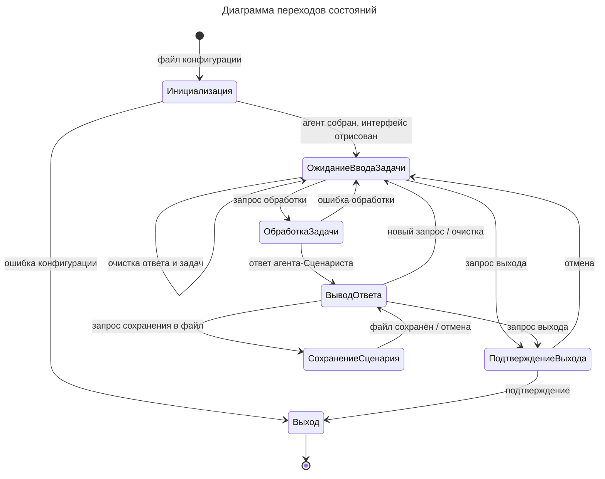

# Диаграмма переходов состояний

> **Задача**: Привести диаграмму в соответствие с бизнес-логикой и пользовательским интерфейсом.
> Диаграмма переходов состояний (STD, State Transition Diagram, ДПС) является гграфическим представлением конечного автомата – математической абстракции для моделирования поведения технических объектов и объектов реального мира.
> Для интерактивного ПО с развитым пользовательским интерфейсом основные управляющие воздействия – команды пользователя, для ПО реального времени – входные сигналы от датчиков и команды оператора.
> Общим является наличие состояния ожидания, когда ПО приостанавливает работу до получения очередного управляющего воздействия
> Общим для этих типов ПО является наличие состояния ожидания, когда ПО приостанавливает работу до получения очередного управляющего воздействия.
> Состояния должны обозначать устойчивые положения системы («Отображение сообщения», длительная обработка чего-либо, формирование и т.д.), а не конкретные действия.
> Если есть действия при сохранении состояния, все операции должны помечаться ненумерованным списком: "- операция 1\n- операция 2 ...".

Начальным состоянием является запуск системы, после чего она переходит в режим ОжиданиеЗапроса, то есть команды от Сценариста.

СозданиеНовогоСценария и ИзменениеСуществующегоСценария являются командами и самостоятельными единицами работы, для которых проходит предобработка Документов из файлового хранилища, выполнение ряда операций для генерации сценариев, которое может как завершиться с Ошибкой, так и ручным Прерыванием, которые не повлияют на состояние системы.

Конечным состоянием системы является получение команды Остановки, после чего следует выключение системы.
