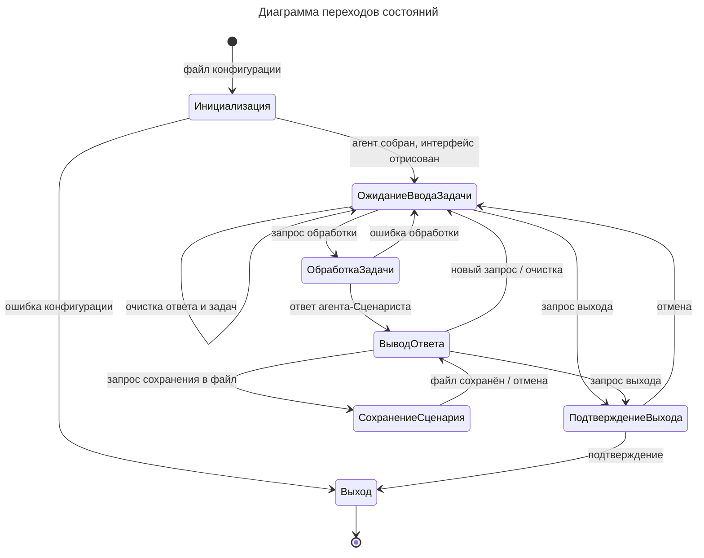

# Диаграмма переходов состояний

> **Задача**: Привести диаграмму в соответствие с бизнес-логикой и пользовательским интерфейсом.
> Диаграмма переходов состояний (STD, State Transition Diagram, ДПС) представляет собой графическое описание конечного автомата — математической модели поведения системы, состоящей из множества состояний и переходов между ними.
> Для интерактивного программного обеспечения с развитым пользовательским интерфейсом основными управляющими воздействиями являются команды пользователя. Для программного обеспечения реального времени — входные сигналы датчиков и команды оператора.
> Общим для обоих типов программного обеспечения является наличие состояния ожидания, в котором система ожидает получения очередного управляющего воздействия или соответствующего события.
> Состояния должны обозначать устойчивые положения системы, в которых она может находиться в течение некоторого времени (например, «Ожидание ввода пользователя», «Отображение сообщения», «Обработка запроса», «Формирование сценария»).
> Не следует обозначать состояния конкретными действиями или одноразовыми операциями.
> Переходы должны отражать условия и управляющие воздействия, вызывающие изменение состояния системы.
> Если в рамках одного состояния выполняются дополнительные операции, не приводящие к переходу в другое состояние, их необходимо указывать внутри соответствующего состояния ненумерованным списком: - "операция 1\n- операция 2".

Начальным состоянием является запуск системы, после чего она переходит в режим ОжиданиеЗапроса, то есть команды от Сценариста.

СозданиеНовогоСценария и ИзменениеСуществующегоСценария являются командами и самостоятельными единицами работы, для которых проходит предобработка Документов из файлового хранилища, выполнение ряда операций для генерации сценариев, которое может как завершиться с Ошибкой, так и ручным Прерыванием, которые не повлияют на состояние системы.

Конечным состоянием системы является получение команды Остановки, после чего следует выключение системы.
