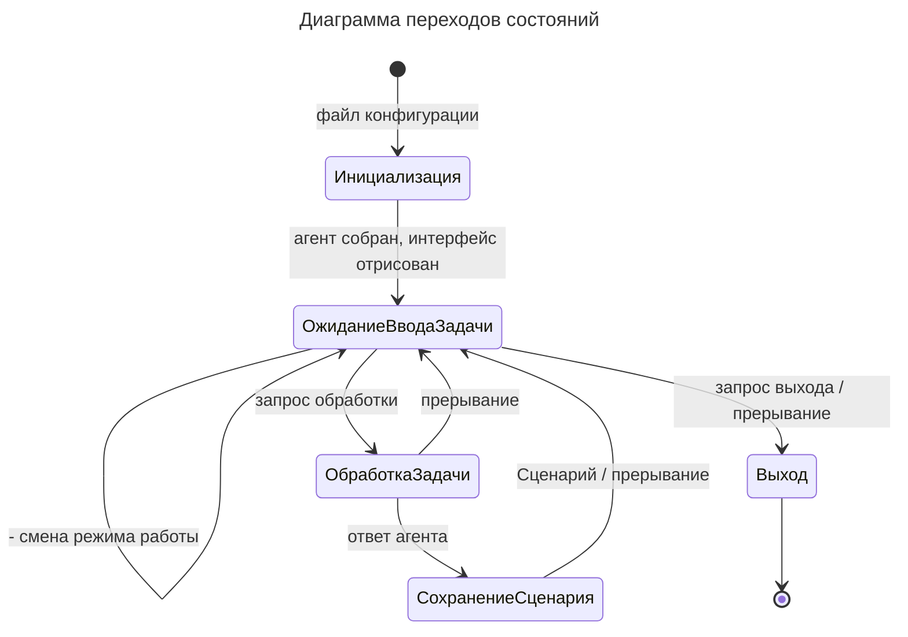

# Диаграмма переходов состояний

> Задача: Привести диаграмму в соответствие с бизнес-логикой и пользовательским интерфейсом. Диаграмма должна отражать именно переходы между состояниями, а не последовательность вызовов методов. Состояния должны обозначать устойчивые состояния системы, а не действия.
> Вспомогательные файлы: `src/__main__.py`, `src/ui/*`.

| Состояние           | Описание                                                                      |
| ------------------- | ----------------------------------------------------------------------------- |
| Инициализация       | Запуск приложения: чтение конфигурации, сборка агента, подготовка интерфейса. |
| ОжиданиеВводаЗадачи | Редактирование списка задач, смена режима работы.                             |
| ОбработкаЗадачи     | Запросы переданы агенту, система ожидает результатов генерации Сценария.      |
| СохранениеСценария  | Сохранение Сценария в файл.                                                   |
| Выход               | Процесс выхода из приложения.                                                 |
