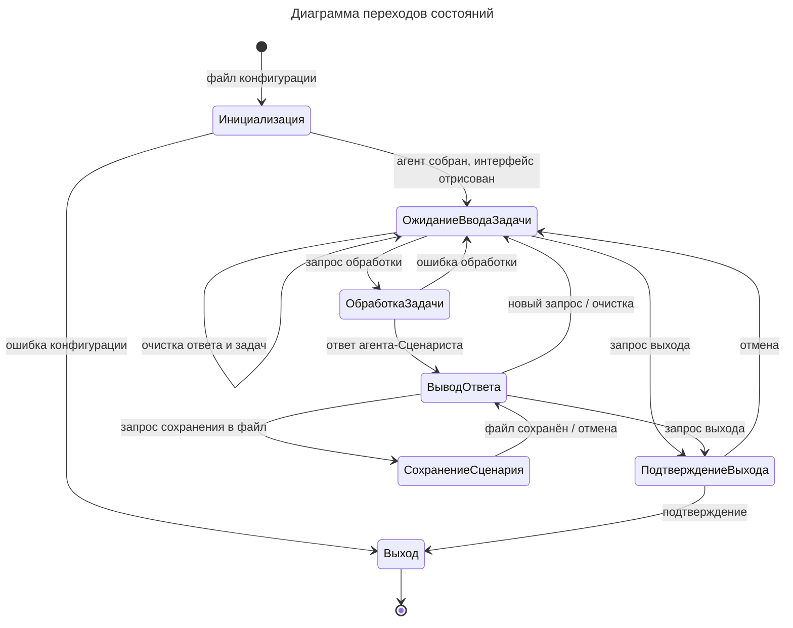

# Диаграмма переходов состояний

> Задача: Привести диаграмму в соответствие с бизнес-логикой и пользовательским интерфейсом. Диаграмма должна отражать именно переходы между состояниями, а не последовательность вызовов методов. Состояния должны обозначать устойчивые состояния системы, а не действия.
> Вспомогательные файлы: `src/__main__.py`, `src/ui/*`.

| Состояние           | Описание                                                                      |
| ------------------- | ----------------------------------------------------------------------------- |
| Инициализация       | Запуск приложения: чтение конфигурации, сборка агента-Сценариста, отрисовка интерфейса. |
| ОжиданиеВводаЗадачи | Сценарист редактирует список задач, загружает задачи из файла, выбирает режим работы. |
| ОбработкаЗадачи     | Запросы переданы агенту-Сценаристу, система ожидает результатов генерации Сценария. |
| ВыводОтвета         | Ответ агента-Сценариста отображён Сценаристу.                                 |
| СохранениеСценария  | Открыт диалог сохранения ответа в файл формата JSON.                          |
| ПодтверждениеВыхода | Открыт диалог подтверждения выхода из приложения.                             |
| Выход               | Завершение работы приложения.                                                 |
