```mermaid
---
title: Диаграмма деятельностей варианта использования "Изменение существующего сценария"
---
graph TD
    %% Элементы диаграммы
    StartNode(( ))

    A[Выбор существующего Сценария]
    Edit1[Загрузка выбранного Сценария из хранилища]
    Edit2[Получение рекомендаций от Сценариста]
    Edit3[Задание дополнительных параметров изменения и подтверждение]
    Edit4[Генерация новой версии Сценария]

    CondSave{ }
    Save[Сохранение результата в хранилище]
    Notify[Уведомление об успешном изменении]
    EndNode((( )))

    %% Связи и ветвления
    StartNode --> A
    A --> Edit1
    Edit1 --> Edit2
    Edit2 --> Edit3
    Edit3 --> Edit4
    Edit4 --> CondSave

    %% Логика сохранения (Условие extend)
    CondSave -- "Соответствует документам? [да]" --> Save
    CondSave -- "[нет]" --> Edit2

    Save --> Notify
    Notify --> EndNode

    %% Стили для начальной и конечной точек
    style StartNode fill:#000
    style EndNode fill:#000
```

# Диаграмма деятельностей варианта использования

> **Задача**: Привести диаграмму в соответствие с бизнес-логикой и пользовательским интерфейсом.
> В теоретическом плане диаграммы деятельностей являются обобщённым представлением алгоритма, реализующего анализируемый ВИ.
> Составь диаграмму деятельностей варианта использования "Изменение существующего сценария".

Процесс изменения существующего сценария начинается с ввода Пользователем рекомендаций, после чего система последовательно извлекает контекст из документов, загружает сценарии, выполняется автоматическая генерация обновлённого сценария. Итоговые обновлённые Сценарии сохраняются как новые файлы в хранилище.
