# Диаграмма деятельностей варианта использования

> **Задача**: Привести диаграмму в соответствие с бизнес-логикой и пользовательским интерфейсом.
> В теоретическом плане диаграммы деятельностей являются обобщённым представлением алгоритма, реализующего анализируемый ВИ.
> Вместо фактического названия переменных используй их назначение.
> Не описывай детали реализации, вместо фактической терминологии в программе используй абстракции высокого уровня: "Данные файлового хранилища" вместо "Коллекции источников", "Формирование ответа..." вместо "Формирование Json-ответа...", "Чтение файла..." вместо "Чтение CSV-файла с...", "Ввод запроса..." вместо "Ввод запроса формата...".
> Составь диаграмму деятельностей варианта использования "Изменение существующего сценария".

```mermaid
---
title: Диаграмма деятельностей варианта использования "Изменение существующего сценария"
---
graph TD
    %% Элементы диаграммы
    StartNode(( ))

    A[Ввод Сценаристом запроса формата CSV:<br>Сценарий или имя файла, min_steps, инструкция]
    B[Разбор параметров запроса и подтверждение отправки]
    C{Сценарий хранится<br>в файле хранилища?}
    D[Чтение сохранённого Сценария<br>из хранилища - back_request]
    E[Вызов агента-Сценариста<br>с задачей, min_steps и инструкцией]
    F{Подключены<br>коллекции источников?}
    G[Поиск контекста по источникам<br>векторным поиском]
    H[Запрос к LLM:<br>инструкции, история и текущий Сценарий]
    I{LLM вызвала инструменты<br>и лимит вызовов<br>не исчерпан?}
    J[Выполнение инструментов:<br>get_scenario, delete_step,<br>insert_step, update_step]
    K{Число Шагов Сценария<br>меньше min_steps?}
    L[Формирование JSON-ответа<br>с порядковыми номерами Шагов]
    M[Отображение ответа Сценаристу<br>в окне интерфейса]
    Save[Сохранение Сценария в файл<br>по выбору Сценариста]
    EndNode((( )))

    %% Связи и ветвления
    StartNode --> A
    A --> B
    B --> C
    C -- "[да]" --> D
    C -- "[нет]" --> E
    D --> E
    E --> F
    F -- "[да]" --> G
    F -- "[нет]" --> H
    G --> H
    H --> I
    I -- "[да]" --> J
    J --> H
    I -- "[нет]" --> K
    K -- "[да, лимит не исчерпан]" --> H
    K -- "[нет]" --> L
    L --> M
    M --> Save
    Save --> EndNode

    %% Стили для начальной и конечной точек
    style StartNode fill:#000
    style EndNode fill:#000
```

Процесс изменения существующего сценария начинается с ввода Сценаристом запроса формата CSV, в котором указывается существующий Сценарий (непосредственно JSON или имя сохранённого файла из хранилища `responses/`), требуемое число Шагов и дополнительная инструкция. Система разбирает параметры запроса, при необходимости читает сохранённый Сценарий из файлового хранилища и передаёт его агенту-Сценаристу в виде `back_request`. Если подключены коллекции источников, контекст собирается векторным поиском по документам. Далее LLM в цикле получает актуальное состояние Сценария и изменяет его инструментами (`get_scenario`, `delete_step`, `insert_step`, `update_step`); цикл продолжается, пока LLM вызывает инструменты и не исчерпан лимит вызовов, а также пока число Шагов меньше заданного `min_steps`. Итоговый Сценарий сериализуется в JSON с порядковыми номерами Шагов (`order`), отображается Сценаристу в окне интерфейса и сохраняется в файл по его выбору.
