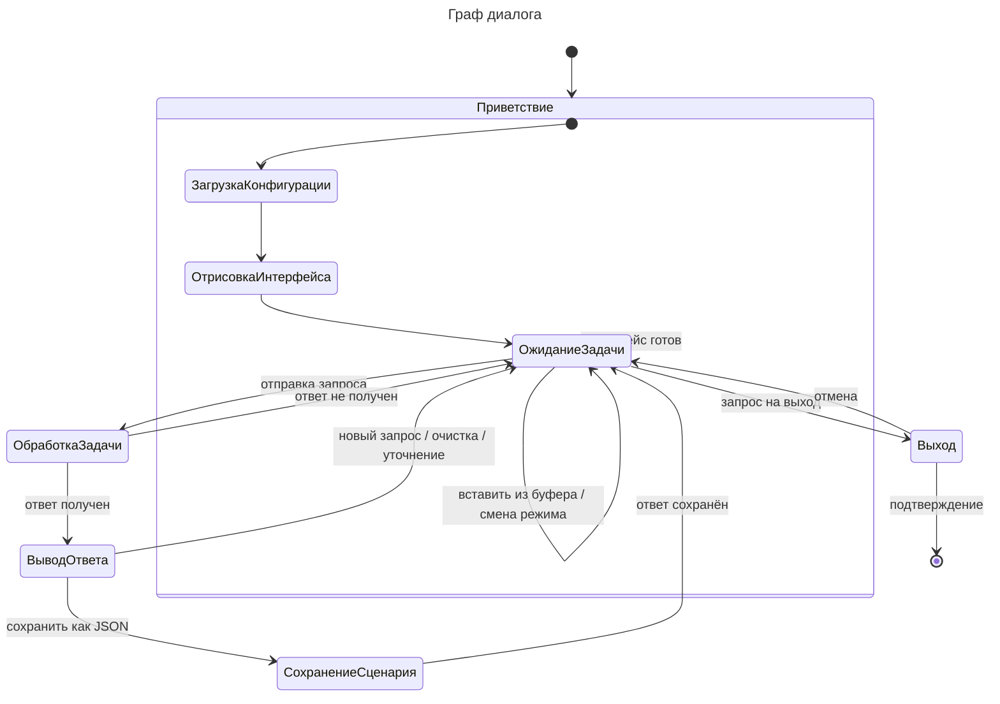

# Граф диалога

> **Задача**: Привести диаграмму в соответствие с бизнес-логикой и пользовательским интерфейсом.
> Граф должен отражать логические переходы между этапами диалога, а не внутреннюю реализацию.
> Узлы должны отражать этапы диалога, рёбра — переходы между ними.
> Вспомогательные файлы:
>     - `src/ui/qml/Main.qml`.

Узлы графа отражают этапы диалога Сценариста с системой:

| Этап                  | Описание                                                                       |
| --------------------- | ------------------------------------------------------------------------------ |
| Приветствие           | Запуск приложения: загрузка конфигурации и отрисовка интерфейса.                |
| ОжиданиеЗадачи       | Сценарист формирует и редактирует список запросов, выбирает режим работы.       |
| ОбработкаЗадачи      | Запрос передан агенту, диалог ожидает реакции системы.                          |
| ВыводОтвета           | Система выводит ответ (Json-Сценарий) и возвращает диалог к вводу.              |
| СохранениеСценария      | Ответ сохраняется в файл в формате JSON.                                        |
| Выход   | Система запрашивает подтверждение выхода из диалога.                            |
