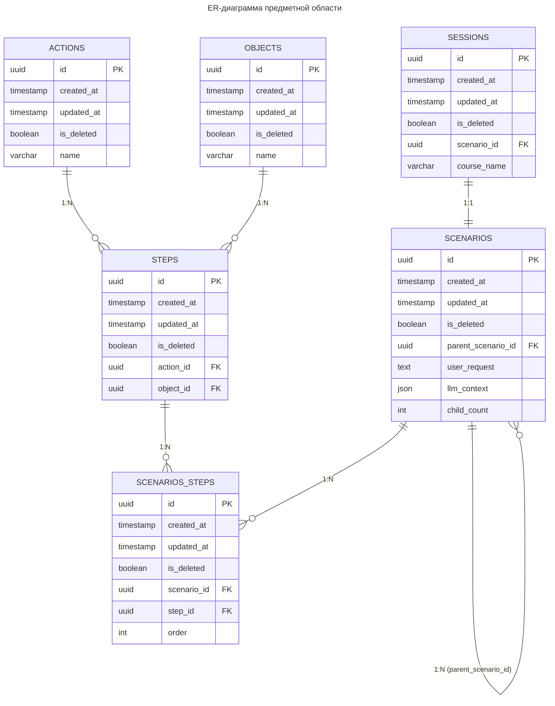

# Описание сущностей базы данных

> **Задача**: `src/agent/schema.py` содержит класс `AgentState` - он является отражением потенциальной базы данных для моей программы.
> Цель базы данных - хранение Сценариев как дерево версий с сессиями-указателями на id последнего сообщения в истории сообщений с агентом.
> Необходимо определить сохраняемые сущности и связи, исходя из исходных материалов.
> Необходимо составить ER-диаграмму в соответсвии со всеми сущностями.
> По ER-диаграмме нужно заполнить таблицы описаний сущностей, одна сущность - одна таблица.
> Используй стандартные SQL-типы, а типы PostgreSQL применяй только при обоснованной необходимости.
> Требования к устранению транзитивных зависимостей, избыточности данных, ссылочной целостности (третья нормальная форма).
> Должна быть отражена мощность связей, использовать обозначения 1:1, 1:N, M:N.
> Индексы и триггеры не нужны.
> Обязательно включи поля:
>
> - `id UUID [PK]`;
> - `created_at TIMESTAMP [DEFAULT: now()]`;
> - `updated_at TIMESTAMP [DEFAULT: now()]`;
> - `is_deleted BOOLEAN [DEFAULT: false] [NOTE: 'Для мягкого удаления']`.

## Описание сущностей базы данных

| Сущность       | Описание                                                                                                                              |
| -------------- | ------------------------------------------------------------------------------------------------------------------------------------- |
| Объекты        | Оборудование, ситуации, люди и прочее, с чем происходит взаимодействие.                                                               |
| Действия       | Перечень элементарных операций, которые можно совершить.                                                                              |
| Шаги           | Связующая таблица, которая объединяет конкретное действие с конкретным объектом с заданными параметрами.                              |
| Сценарии       | Хранит контекст взаимодействия с LLM, запросы пользователя и сценарий.                                                                |
| Шаги Сценариев | Связующая таблица (многие-ко-многим), которая определяет порядок и настройки конкретных шагов внутри определённого сценария (версии). |
| Сессии         | Указатели на последние сессии для отслеживания версий Сценариев.                                                                      |

## Описание сущности «Объекты» (objects)

Содержит оборудование, ситуации, люди и прочее, с чем происходит взаимодействие.

| Атрибут    | Тип       | Описание                           | Размер |
| ---------- | --------- | ---------------------------------- | ------ |
| id         | uuid      | Уникальный идентификатор записи    | 36     |
| created_at | timestamp | Дата и время создания записи       | -      |
| updated_at | timestamp | Дата и время последнего обновления | -      |
| is_deleted | boolean   | Флаг мягкого удаления              | -      |
| name       | varchar   | Алиас (имя) объекта из регламента  | 255    |

## Описание сущности «Действия» (actions)

Содержит перечень элементарных операций, которые можно совершить.

| Атрибут    | Тип       | Описание                           | Размер |
| ---------- | --------- | ---------------------------------- | ------ |
| id         | uuid      | Уникальный идентификатор записи    | 36     |
| created_at | timestamp | Дата и время создания записи       | -      |
| updated_at | timestamp | Дата и время последнего обновления | -      |
| is_deleted | boolean   | Флаг мягкого удаления              | -      |
| name       | varchar   | Название единицы действия          | 255    |

## Описание сущности «Шаги» (steps)

Связующая таблица, которая объединяет конкретное действие с конкретным объектом с заданными параметрами.

| Атрибут    | Тип       | Описание                           | Размер |
| ---------- | --------- | ---------------------------------- | ------ |
| id         | uuid      | Уникальный идентификатор записи    | 36     |
| created_at | timestamp | Дата и время создания записи       | -      |
| updated_at | timestamp | Дата и время последнего обновления | -      |
| is_deleted | boolean   | Флаг мягкого удаления              | -      |
| action_id  | uuid      | Внешний ключ на таблицу действий   | 36     |
| object_id  | uuid      | Внешний ключ на таблицу объектов   | 36     |

## Описание сущности «Сценарии_шаги» (scenarios_steps)

Связующая таблица (многие-ко-многим), которая определяет порядок и настройки конкретных шагов внутри определённого сценария (версии).

| Атрибут     | Тип       | Описание                           | Размер |
| ----------- | --------- | ---------------------------------- | ------ |
| id          | uuid      | Уникальный идентификатор записи    | 36     |
| created_at  | timestamp | Дата и время создания записи       | -      |
| updated_at  | timestamp | Дата и время последнего обновления | -      |
| is_deleted  | boolean   | Флаг мягкого удаления              | -      |
| scenario_id | uuid      | Внешний ключ на таблицу сценариев  | 36     |
| step_id     | uuid      | Внешний ключ на таблицу шагов      | 36     |
| order       | int       | Порядковый номер шага в сценарии   | -      |

## Описание сущности «Сценарии» (scenarios)

Хранит контекст взаимодействия с LLM, запросы пользователя и структуру дерева версий.

| Атрибут            | Тип       | Описание                                            | Размер |
| ------------------ | --------- | --------------------------------------------------- | ------ |
| id                 | uuid      | Уникальный идентификатор записи                     | 36     |
| created_at         | timestamp | Дата и время создания записи                        | -      |
| updated_at         | timestamp | Дата и время последнего обновления                  | -      |
| is_deleted         | boolean   | Флаг мягкого удаления                               | -      |
| parent_scenario_id | uuid      | Ссылка на родительский сценарий (для ветвления)     | 36     |
| user_request       | text      | Текст запроса, эмбеддинги и ссылки на S3            | -      |
| llm_context        | json      | Полный ответ и технический контекст модели          | -      |
| child_count        | int       | Количество дочерних элементов (для логики удаления) | -      |

## Описание сущности «Сессии» (sessions)

Указатели на последние сессии (вроде HEAD в системе GIT) для отслеживания версий Сценариев.

| Атрибут     | Тип       | Описание                                         | Размер |
| ----------- | --------- | ------------------------------------------------ | ------ |
| id          | uuid      | Уникальный идентификатор записи                  | 36     |
| created_at  | timestamp | Дата и время создания записи                     | -      |
| updated_at  | timestamp | Дата и время последнего обновления               | -      |
| is_deleted  | boolean   | Флаг мягкого удаления                            | -      |
| scenario_id | uuid      | Ссылка на актуальный узел сценария (аналог HEAD) | 36     |
| course_name | varchar   | Название учебного курса                          | 255    |
