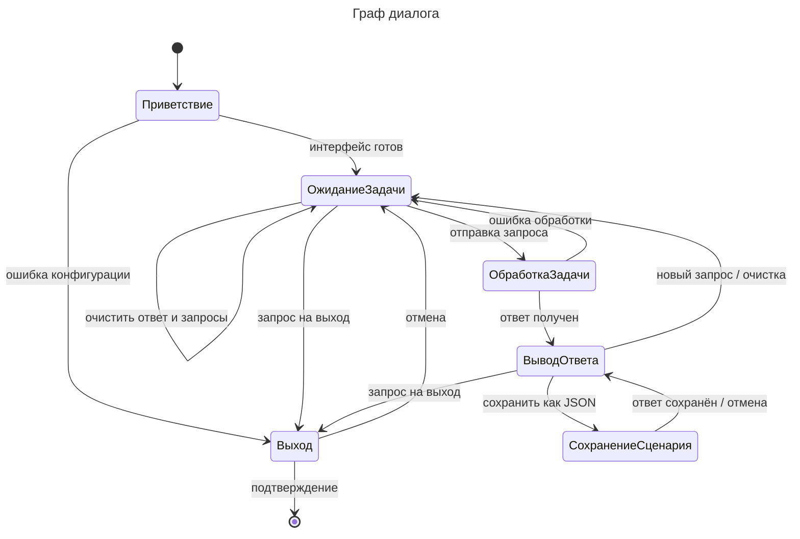

# Граф диалога

> **Задача**: Привести диаграмму в соответствие с пользовательским интерфейсом.
> Граф диалога должен отражать логику взаимодействия пользователя с системой, а не её внутреннюю реализацию.
> **Узлы** должны представлять логические этапы диалога с пользователем (состояния пользовательского взаимодействия).
> **Рёбра** должны представлять переходы между этапами, обусловленные действиями пользователя, событиями системы или результатами обработки запроса.
> Диаграмма должна учитывать основные сценарии взаимодействия, включая альтернативные ветви и обработку ошибок, если они предусмотрены пользовательским интерфейсом.
> Не следует включать внутренние компоненты, методы, классы и технические операции, не имеющие самостоятельного значения с точки зрения пользовательского взаимодействия.
> В качестве ориентира можно использовать `diagrammy/4. Диаграмма переходов состояний.md`, адаптировав её структуру и содержание под фактическую логику пользовательского интерфейса.
> Необходимо самостоятельно проанализировать исходные материалы, не ограничиваясь механическим копированием `diagrammy/4. Диаграмма переходов состояний.md`.

## Описание узлов диалога

| Этап               | Описание                                                                  |
| ------------------ | ------------------------------------------------------------------------- |
| Приветствие        | Запуск приложения и отрисовка интерфейса.                                 |
| ОжиданиеЗадачи     | Сценарист формирует и редактирует список запросов, выбирает режим работы. |
| ОбработкаЗадачи    | Запрос передан агенту, диалог ожидает реакции системы.                    |
| ВыводОтвета        | Система выводит ответ (Json-Сценарий) и возвращает диалог к вводу.        |
| СохранениеСценария | Ответ сохраняется в файл в формате JSON.                                  |
| Выход              | Система запрашивает подтверждение выхода из диалога.                      |
