# State Diagram (STD) for Embedding Processing Server

## Диаграмма состояний сервера обработки эмбеддингов

```mermaid
---
title: Диаграмма состояний сервера обработки эмбеддингов
---
stateDiagram-v2
    [*] --> Неактивен
    
    state "Инициализация сервера" as init {
        Неактивен --> ЗагрузкаКонфигурации : запуск сервера
        ЗагрузкаКонфигурации --> ПроверкаКонфигурации : конфиг загружен
        ПроверкаКонфигурации --> ИнициализацияМодели : конфиг валиден
        ПроверкаКонфигурации --> ОшибкаКонфигурации : невалидный конфиг
        ОшибкаКонфигурации --> [*] : остановка сервера
        ИнициализацияМодели --> ИнициализацияИндекса : модель готова
        ИнициализацияИндекса --> Готов : индекс инициализирован
    }
    
    state "Обработка документов" as doc_processing {
        Готов --> ЗагрузкаДокумента : получен документ
        ЗагрузкаДокумента --> ПарсингДокумента : файл загружен
        ПарсингДокумента --> Чанкирование : текст извлечен
        Чанкирование --> ГенерацияЭмбеддингов : чанки созданы
        ГенерацияЭмбеддингов --> Индексация : эмбеддинги сгенерированы
        Индексация --> Готов : документ проиндексирован
        
        state "Обработка ошибок документов" as doc_errors {
            ЗагрузкаДокумента --> ОшибкаЗагрузки : файл не найден/нечитаем
            ПарсингДокумента --> ОшибкаПарсинга : неверный формат
            Чанкирование --> ОшибкаЧанкирования : ошибка обработки
            ГенерацияЭмбеддингов --> ОшибкаГенерации : ошибка модели
            Индексация --> ОшибкаИндексации : ошибка базы данных
            
            ОшибкаЗагрузки --> Готов : пропустить документ
            ОшибкаПарсинга --> Готов : пропустить документ
            ОшибкаЧанкирования --> Готов : пропустить документ
            ОшибкаГенерации --> Готов : пропустить документ
            ОшибкаИндексации --> ПовторнаяПопытка : retry логика
            ПовторнаяПопытка --> Индексация : повторная попытка
            ПовторнаяПопытка --> Готов : превышено кол-во попыток
        }
    }
    
    state "Поиск и запросы" as search {
        Готов --> ОбработкаЗапроса : получен поисковый запрос
        ОбработкаЗапроса --> ВекторизацияЗапроса : запрос разобран
        ВекторизацияЗапроса --> ПоискВИндексе : эмбеддинг запроса готов
        ПоискВИндексе --> РанжированиеРезультатов : результаты найдены
        РанжированиеРезультатов --> ФормированиеОтвета : результаты ранжированы
        ФормированиеОтвета --> Готов : ответ отправлен
        
        state "Обработка ошибок поиска" as search_errors {
            ОбработкаЗапроса --> ОшибкаЗапроса : невалидный запрос
            ВекторизацияЗапроса --> ОшибкаВекторизации : ошибка модели
            ПоискВИндексе --> ОшибкаПоиска : ошибка индекса
            РанжированиеРезультатов --> ОшибкаРанжирования : ошибка алгоритма
            
            ОшибкаЗапроса --> Готов : отклонить запрос
            ОшибкаВекторизации --> Готов : отклонить запрос
            ОшибкаПоиска --> Готов : отклонить запрос
            ОшибкаРанжирования --> Готов : отклонить запрос
        }
    }
    
    state "Обслуживание" as maintenance {
        Готов --> ОбновлениеИндекса : команда обновления
        ОбновлениеИндекса --> Реиндексация : начало обновления
        Реиндексация --> Готов : обновление завершено
        
        Готов --> РезервноеКопирование : команда бэкапа
        РезервноеКопирование --> Готов : бэкап завершен
        
        Готов --> ОчисткаКэша : команда очистки
        ОчисткаКэша --> Готов : кэш очищен
    }
    
    state "Аварийные состояния" as emergency {
        Готов --> Перегрузка : слишком много запросов
        Перегрузка --> ОграничениеЗапросов : активация rate limiting
        ОграничениеЗапросов --> Готов : нагрузка нормализована
        
        Готов --> ПотеряСоединения : отключение БД/модели
        ПотеряСоединения --> ПопыткаВосстановления : переподключение
        ПопыткаВосстановления --> Готов : соединение восстановлено
        ПопыткаВосстановления --> АварийныйРежим : восстановление невозможно
        АварийныйРежим --> [*] : принудительная остановка
    }
    
    Готов --> ЗавершениеРаботы : команда остановки
    ЗавершениеРаботы --> СохранениеСостояния : начало остановки
    СохранениеСостояния --> [*] : сервер остановлен
    
    note right of Готов
        Основное рабочее состояние сервера.
        Готов принимать документы и обрабатывать запросы.
    end note
    
    note right of Индексация
        Сохранение эмбеддингов в векторной БД
        (in-memory или Qdrant)
    end note
    
    note right of ПоискВИндексе
        Поиск k ближайших соседей (top-k)
        по косинусному расстоянию
    end note
```

## Описание состояний

### Основные состояния сервера

1. **Неактивен** - Сервер не запущен
2. **Готов** - Основное рабочее состояние, сервер готов к обработке документов и запросов
3. **ЗавершениеРаботы** - Процесс корректной остановки сервера

### Состояния инициализации
- **ЗагрузкаКонфигурации** - Загрузка параметров из переменных окружения и конфиг-файлов
- **ПроверкаКонфигурации** - Валидация конфигурационных параметров
- **ИнициализацияМодели** - Инициализация embedding-модели (embed_model_id)
- **ИнициализацияИндекса** - Создание/подключение векторного индекса (in-memory или Qdrant)

### Состояния обработки документов
- **ЗагрузкаДокумента** - Чтение файла из documents_path
- **ПарсингДокумента** - Извлечение текстового содержимого
- **Чанкирование** - Разделение текста на чанки (chunk_size, chunk_overlap)
- **ГенерацияЭмбеддингов** - Создание векторных представлений через LLM
- **Индексация** - Сохранение эмбеддингов в векторной БД

### Состояния поиска
- **ОбработкаЗапроса** - Прием и парсинг поискового запроса
- **ВекторизацияЗапроса** - Преобразование запроса в embedding
- **ПоискВИндексе** - Поиск похожих документов (top-k)
- **РанжированиеРезультатов** - Сортировка результатов по релевантности
- **ФормированиеОтвета** - Подготовка ответа для клиента

### Состояния обслуживания
- **ОбновлениеИндекса** - Процесс обновления векторного индекса
- **РезервноеКопирование** - Создание бэкапа данных
- **ОчисткаКэша** - Очистка кэшированных данных

### Аварийные состояния
- **Перегрузка** - Превышение лимита одновременных запросов
- **ПотеряСоединения** - Разрыв соединения с внешними сервисами
- **АварийныйРежим** - Критическая ошибка, требующая остановки

## Ключевые переходы

1. **Запуск сервера**: `[*] → Неактивен → ЗагрузкаКонфигурации → ... → Готов`
2. **Обработка документа**: `Готов → ЗагрузкаДокумента → ... → Индексация → Готов`
3. **Обработка запроса**: `Готов → ОбработкаЗапроса → ... → ФормированиеОтвета → Готов`
4. **Остановка сервера**: `Готов → ЗавершениеРаботы → СохранениеСостояния → [*]`

## Обработка ошибок

Для каждого этапа обработки предусмотрены соответствующие состояния ошибок с путями восстановления:
- **Пропуск документа** при ошибках обработки
- **Отклонение запроса** при ошибках поиска
- **Повторные попытки** для временных сбоев
- **Аварийная остановка** при критических ошибках

Диаграмма отражает отказоустойчивую архитектуру сервера обработки эмбеддингов, способную восстанавливаться после сбоев и продолжать работу.