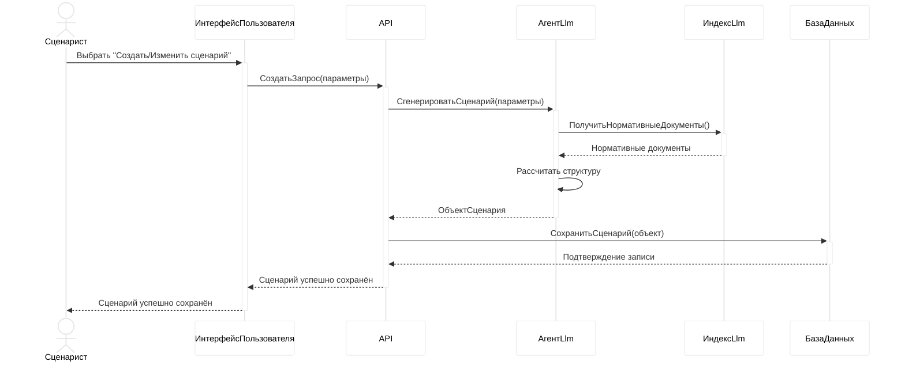
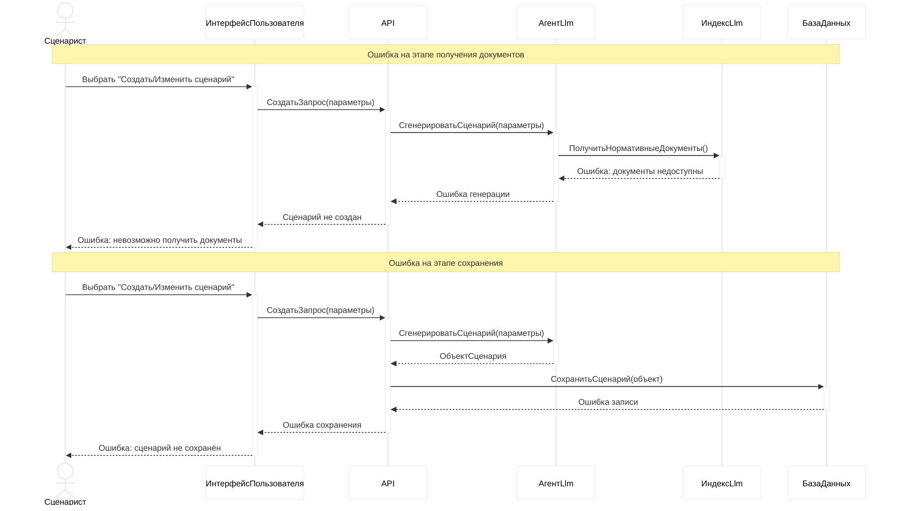
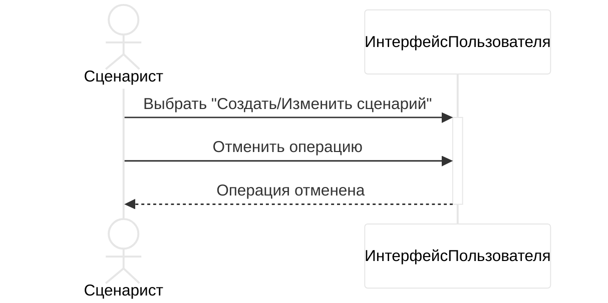
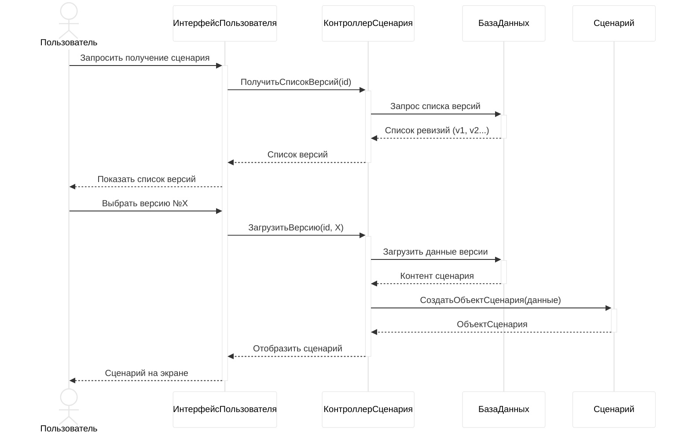
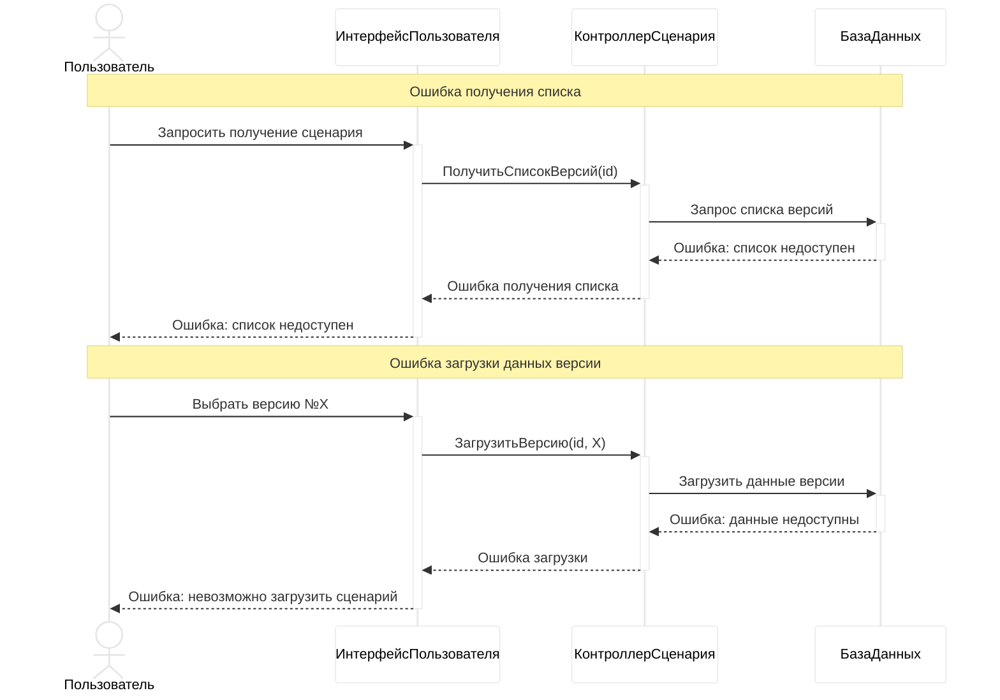
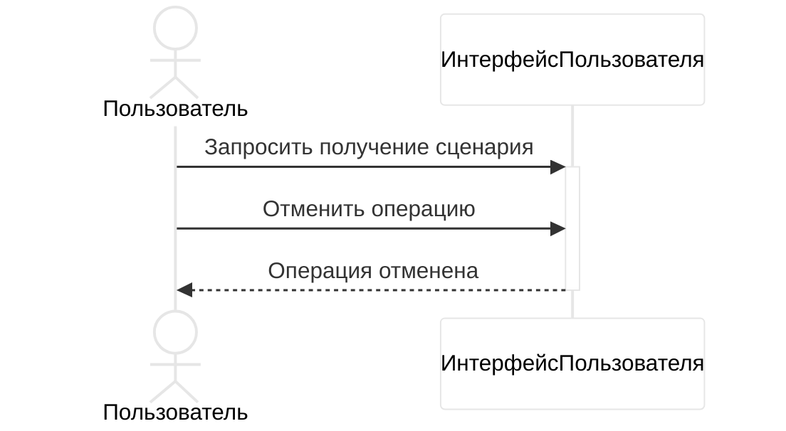
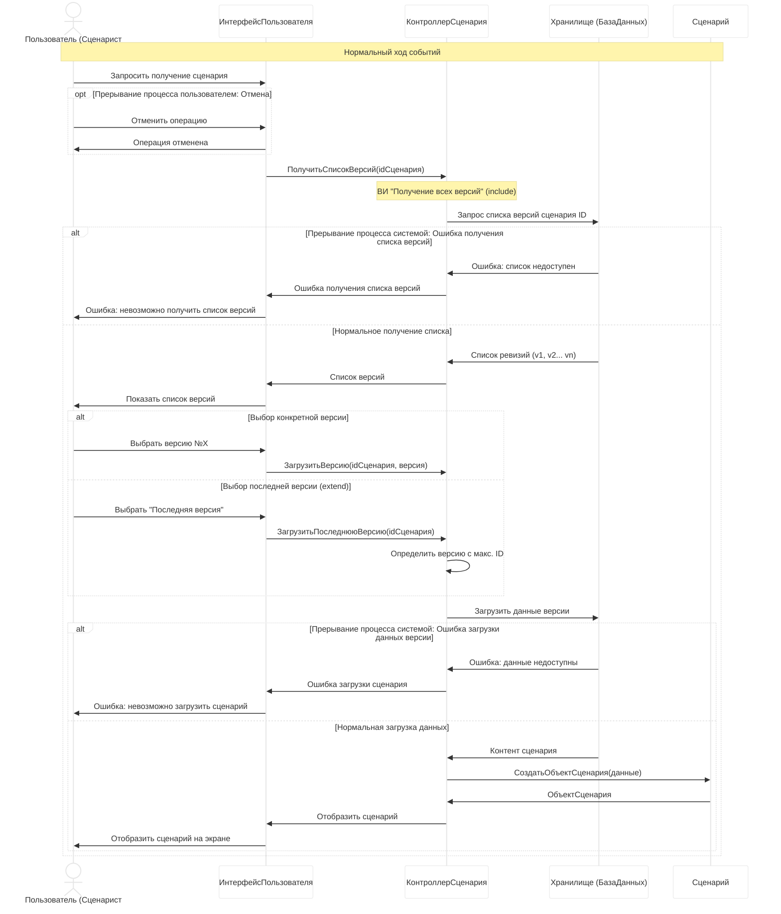
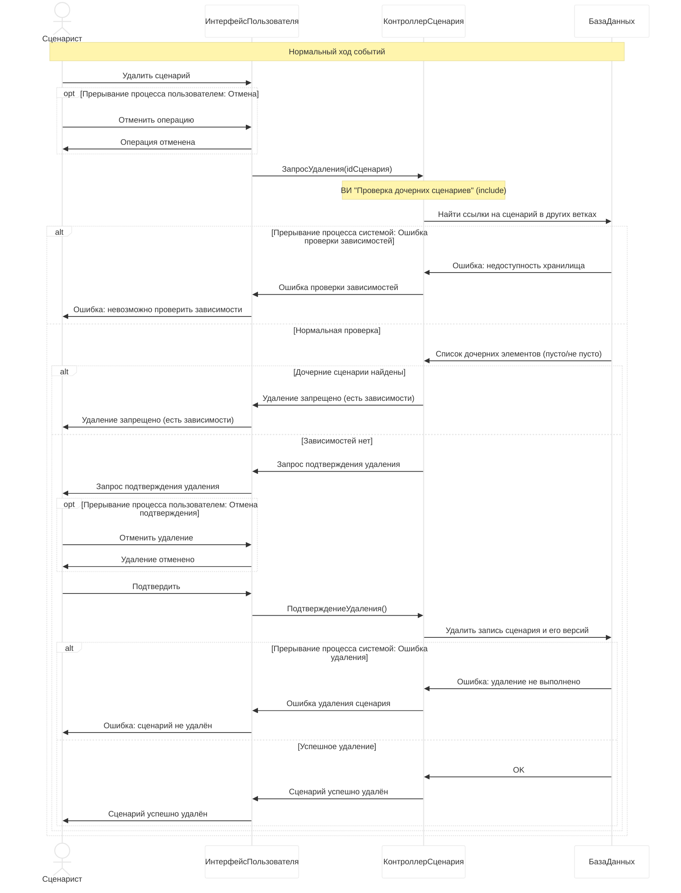

"Создание нового сценария/Изменение существующего сценария"







"Получение сценария определённой версии"







```mermaid
%%{init: {'theme': 'base', 'themeVariables': { 'primaryColor': '#fff', 'edgeColor': '#000', 'lineColor': '#000', 'actorTextColor': '#000'}}}%%
```

"Получение сценария определённой версии"



"Удаление сценария"


