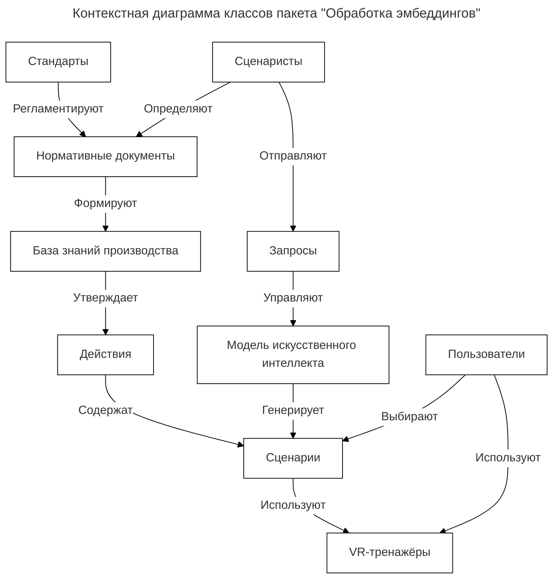
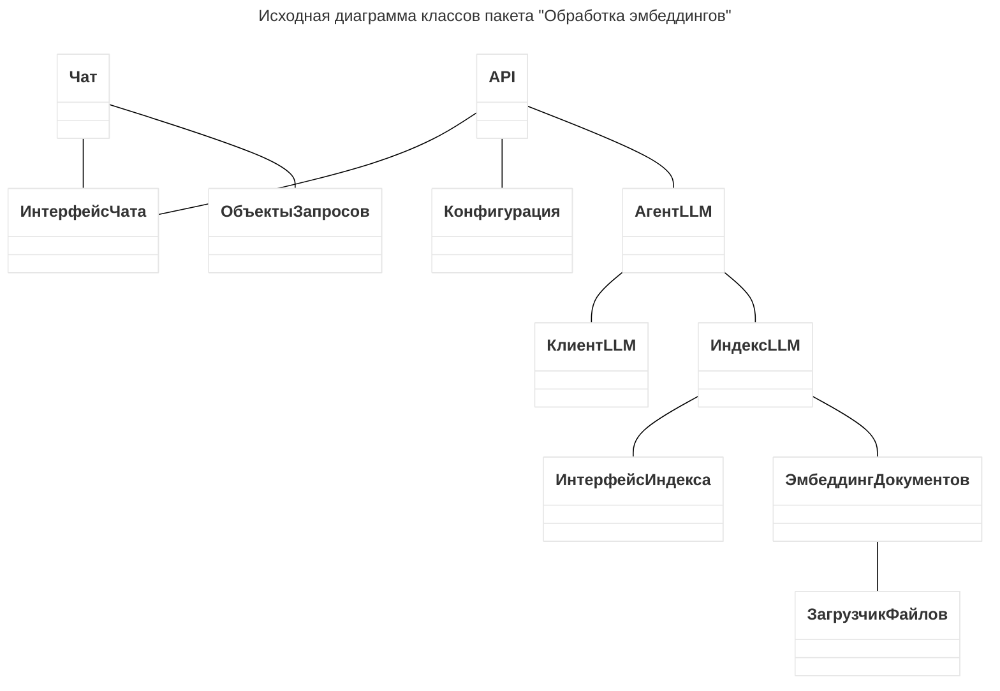
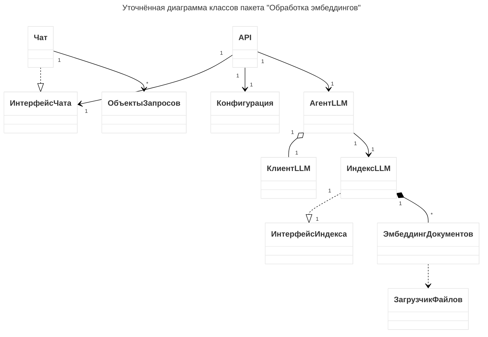
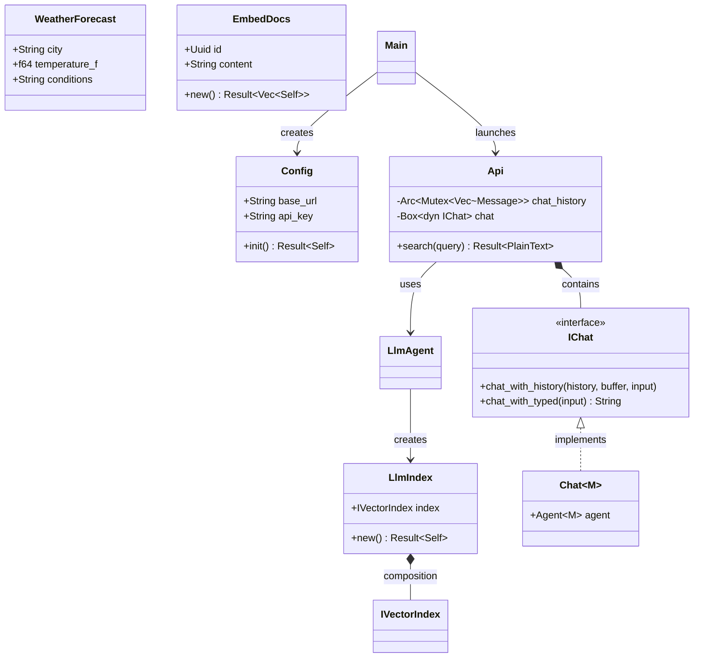

# Диаграммы классов

## Контекстная диаграмма классов



## Исходная диаграмма классов пакета "Обработка эмбеддингов"



## Уточнённая диаграмма классов "Обработка эмбеддингов"



## Детальная диаграмма классов

```mermaid
classDiagram
    %% Модуль DTO (Data Transfer Objects)
    class WeatherForecast {
        +String city
        +f64 temperature_f
        +String conditions
    }
    
    %% Модуль Interface (интерфейсы и конфигурация)
    class Config {
        +String base_url
        +String api_key
        +String chat_model_id
        +String system_prompt
        +f64 temperature
        +String embed_model_id
        +u64 max_tokens
        +usize chunk_size
        +usize chunk_overlap
        +Option~String~ qdrant_url
        +usize top_k
        +String documents_path
        +String host
        +String port
        +init() Result~Self~
    }
    
    class IVectorIndex {
        -LLMout inner
        +new(LLMout) Self
        +top_n(Req) WasmBoxedFuture~TopNResults~
        +top_n_ids(Req) WasmBoxedFuture~Result~Vec~(f64, String)~~
    }

    class IChat {
        <<interface>>
        +chat_with_history(Arc~Mutex~Vec~Message~~, &mut String, &str) Arc~Mutex~Vec~Message~~
        +chat_with_typed(&str) String
    }
    
    %% Модуль Model (реализации)
    class LlmClient {
        -Client inner
        +new(&str, &str) Result~Self~
    }
    
    class LlmIndex {
        +IVectorIndex index
        +new~C~(C::EmbeddingModel, &str, Option~String~, usize, usize) Result~Self~
    }

    class EmbedDocs {
        +Uuid id
        +i64 created_at
        +String file_path
        +String file_name
        +String content
        +String context_chunk
        +new~M~(M, &str, usize, usize) Result~Vec~(Self, OneOrMany~Embedding~)~
    }
    
    class Chat~M~ {
        +Agent~M~ agent
        +IChat implementation
    }

    class LlmAgent {
        +new(Config) Result~Agent~...~~
    }

    %% Модуль Src (основное приложение)
    class Api {
        -Arc~Mutex~Vec~Message~~ chat_history
        -Box~dyn IChat~ chat
        +new(Config) Result~Self~
        +index() Result~PlainText~
        +search(Query~String~) Result~PlainText~
        +forecast(Query~String~) Result~PlainText~
    }

    class Main {
        +main() Result~()~
    }

    %% Внешние зависимости (упрощённо)
    class Agent~M~ {
        <<external>>
    }
    class VectorStoreIndexDyn {
        <<external>>
    }
    
    class Message {
        <<external>>
    }

    %% Связи и зависимости
    Config --> WeatherForecast : использует в коде
    IChat <|.. Chat~M~ : реализует
    IVectorIndex ..|> VectorStoreIndexDyn : реализует
    LlmIndex --> IVectorIndex : содержит
    LlmIndex --> EmbedDocs : создаёт
    LlmAgent --> Config : принимает
    LlmAgent --> LlmClient : создаёт
    LlmAgent --> LlmIndex : создаёт
    LlmAgent --> Agent~M~ : возвращает
    Chat~M~ --> Agent~M~ : содержит
    Api --> Config : принимает
    Api --> LlmAgent : создаёт
    Api --> Chat~M~ : содержит
    Api --> IChat : использует
    Api --> Message : хранит
    Main --> Config : создаёт
    Main --> Api : создаёт
    EmbedDocs --> Embed : реализует (derive)
    WeatherForecast --> JsonSchema : реализует (derive)
    WeatherForecast --> Deserialize : реализует (derive)

    %% Агрегации/композиции
    Api "1" *-- "1" Box~dyn IChat~ : содержит
    Api "1" *-- "1" Arc~Mutex~Vec~Message~~ : содержит
    LlmIndex "1" *-- "1" IVectorIndex : содержит
    IVectorIndex "1" *-- "1" LLMout : обёртывает
    Chat~M~ "1" *-- "1" Agent~M~ : содержит
    LlmAgent "1" *-- "1" LlmClient : создаёт
    LlmAgent "1" *-- "1" LlmIndex : создаёт
```



## Описание модулей

  

### Модуль `dto`

Содержит структуры данных для передачи между слоями приложения.

  

- **WeatherForecast**: DTO для прогноза погоды. Используется в типизированных запросах к LLM.

  

### Модуль `interface`

Определяет контракты (трейты) и конфигурацию.

  

- **Config**: центральная конфигурация приложения с builder-паттерном (через `bon::Builder`). Загружает параметры из переменных окружения.

- **IChat**: трейт для чат-функциональности с двумя методами — работа с историей и типизированный ответ.

- **IVectorIndex**: обёртка над векторным индексом, реализующая `VectorStoreIndexDyn` из библиотеки `rig`.

  

### Модуль `model`

Реализует бизнес-логику и интеграции.

  

- **LlmClient**: клиент для LLM API (OpenAI‑совместимый).

- **LlmIndex**: управляет векторным индексом (in‑memory или Qdrant) и создаёт эмбеддинги документов.

- **EmbedDocs**: структура для чанков документов с эмбеддингами. Реализует `rig::Embed`.

- **Chat**: реализация `IChat`, использующая `Agent` из `rig` для стримингового и типизированного взаимодействия.

- **LlmAgent**: фасад для создания готового `Agent` с динамическим контекстом из векторного индекса.

  

### Модуль `src`

Точка входа и API‑слой.

  

- **Api**: Poem OpenAPI‑сервис с тремя endpoint’ами (`/`, `/search`, `/forecast`). Хранит историю чата в памяти и использует внедрённую реализацию `IChat`.

- **Main**: инициализирует конфиг, создаёт API и запускает сервер.

  

## Типы связей

  

- **Реализация интерфейса**: `IChat <|.. Chat`

- **Наследование/реализация внешнего трейта**: `IVectorIndex ..|> VectorStoreIndexDyn`

- **Композиция (жёсткое владение)**: `Api *-- Box~dyn IChat~`

- **Агрегация (ссылочное владение)**: `LlmIndex *-- IVectorIndex`

- **Зависимость (использование)**: `Config --> WeatherForecast`

  

## Мощность связей

  

- `1` — один экземпляр.

- `*` — множество (в диаграмме не указано, где есть коллекции, например `Vec<Message>`).

  

## Методы и параметры

  

Для краткости в диаграмме указаны только сигнатуры ключевых методов. Полные сигнатуры можно найти в исходном коде.

  

### Config

- `init() -> Result<Self>`: создаёт конфиг из переменных окружения.

  

### IChat

- `chat_with_history(history: &Arc<Mutex<Vec<Message>>>, response: &mut String, query: &str) -> Arc<Mutex<Vec<Message>>>`

- `chat_with_typed(city: &str) -> String`

  

### IVectorIndex

- `top_n(req: Req) -> WasmBoxedFuture<'a, TopNResults>`

- `top_n_ids(req: Req) -> WasmBoxedFuture<'a, Result<Vec<(f64, String)>, VectorStoreError>>`

  

### Api

- `new(config: Config) -> anyhow::Result<Self>`

- `index() -> Result<PlainText<&'static str>>`

- `search(query: Query<String>) -> Result<PlainText<String>>`

- `forecast(city: Query<String>) -> Result<PlainText<String>>`

  

## Примечания

  

- `rig` — внешняя библиотека для работы с LLM, её типы (`Agent`, `Message`, `VectorStoreIndexDyn`) показаны как внешние классы.

- `Chat` является generic‑структурой `Chat<M: CompletionModel>`; на диаграмме обозначена как `Chat~M~`.

- `EmbedDocs` автоматически реализует `rig::Embed` благодаря derive‑макросу.

- История чата в `Api` хранится как `Arc<Mutex<Vec<Message>>>` — временное решение, планируется замена на БД.

  

Диаграмма отражает архитектуру проекта на момент анализа (апрель 2026).