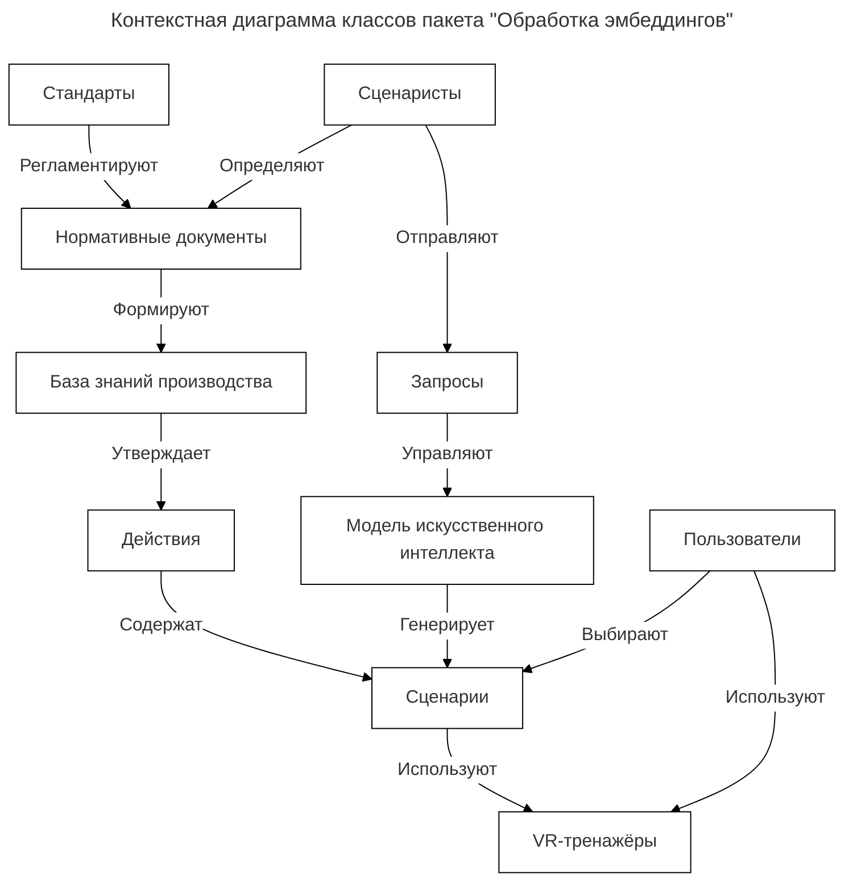
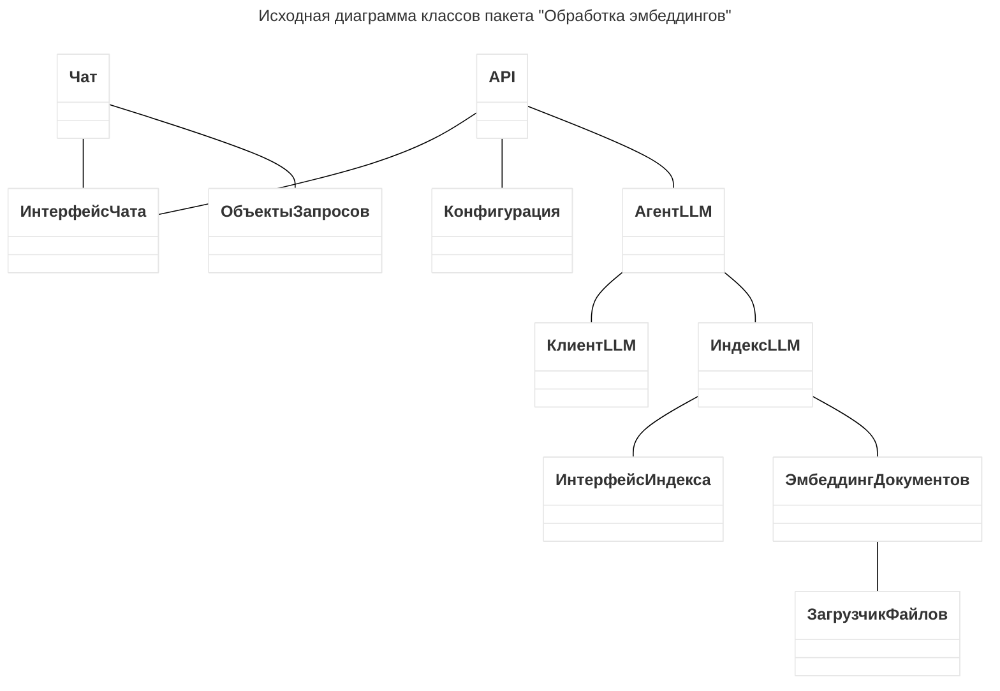
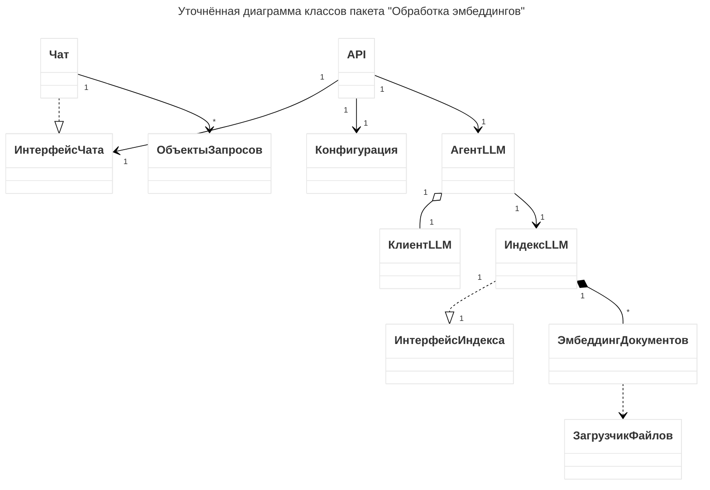
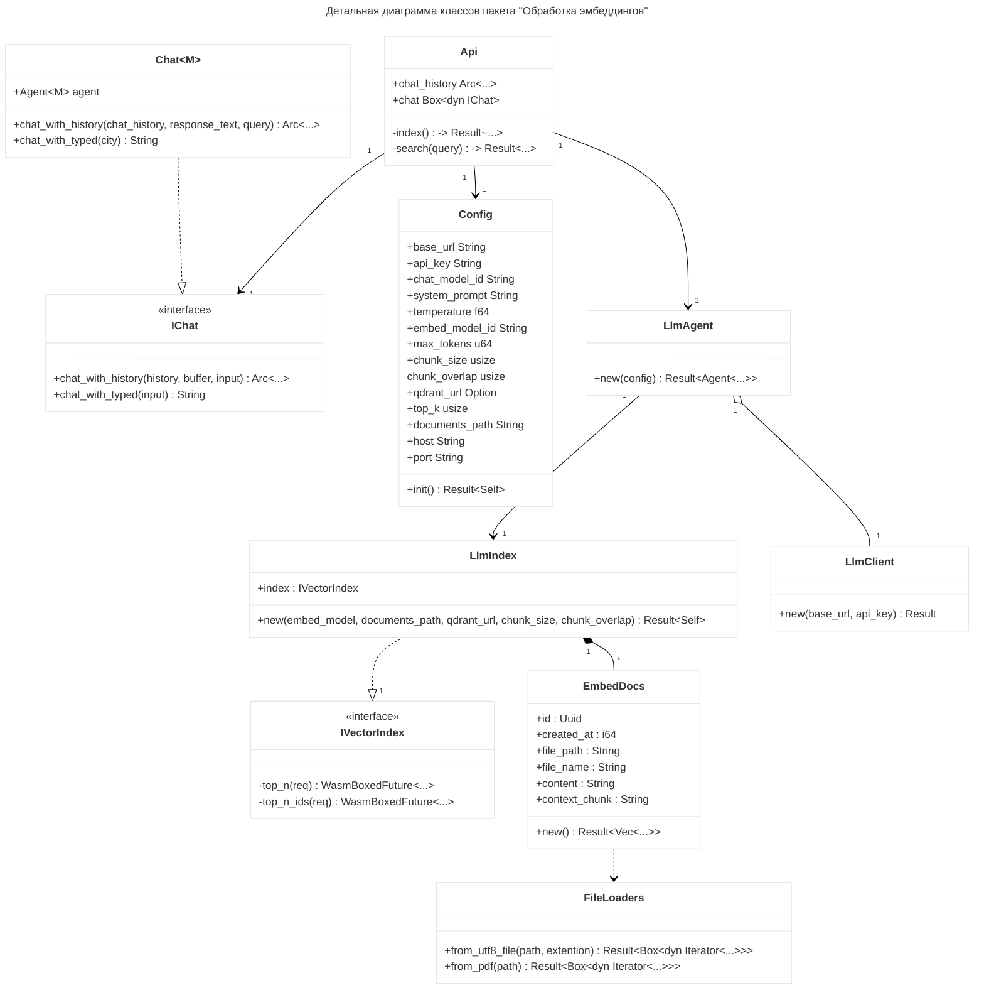

# Диаграммы классов

## Контекстная диаграмма классов

## Исходная диаграмма классов пакета "Обработка эмбеддингов"

## Уточнённая диаграмма классов "Обработка эмбеддингов"

## Детальная диаграмма классов

Таблица 35
Описание полей класса «Config»

| Описание полей класса «Config» |        |                                    |
| ------------------------------ | ------ | ---------------------------------- |
| Название                       | Тип    | Описание                           |
| Id                             | String | Уникальный идентификатор заявления |
| …                              | …      | …                                  |

Таблица 36

Описание методов класса «…»

| Название                    | Параметры | Возвр. знач. | Описание                                         |
| --------------------------- | --------- | ------------ | ------------------------------------------------ |
| init                        | -         | Result<Self> | Получить данные конфига из переменных окружения. |
| …                           | …         | …            | …                                                |
