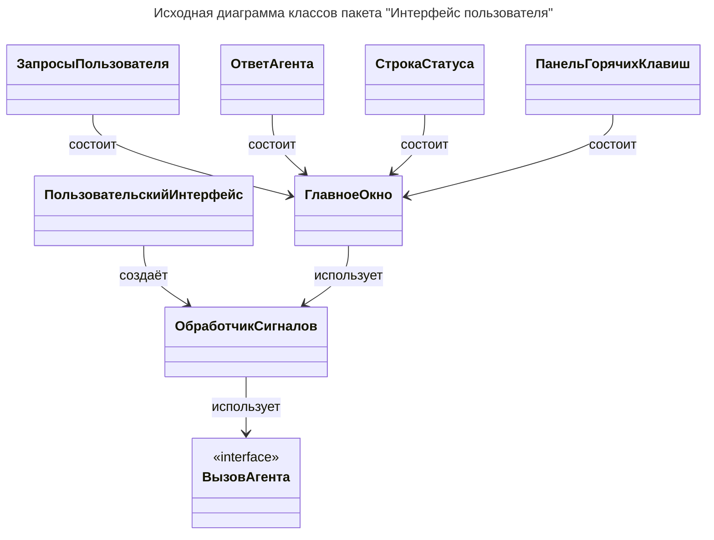

# Исходная диаграмма классов

> **Задача**: Привести диаграмму в соответствие с бизнес-логикой и пользовательским интерфейсом.
> Возьми все (если не сказано иначе) названия классов/компонентов из `src/ui/*` (`.py` и `.qml`), переведи их на русский язык в нотации "НазваниеКласса".
> Укажи их на диаграмме, их направления связей.
> Каждую связь подпиши одним словом, обозначающим действие исходящего класса по отношению к целевому классу.
> Направление стрелки должно соответствовать направлению взаимодействия: от инициатора действия к его получателю.
> Составь таблицу описания назначений классов, бери описания только из их docstring в коде программы:
>     - Таблица описания должна содержать все классы и компоненты диаграммы.
>     - При отсутствии docstring составь описание исключительно на основании фактической реализации класса.
>     - Добавь сформированное описание в docstring соответствующего класса.
>     - Не допускается приписывать классу функциональность, не подтверждённую исходным кодом.

## Таблица ... / Описание назначений классов

| Класс                     | Соответствующий элемент кода           | Описание                                                  |
| ------------------------- | -------------------------------------- | --------------------------------------------------------- |
| ПользовательскийИнтерфейс | `UserInterface` (`src/ui/handler.py`)  | Сборщик пользовательского интерфейса.                     |
| ОбработчикСигналов        | `HandlerBackend` (`src/ui/handler.py`) | Обработчик сигналов пользовательского интерфейса.         |
| ВызовАгента               | `InvokeAgent` (`src/ui/handler.py`)    | Интерфейс для работы с агентом-Сценаристом.               |
| ГлавноеОкно               | `Main.qml`                             | Управление пользовательским интерфейсом, бизнес-логика.   |
| СтрокаСтатуса             | `StatusBar.qml`                        | Компонент отображения строки состояния работы приложения. |
| ОтветАгента               | `AgentResponse.qml`                    | Компонент отображения ответов агента-Сценариста.          |
| ЗапросыПользователя       | `UserQueries.qml`                      | Компонент управления списком пользовательских запросов.   |
| ПанельГорячихКлавиш       | `HotkeyBar.qml`                        | Компонент обработки сочетаний горячих клавиш.             |
