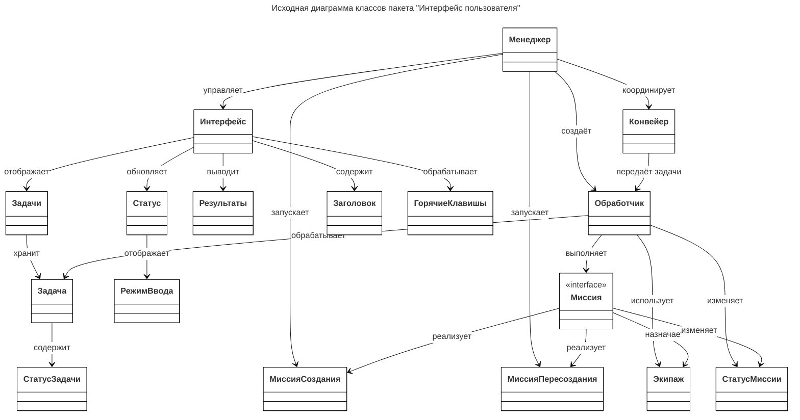

# Исходная диаграмма классов

| Класс              | Описание                                                                                                                                                                                                         |
| ------------------ | ---------------------------------------------------------------------------------------------------------------------------------------------------------------------------------------------------------------- |
| Менеджер           | Координирующий компонент системы. Управляет взаимодействием между интерфейсом пользователя, Конвейером, обработчиком и миссиями. Отвечает за жизненный цикл приложения и распределение задач между компонентами. |
| Интерфейс          | Корневой компонент пользовательского интерфейса. Объединяет элементы ввода, отображения результатов, статуса приложения и обработку горячих клавиш.                                                              |
| Заголовок          | Компонент отображения заголовка интерфейса, текущего контекста или активной миссии.                                                                                                                              |
| Статус             | Компонент отображения текущего состояния интерфейса и режима работы приложения.                                                                                                                                  |
| Задачи             | Компонент-менеджер списка пользовательских задач. Отвечает за хранение, отображение и управление набором задач.                                                                                                  |
| РежимВвода         | Объект, определяющий активный режим взаимодействия пользователя с интерфейсом.                                                                                                                                   |
| ГорячиеКлавишы     | Компонент обработки сочетаний клавиш. Обеспечивает быстрый доступ к функциям интерфейса и запуск пользовательских действий.                                                                                      |
| Результаты         | Компонент хранения и отображения набора результатов обработки задач.                                                                                                                                             |
| Миссия             | Абстракция процесса выполнения определённой операции или сценария обработки. Содержит логику выполнения, состояние и привязанный Экипаж.                                                                         |
| МиссияСоздания     | Специализированная реализация Миссии, отвечающая за создание новых сущностей или результатов обработки.                                                                                                          |
| МиссияПересоздания | Специализированная реализация Миссии, предназначенная для повторной генерации или пересоздания существующих результатов.                                                                                         |
| Обработчик         | Компонент выполнения задач и миссий. Получает задачи от Конвейера, управляет состоянием выполнения и взаимодействует с Экипажем.                                                                                 |
| СтатусМиссии       | Объект состояния выполнения Миссии. Содержит информацию о текущем этапе, успешности выполнения и возможных ошибках.                                                                                              |
| Экипаж             | Набор исполнителей или сервисных компонентов, участвующих в выполнении Миссии. Предоставляет ресурсы и инструменты обработки.                                                                                    |
| Конвейер           | Управляет выполнением задач.                                                                                                                                                                                     |
| Задача             | Компонент представления и обработки пользовательского ввода.                                                                                                                                                     |
| СтатусЗадачи       | Объект состояния пользовательской задачи. Используется для отслеживания этапов обработки задачи от создания до завершения.                                                                                       |
