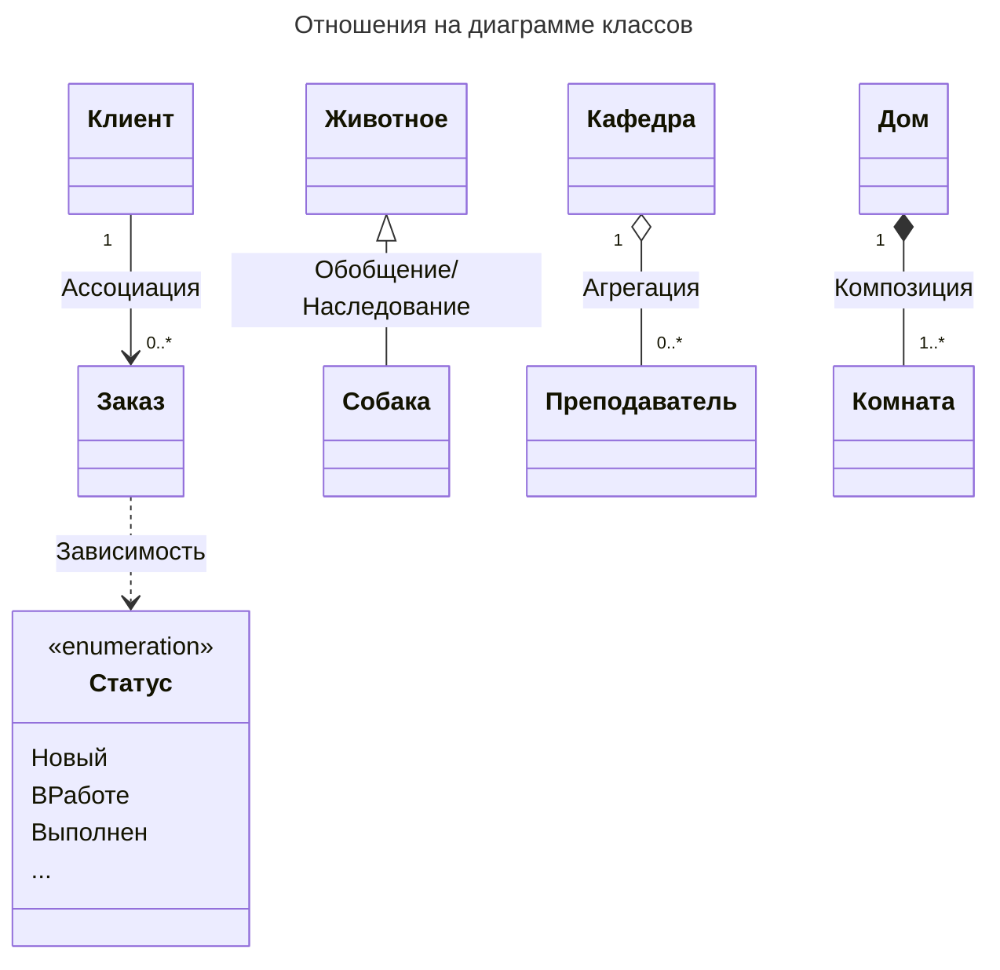
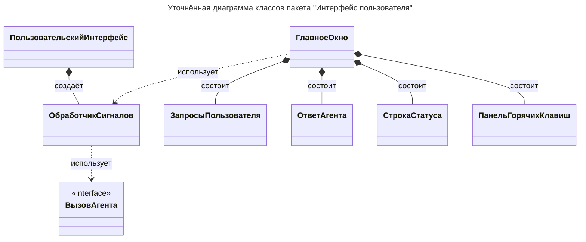

# Уточнённая диаграмма классов

> **Задача**: Привести диаграмму в соответствие с бизнес-логикой и пользовательским интерфейсом.
> Возьми `diagrammy/Пакет Интерфейс пользователя/1. Исходная диаграмма классов.md`, скопируй и поменяй стрелки в отношениях между классами на конкретный тип отношения (Ассоциация, Зависимость, Обобщение, Агрегация, Композиция или Реализация).
> Тип отношения определяется по исходному коду, а не выбирается произвольно.
> Мощность отношения не нужна.

