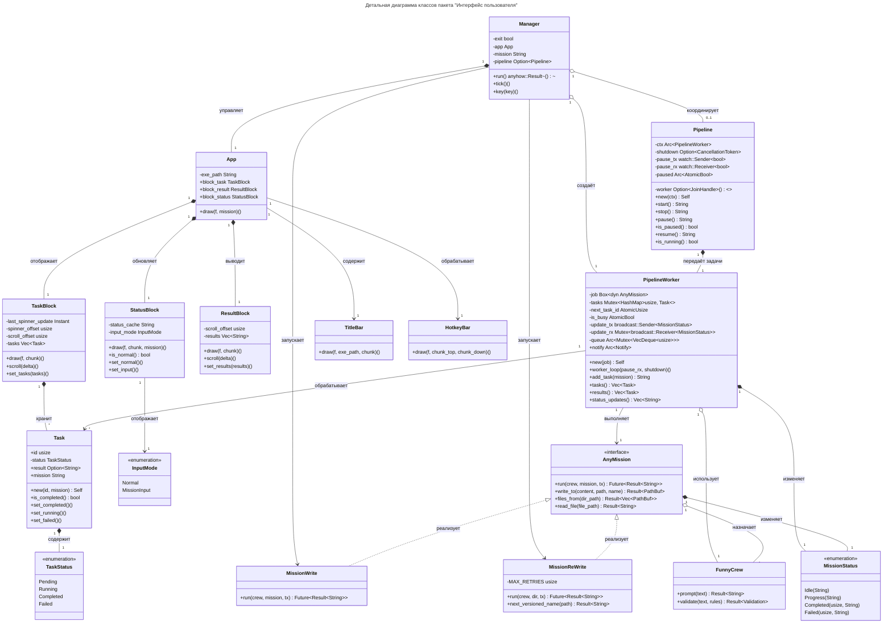

# Детальная диаграмма классов

## Таблица ... / Описание полей класса «Manager»

| Название | Тип               | Описание                                |
| -------- | ----------------- | --------------------------------------- |
| exit     | bool              | Флаг завершения работы приложения.      |
| app      | App               | Основной UI компонент приложения.       |
| mission  | String            | Текущая вводимая миссия.                |
| pipeline | Option\<Pipeline> | Конвейер обработки задач (опционально). |

## Таблица ... / Описание методов класса «Manager»

| Название | Параметры | Возвр. знач.        | Описание                           |
| -------- | --------- | ------------------- | ---------------------------------- |
| run      | -         | anyhow::Result\<()> | Запустить главный цикл приложения. |
| tick     | -         | ()                  | Обновить состояние (асинхронно).   |
| key      | key       | ()                  | Обработать нажатие клавиши.        |

## Таблица ... / Описание полей класса «App»

| Название     | Тип         | Описание                              |
| ------------ | ----------- | ------------------------------------- |
| exe_path     | String      | Путь к исполняемому файлу приложения. |
| block_task   | TaskBlock   | Компонент отображения задач.          |
| block_result | ResultBlock | Компонент отображения результатов.    |
| block_status | StatusBlock | Компонент отображения статуса.        |

## Таблица ... / Описание методов класса «App»

| Название | Параметры  | Возвр. знач. | Описание              |
| -------- | ---------- | ------------ | --------------------- |
| draw     | f, mission | ()           | Отрисовать интерфейс. |

## Таблица ... / Описание полей класса «Pipeline»

| Название | Тип                        | Описание                       |
| -------- | -------------------------- | ------------------------------ |
| ctx      | Arc\<PipelineWorker>       | Рабочий контекст конвейера.    |
| worker   | Option\<JoinHandle\<()>>   | Дескриптор потока-обработчика. |
| shutdown | Option\<CancellationToken> | Токен отмены для остановки.    |
| pause_tx | watch::Sender\<bool>       | Канал отправки сигнала паузы.  |
| pause_rx | watch::Receiver\<bool>     | Канал получения сигнала паузы. |
| paused   | Arc\<AtomicBool>           | Флаг паузы.                    |

## Таблица ... / Описание методов класса «Pipeline»

| Название   | Параметры | Возвр. знач. | Описание                          |
| ---------- | --------- | ------------ | --------------------------------- |
| new        | ctx       | Self         | Создать конвейер.                 |
| start      | -         | String       | Запустить обработку задач.        |
| stop       | -         | String       | Остановить обработку задач.       |
| pause      | -         | String       | Поставить конвейер на паузу.      |
| is_paused  | -         | bool         | Проверить, находится ли на паузе. |
| resume     | -         | String       | Продолжить работу конвейера.      |
| is_running | -         | bool         | Проверить, запущен ли конвейер.   |

## Таблица ... / Описание полей класса «PipelineWorker»

| Название     | Тип                                         | Описание                          |
| ------------ | ------------------------------------------- | --------------------------------- |
| job          | Box\<dyn AnyMission>                        | Задача для выполнения.            |
| tasks        | Mutex\<HashMap\<usize, Task>>               | Хранилище задач.                  |
| next_task_id | AtomicUsize                                 | Следующий идентификатор задачи.   |
| is_busy      | AtomicBool                                  | Флаг занятости рабочего.          |
| update_tx    | broadcast::Sender\<MissionStatus>           | Канал отправки обновлений задач.  |
| update_rx    | Mutex\<broadcast::Receiver\<MissionStatus>> | Канал получения обновлений задач. |
| queue        | Arc\<Mutex\<VecDeque\<usize>>>              | Очередь идентификаторов задач.    |
| notify       | Arc\<Notify>                                | Уведомление о новых задачах.      |

## Таблица ... / Описание методов класса «PipelineWorker»

| Название       | Параметры          | Возвр. знач. | Описание                           |
| -------------- | ------------------ | ------------ | ---------------------------------- |
| new            | job                | Self         | Создать рабочего конвейера.        |
| worker_loop    | pause_rx, shutdown | ()           | Главный цикл обработки задач.      |
| add_task       | mission            | String       | Добавить задачу в очередь.         |
| tasks          | -                  | Vec\<Task>   | Получить список всех задач.        |
| results        | -                  | Vec\<Task>   | Получить список завершённых задач. |
| status_updates | -                  | Vec\<String> | Получить накопленные обновления.   |

## Таблица ... / Описание полей класса «TaskBlock»

| Название            | Тип        | Описание                              |
| ------------------- | ---------- | ------------------------------------- |
| last_spinner_update | Instant    | Время последнего обновления спиннера. |
| spinner_offset      | usize      | Текущая позиция спиннера.             |
| scroll_offset       | usize      | Смещение прокрутки списка задач.      |
| tasks               | Vec\<Task> | Список задач для отображения.         |

## Таблица ... / Описание методов класса «TaskBlock»

| Название  | Параметры | Возвр. знач. | Описание                 |
| --------- | --------- | ------------ | ------------------------ |
| draw      | f, chunk  | ()           | Отрисовать блок задач.   |
| scroll    | delta     | ()           | Прокрутить список задач. |
| set_tasks | tasks     | ()           | Установить список задач. |

## Таблица ... / Описание полей класса «ResultBlock»

| Название      | Тип          | Описание                               |
| ------------- | ------------ | -------------------------------------- |
| scroll_offset | usize        | Смещение прокрутки списка результатов. |
| results       | Vec\<String> | Список результатов для отображения.    |

## Таблица ... / Описание методов класса «ResultBlock»

| Название    | Параметры | Возвр. знач. | Описание                       |
| ----------- | --------- | ------------ | ------------------------------ |
| draw        | f, chunk  | ()           | Отрисовать блок с результатом. |
| scroll      | delta     | ()           | Прокрутить список результатов. |
| set_results | results   | ()           | Установить список результатов. |
