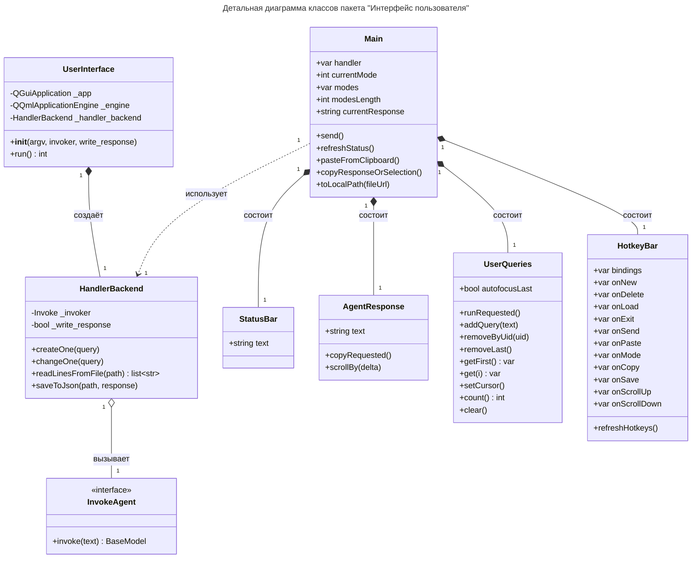

# Детальная диаграмма классов

> Задача: Привести диаграмму в соответствие с бизнес-логикой и пользовательским интерфейсом. Возьми `diagrammy/Пакет Интерфейс пользователя/3. Уточнённая диаграмма классов.md`. Каждому элементу диаграммы должен соответствовать ровно один класс Python или один компонент QML из исходного кода программы. Название класса теперь соответвует его оригинальному названию на английском языке из "Описание назначений классов" в `diagrammy/Пакет Интерфейс пользователя/4. Детальная диаграмма классов.md`. У каждой связи теперь должна быть мощность (кратность). Не допускается объединение нескольких элементов исходного кода в один элемент диаграммы. В конце составь описание класса, его полей и методов. Описание полей и методов должно соответствовать конкретным элементам исходного кода. Для каждого класса, поля и метода используй соответствующий docstring. Если docstring отсутствует, ставь в описании `...`. Не используй реализацию кода для самостоятельного составления описаний. Вспомогательные файлы: `src/ui/*`.

## Таблица ... / Описание полей класса «UserInterface»

| Название           | Тип                     | Описание |
| ------------------ | ----------------------- | -------- |
| `_app`             | `QGuiApplication`       | ...      |
| `_engine`          | `QQmlApplicationEngine` | ...      |
| `_handler_backend` | `HandlerBackend`        | ...      |

## Таблица ... / Описание методов класса «UserInterface»

| Название | Параметры                          | Возвр. знач. | Описание                          |
| -------- | ---------------------------------- | ------------ | --------------------------------- |
| `__init__` | `argv, invoker, write_response`  |              | ...                               |
| `run`    | -                                  | `int`        | Запуск пользовательского интерфейса. |

## Таблица ... / Описание полей класса «HandlerBackend»

| Название          | Тип      | Описание |
| ----------------- | -------- | -------- |
| `_invoker`        | `Invoke` | ...      |
| `_write_response` | `bool`   | ...      |

## Таблица ... / Описание методов класса «HandlerBackend»

| Название            | Параметры                               | Возвр. знач. | Описание                                           |
| ------------------- | --------------------------------------- | ------------ | -------------------------------------------------- |
| `createOne`         | `query: dict`                           |              | Создать один Сценарий.                             |
| `changeOne`         | `query: dict`                           |              | ...                                                |
| `readLinesFromFile` | `path: str`                             | `list[str]`  | Чтение задач (1 задача = 1 строка) из 'csv' файла. |
| `saveToJson`        | `file_path: str, current_response: str` |              | Сохранение текста в файл в формате Json.           |

## Таблица ... / Описание методов класса «InvokeAgent»

| Название | Параметры    | Возвр. знач. | Описание                                            |
| -------- | ------------ | ------------ | --------------------------------------------------- |
| `invoke` | `text: str`  | `BaseModel`  | Объявление метода для отправки запросов LLM-агенту. |

## Таблица ... / Описание полей класса «Main»

| Название          | Тип      | Описание |
| ----------------- | -------- | -------- |
| `handler`         | `var`    | ...      |
| `currentMode`     | `int`    | ...      |
| `modes`           | `var`    | ...      |
| `modesLength`     | `int`    | ...      |
| `currentResponse` | `string` | ...      |

## Таблица ... / Описание методов класса «Main»

| Название                  | Параметы  | Возвр. знач. | Описание |
| ------------------------- | --------- | ------------ | -------- |
| `send`                    | -         |              | ...      |
| `refreshStatus`           | -         |              | ...      |

## Таблица ... / Описание полей класса «StatusBar»

| Название | Тип      | Описание |
| -------- | -------- | -------- |
| `text`   | `string` | ...      |

## Таблица ... / Описание полей класса «AgentResponse»

| Название | Тип      | Описание |
| -------- | -------- | -------- |
| `text`   | `string` | ...      |

## Таблица ... / Описание класса «UserQueries»

| Название      | Параметы | Возвр. знач. | Описание |
| ------------- | -------- | ------------ | -------- |
| `addQuery`    | `text`   |              | ...      |
| `removeByUid` | `uid`    |              | ...      |
| `removeLast`  | -        |              | ...      |
| `getFirst`    | -        | `var`        | ...      |
| `get`         | `i`      | `var`        | ...      |
| `count`       | -        | `int`        | ...      |
| `clear`       | -        |              | ...      |

## Таблица ... / Описание класса «HotkeyBar»

| Название       | Тип   | Описание |
| -------------- | ----- | -------- |
| `bindings`     | `var` | ...      |
| `onNew`        | `var` | ...      |
| `onDelete`     | `var` | ...      |
| `onLoad`       | `var` | ...      |
| `onExit`       | `var` | ...      |
| `onSend`       | `var` | ...      |
| `onPaste`      | `var` | ...      |
| `onMode`       | `var` | ...      |
| `onCopy`       | `var` | ...      |
| `onSave`       | `var` | ...      |
| `onScrollUp`   | `var` | ...      |
| `onScrollDown` | `var` | ...      |

| Название         | Параметы | Возвр. знач. | Описание |
| ---------------- | -------- | ------------ | -------- |
| `refreshHotkeys` | -        |              | ...      |
