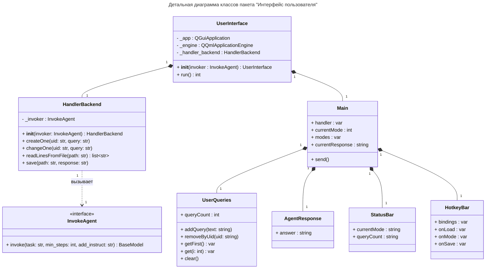

# Детальная диаграмма классов

> **Задача**: Привести диаграмму в соответствие с бизнес-логикой и пользовательским интерфейсом.
> Возьми `diagrammy/Пакет Интерфейс пользователя/3. Уточнённая диаграмма классов.md`.
> Каждому элементу диаграммы должен соответствовать ровно один класс Python или один компонент QML из исходного кода программы.
> Название класса теперь соответвует его оригинальному названию на английском языке из "Описание назначений классов" в `diagrammy/Пакет Интерфейс пользователя/4. Детальная диаграмма классов.md`.
> У каждой связи теперь должна быть мощность (кратность).
> Не допускается объединение нескольких элементов исходного кода в один элемент диаграммы.
> В конце составь описание класса, его полей и методов.
> Описание полей и методов должно соответствовать конкретным элементам исходного кода.
> Для каждого класса, поля и метода используй соответствующий docstring или комментарий рядом, описывающий назначение метода/переменной.
> Если комментарий отсутствует, ставь в описании `...`.
> Не используй реализацию кода для самостоятельного составления описаний.
> Параметр `self` из методов нужно убрать.
> Вспомогательные файлы: - `src/ui/*`.

| Условные обозначения для диаграмм классов | Значение                      |
| ----------------------------------------- | ----------------------------- |
| `+`                                       | public                        |
| `-`                                       | private                       |
| `#`                                       | protected                     |
| `~`                                       | internal                      |
| `<<abstract>>`                            | абстрактный класс             |
| `<<interface>>`                           | интерфейс                     |
| `<<static>>`                              | статический класс             |
| `*`                                       | множество (`0..*` или `1..*`) |
| `1`                                       | ровно один                    |

## Описание класса «UserInterface»

ПользовательскийИнтерфейс.

| Название          | Тип                   | Описание                        |
| ----------------- | --------------------- | ------------------------------- |
| \_app             | QGuiApplication       | Объект UI.                      |
| \_engine          | QQmlApplicationEngine | Объект движка UI.               |
| \_handler_backend | HandlerBackend        | Объект обработчика сигналов UI. |

| Название   | Параметры            | Возвр. знач.  | Описание                                           |
| ---------- | -------------------- | ------------- | -------------------------------------------------- |
| `__init__` | invoker: InvokeAgent | UserInterface | Конструктор сборщика пользовательского интерфейса. |
| run        | -                    | int           | Запустить пользовательский интерфейс.              |

## Описание класса «HandlerBackend»

Обработчик сигналов пользовательского интерфейса.

| Название  | Тип         | Описание                         |
| --------- | ----------- | -------------------------------- |
| \_invoker | InvokeAgent | Объект вызова агента-Сценариста. |

| Название          | Параметры                | Возвр. знач.   | Описание                                                       |
| ----------------- | ------------------------ | -------------- | -------------------------------------------------------------- |
| `__init__`        | invoker: InvokeAgent     | HandlerBackend | Конструктор обработчика сигналов пользовательского интерфейса. |
| createOne         | uid: str, query: str     | -              | Создать один Сценарий.                                         |
| changeOne         | uid: str, query: str     | -              | Изменить один Сценарий.                                        |
| readLinesFromFile | path: str                | `list[str]`    | Прочитать задачи (1 задача = 1 строка) из файла.               |
| save              | path: str, response: str | -              | Сохранить ответ агента в файл.                                 |

## Описание класса «InvokeAgent»

ВызовАгента.

| Название | Параметры                                    | Возвр. знач. | Описание                                   |
| -------- | -------------------------------------------- | ------------ | ------------------------------------------ |
| invoke   | task: str, min_steps: int, add_instruct: str | BaseModel    | Интерфейс метода отправки запросов агенту. |

## Описание класса «Main»

Описание: Управление пользовательским интерфейсом, бизнес-логика.

| Название        | Тип    | Описание                                                                           |
| --------------- | ------ | ---------------------------------------------------------------------------------- |
| handler         | var    | Обработчик сигналов пользовательского интерфейса.                                  |
| currentMode     | int    | Текущий режим работы программы.                                                    |
| modes           | var    | Режимы работы (создать один / создать массово / изменить один / изменить массово). |
| currentResponse | string | Текущий ответ агента.                                                              |

| Название | Параметры | Возвр. знач. | Описание                       |
| -------- | --------- | ------------ | ------------------------------ |
| send     | -         | -            | Отправить задачи на обработку. |

## Описание класса «StatusBar»

СтрокаСтатуса. Компонент отображения строки состояния работы приложения.

| Название    | Тип    | Описание                        |
| ----------- | ------ | ------------------------------- |
| currentMode | string | Текущий режим работы программы. |
| queryCount  | string | Текущее число запросов.         |

## Описание класса «AgentResponse»

ОтветАгента. Компонент отображения ответов агента-Сценариста.

| Название | Тип    | Описание      |
| -------- | ------ | ------------- |
| answer   | string | Ответ агента. |

## Описание класса «UserQueries»

ЗапросыПользователя. Компонент управления списком пользовательских запросов.

| Название   | Тип | Описание     |
| ---------- | --- | ------------ |
| queryCount | int | Число задач. |

| Название    | Параметры    | Возвр. знач. | Описание                |
| ----------- | ------------ | ------------ | ----------------------- |
| addQuery    | text: string | -            | Добавить новую задачу.  |
| removeByUid | uid: string  | -            | Удалить задачу по ID.   |
| getFirst    | -            | var          | Получить первую задачу. |
| get         | i: int       | var          | Получить задачу по ID.  |
| clear       | -            | -            | Очистить список задач.  |

## Описание класса «HotkeyBar»

ПанельГорячихКлавиш. Компонент обработки сочетаний горячих клавиш.

| Название | Тип | Описание                                            |
| -------- | --- | --------------------------------------------------- |
| bindings | var | Список горячих клавиш.                              |
| onLoad   | var | Обработчик события загрузки задач из файла.         |
| onMode   | var | Обработчик события смены режима работы.             |
| onSave   | var | Обработчик события сохранения ответа агента в файл. |
