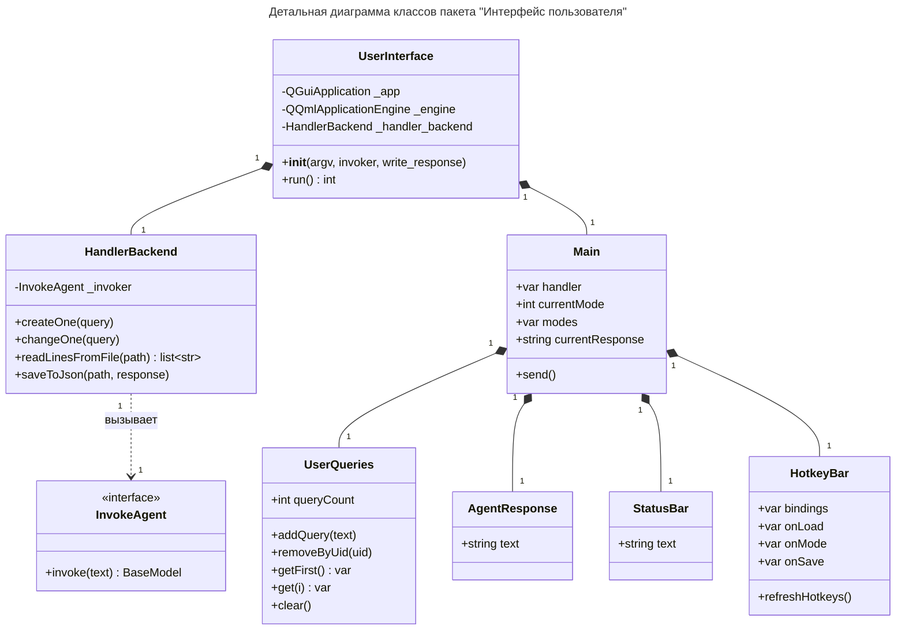

# Детальная диаграмма классов

> **Задача**: Привести диаграмму в соответствие с бизнес-логикой и пользовательским интерфейсом.
> Возьми `diagrammy/Пакет Интерфейс пользователя/3. Уточнённая диаграмма классов.md`.
> Каждому элементу диаграммы должен соответствовать ровно один класс Python или один компонент QML из исходного кода программы.
> Название класса теперь соответвует его оригинальному названию на английском языке из "Описание назначений классов" в `diagrammy/Пакет Интерфейс пользователя/4. Детальная диаграмма классов.md`.
> У каждой связи теперь должна быть мощность (кратность).
> Не допускается объединение нескольких элементов исходного кода в один элемент диаграммы.
> В конце составь описание класса, его полей и методов.
> Описание полей и методов должно соответствовать конкретным элементам исходного кода.
> Для каждого класса, поля и метода используй соответствующий docstring или комментарий рядом, описывающий назначение метода/переменной.
> Если комментарий отсутствует, ставь в описании `...`.
> Не используй реализацию кода для самостоятельного составления описаний.
> Вспомогательные файлы: - `src/ui/*`.

| Условные обозначения для диаграмм классов | Значение                      |
| ----------------------------------------- | ----------------------------- |
| `+`                                       | public                        |
| `-`                                       | private                       |
| `#`                                       | protected                     |
| `~`                                       | internal                      |
| `<<abstract>>`                            | абстрактный класс             |
| `<<interface>>`                           | интерфейс                     |
| `<<static>>`                              | статический класс             |
| `*`                                       | множество (`0..*` или `1..*`) |
| `0..1`                                    | ноль или один                 |
| `1`                                       | ровно один                    |

## Таблица ... / Описание класса «UserInterface»

Описание: Сборщик пользовательского интерфейса.

| Название           | Тип                     | Видимость | Описание                        |
| ------------------ | ----------------------- | --------- | ------------------------------- |
| `_app`             | `QGuiApplication`       | `-`       | Объект UI.                      |
| `_engine`          | `QQmlApplicationEngine` | `-`       | Объект движка UI.               |
| `_handler_backend` | `HandlerBackend`        | `-`       | Объект обработчика сигналов UI. |

| Название   | Параметры                       | Возвр. знач. | Описание                              |
| ---------- | ------------------------------- | ------------ | ------------------------------------- |
| `__init__` | `argv, invoker, write_response` |              | ...                                   |
| `run`      | -                               | `int`        | Запускает пользовательский интерфейс. |

## Таблица ... / Описание класса «HandlerBackend»

Описание: Обработчик сигналов пользовательского интерфейса.

| Название   | Тип           | Видимость | Описание                         |
| ---------- | ------------- | --------- | -------------------------------- |
| `_invoker` | `InvokeAgent` | `-`       | Объект вызова агента-Сценариста. |

| Название            | Параметры                   | Возвр. знач. | Описание                                         |
| ------------------- | --------------------------- | ------------ | ------------------------------------------------ |
| `createOne`         | `query: dict[str, str]`     |              | Создать один Сценарий.                           |
| `changeOne`         | `query: dict[str, str]`     |              | Изменить один Сценарий.                          |
| `readLinesFromFile` | `path: Path`                | `list[str]`  | Прочитать задачи (1 задача = 1 строка) из файла. |
| `saveToJson`        | `path: Path, response: str` |              | Сохранить ответ агента-Сценариста в файл.        |

## Таблица ... / Описание класса «InvokeAgent»

Описание: Интерфейс для работы с агентом-Сценаристом.

| Название | Параметры   | Возвр. знач. | Описание                                        |
| -------- | ----------- | ------------ | ----------------------------------------------- |
| `invoke` | `text: str` | `BaseModel`  | Объявление метода для отправки запросов агенту. |

## Таблица ... / Описание класса «Main»

Описание: Управление пользовательским интерфейсом, бизнес-логика.

| Название          | Тип      | Видимость | Описание                                                                           |
| ----------------- | -------- | --------- | ---------------------------------------------------------------------------------- |
| `handler`         | `var`    | `+`       | Обработчик сигналов пользовательского интерфейса.                                  |
| `currentMode`     | `int`    | `+`       | Текущий режим работы программы.                                                    |
| `modes`           | `var`    | `+`       | Режимы работы (создать один / создать массово / изменить один / изменить массово). |
| `currentResponse` | `string` | `+`       | Текущий ответ агента-Сценариста.                                                   |

| Название | Параметры | Возвр. знач. | Описание                       |
| -------- | --------- | ------------ | ------------------------------ |
| `send`   | -         |              | Отправить задачи на обработку. |

## Таблица ... / Описание класса «StatusBar»

Описание: Компонент отображения строки состояния работы приложения.

| Название | Тип      | Видимость | Описание                     |
| -------- | -------- | --------- | ---------------------------- |
| `text`   | `string` | `+`       | Состояние работы приложения. |

## Таблица ... / Описание класса «AgentResponse»

Описание: Компонент отображения ответов агента-Сценариста.

| Название | Тип      | Видимость | Описание                 |
| -------- | -------- | --------- | ------------------------ |
| `text`   | `string` | `+`       | Ответ агента-Сценариста. |

## Таблица ... / Описание класса «UserQueries»

Описание: Компонент управления списком пользовательских запросов.

| Название     | Тип   | Видимость | Описание     |
| ------------ | ----- | --------- | ------------ |
| `queryCount` | `int` | `+`       | Число задач. |

| Название      | Параметры | Возвр. знач. | Описание                |
| ------------- | --------- | ------------ | ----------------------- |
| `addQuery`    | `text`    |              | Добавить новую задачу.  |
| `removeByUid` | `uid`     |              | Удалить задачу по ID.   |
| `getFirst`    | -         | `var`        | Получить первую задачу. |
| `get`         | `i`       | `var`        | Получить задачу по ID.  |
| `clear`       | -         |              | Очистить список задач.  |

## Таблица ... / Описание класса «HotkeyBar»

Описание: Компонент обработки сочетаний горячих клавиш.

| Название   | Тип   | Видимость | Описание                                                       |
| ---------- | ----- | --------- | -------------------------------------------------------------- |
| `bindings` | `var` | `+`       | Список горячих клавиш.                                         |
| `onLoad`   | `var` | `+`       | Обработчик события загрузки задач из файла.                    |
| `onMode`   | `var` | `+`       | Обработчик события смены режима работы.                        |
| `onSave`   | `var` | `+`       | Обработчик события сохранения ответа агента-Сценариста в файл. |

| Название         | Параметры | Возвр. знач. | Описание                        |
| ---------------- | --------- | ------------ | ------------------------------- |
| `refreshHotkeys` | -         |              | Обновить список горячих клавиш. |
