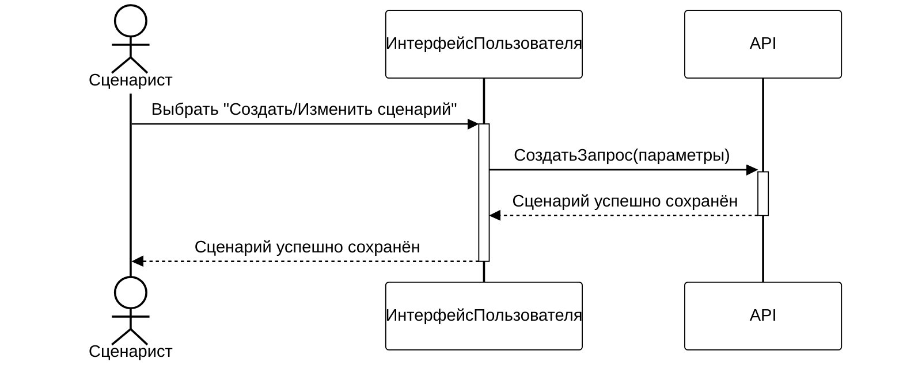
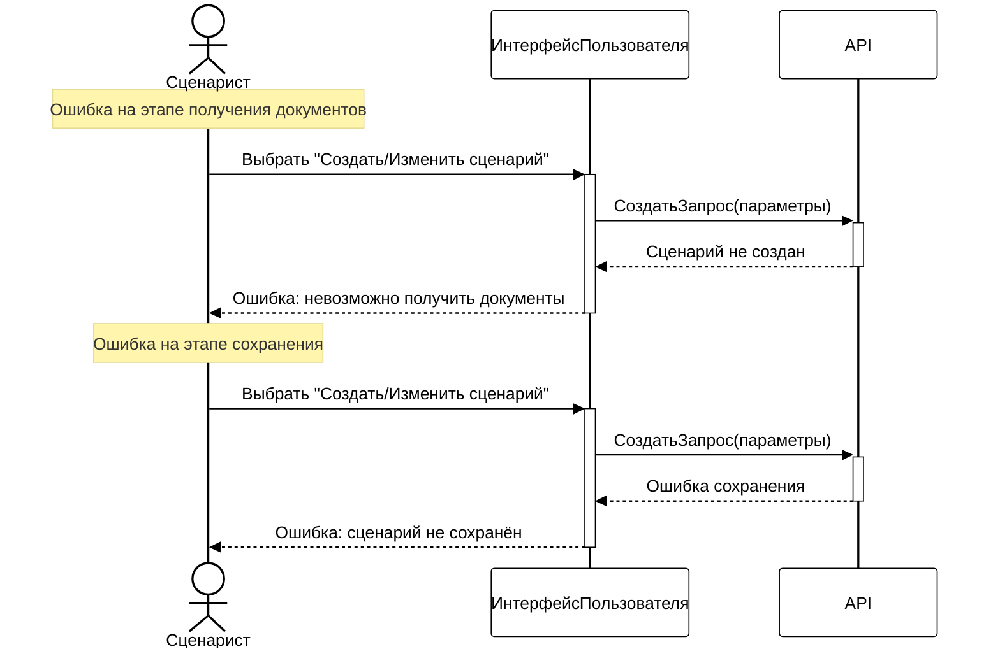
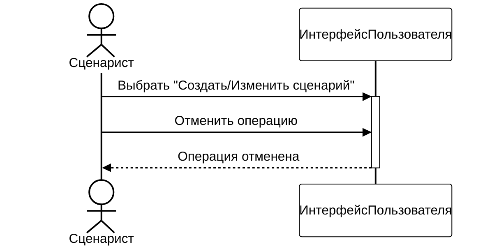
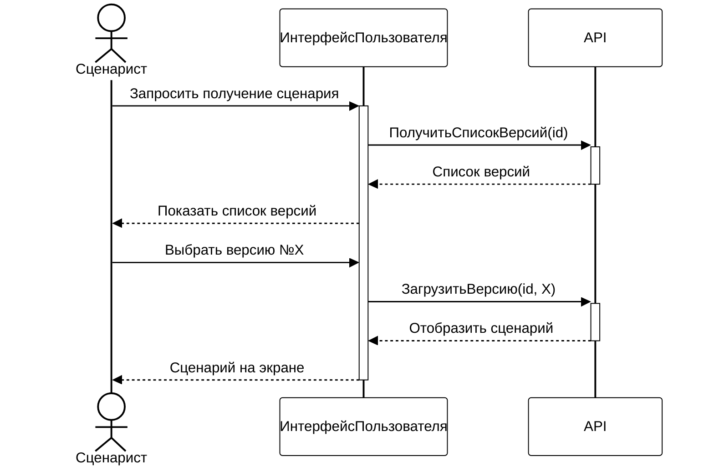
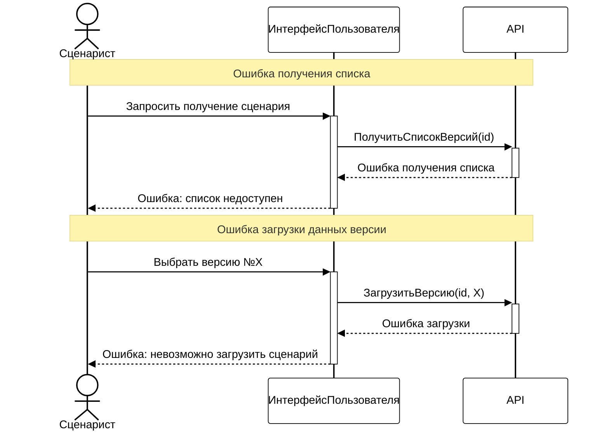
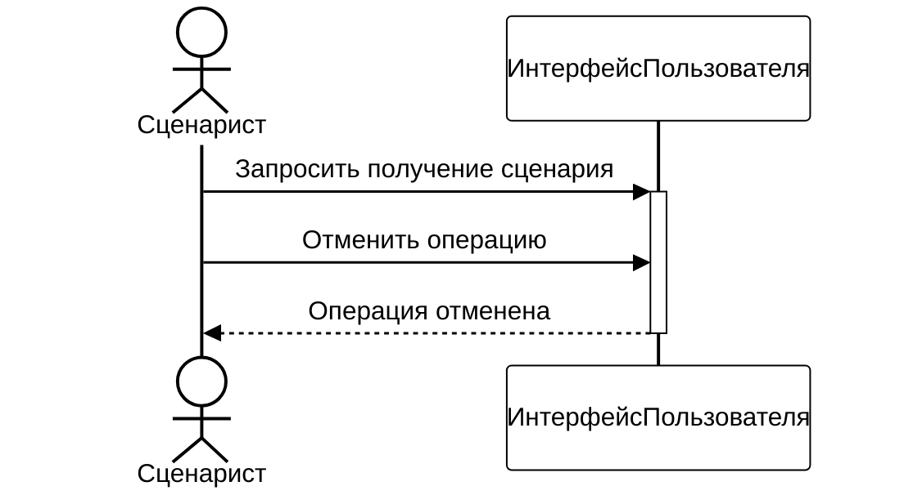
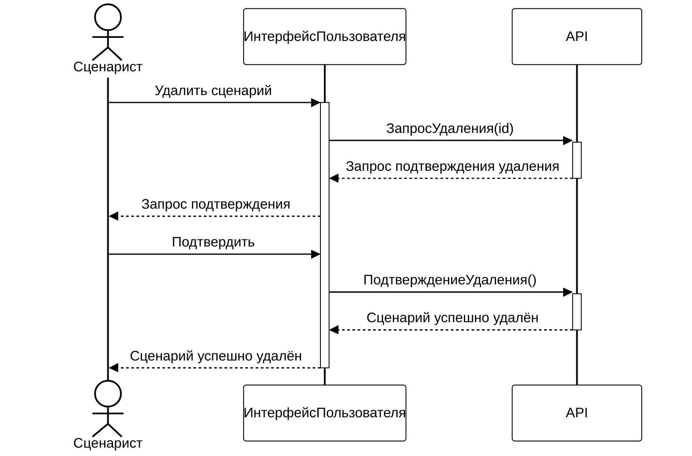
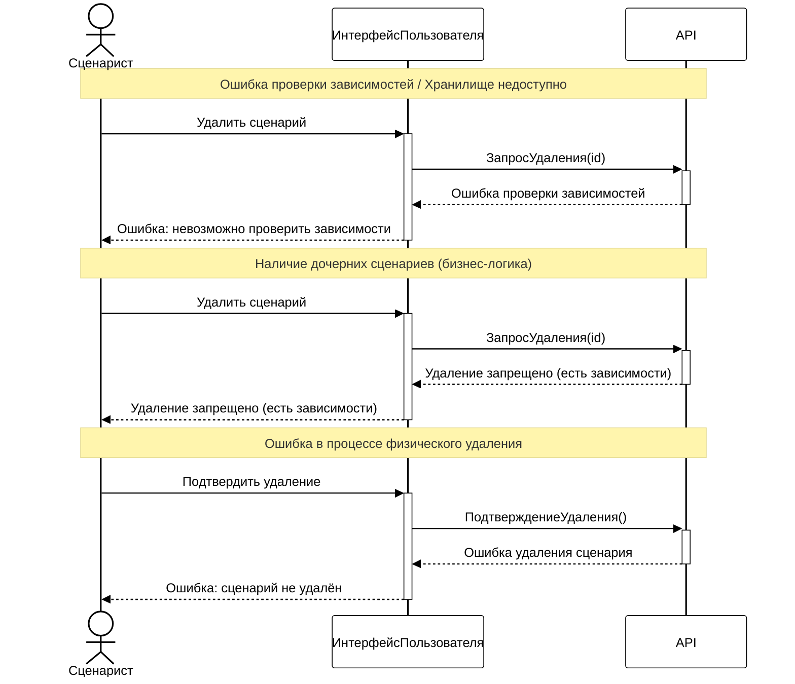
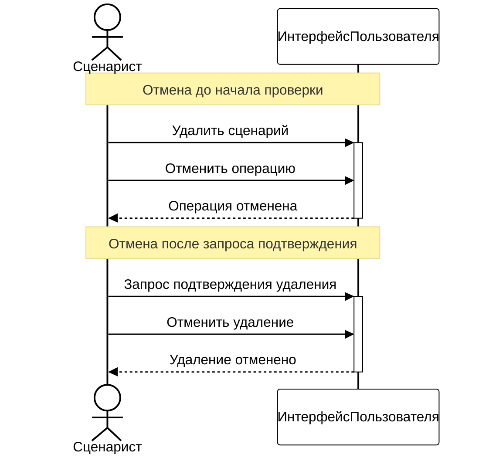

## Создание нового сценария/Изменение существующего сценария

### Нормальный ход событий

### Прерывание процесса системой

### Прерывание процесса пользователем

## Получение сценария определённой версии

### Нормальный ход событий

### Прерывание процесса системой

### Прерывание процесса пользователем

## Удаление сценария

### Нормальный ход событий

### Прерывание процесса системой

### Прерывание процесса пользователем

