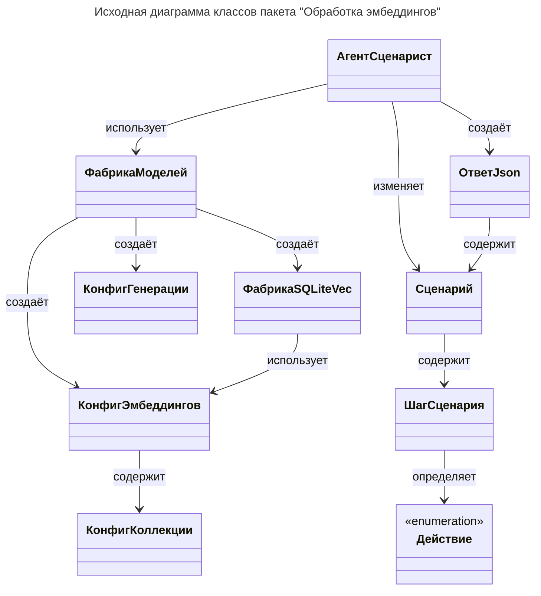

# 1. Исходная диаграмма классов

## Таблица ... / Описание назначений классов

| Класс             | Соответствующий элемент кода              | Описание                                                       |
| ----------------- | ----------------------------------------- | -------------------------------------------------------------- |
| АгентСценарист    | `ScenarAIstAgent` (`src/agent/agent.py`)  | Сборщик агента-Сценариста.                                     |
| ФабрикаМоделей    | `ScenarAIstModelFactory` (`src/agent/model.py`) | Фабрика провайдеров LLM и обработчиков эмбеддингов.       |
| ФабрикаSQLiteVec  | `SQLiteVecFactory` (`src/agent/model.py`) | Фабрика обработчика векторного хранилища базы данных SQLite.   |
| КонфигГенерации   | `CompletionConfig` (`src/agent/config.py`) | Конфигурация модели генерации (LLM-чата).                     |
| КонфигКоллекции   | `CollectionConfig` (`src/agent/config.py`) | Конфигурация одной коллекции документов для векторного поиска. |
| КонфигЭмбеддингов | `EmbeddingConfig` (`src/agent/config.py`) | Конфигурация модели эмбеддингов и векторного хранилища.        |
| Действие          | `Action` (`src/agent/schema.py`)          | Стандартизация Действий персонала производства.                |
| ШагСценария       | `ScenarioStep` (`src/agent/schema.py`)    | Структура Шага в Сценарии.                                     |
| Сценарий          | `Scenario` (`src/agent/schema.py`)        | Структура Сценария.                                            |
| ОтветJson         | `JsonResponse` (`src/agent/schema.py`)    | Структура ответа агента-Сценариста.                            |

Примечание: классы и методы, помеченные в коде `! [AI Note] Не добавлять в документацию` (`OrchestratorState`, `NodeEnum`, `IChat`, `IEmbeddings`, `Providers`, фабричные функции и приватные методы), на диаграмме не отражаются.
