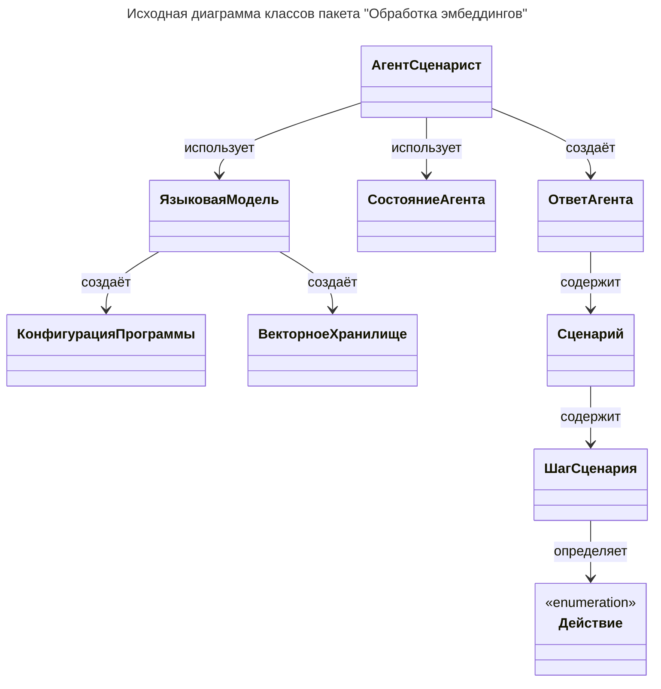

# 1. Исходная диаграмма классов

> **Задача**: Привести диаграмму в соответствие с логикой работы агента-Сценариста и ядра программы.
> Возьми названия классов из `src/agent/*.py`, переведи их на русский язык в нотации "НазваниеКласса".
> Укажи их на диаграмме, их направления связей.
> Каждую связь подпиши одним словом, обозначающим действие исходящего класса по отношению к целевому классу.
> Направление стрелки должно соответствовать направлению взаимодействия: от инициатора действия к его получателю.
> Составь таблицу описания назначений классов, бери описания только из их docstring в коде программы.
> Таблица описания должна содержать все классы и компоненты диаграммы.
> При отсутствии docstring составь описание исключительно на основании фактической реализации класса (добавь сформированное описание в docstring соответствующего класса).
> Не допускается приписывать классу функциональность, не подтверждённую исходным кодом.

## Описание назначений классов

| Класс                 | Соответствующий элемент кода                                                                                                            | Описание                                                   |
| --------------------- | --------------------------------------------------------------------------------------------------------------------------------------- | ---------------------------------------------------------- |
| АгентСценарист        | `ScenarAIstAgent` (`src/agent/agent.py`)                                                                                                | АгентСценарист. Сборщик агента-Сценариста.                 |
| СостояниеАгента       | `AgentState` (`src/agent/tools.py`)                                                                                                     | СостояниеАгента. База данных состояния агента-Сценариста.  |
| ЯзыковаяМодель        | `AgentModelBuilder` (`src/agent/model.py`)                                                                                              | Сборщик LLM и обработчиков эмбеддингов разных провайдеров. |
| ВекторноеХранилище    | `VectoreStoreBuilder` (`src/agent/vec_db.py`)                                                                                           | Сборщик обработчика векторного хранилища.                  |
| КонфигурацияПрограммы | `CompletionConfig` (`src/agent/model.py`) + `EmbeddingConfig` (`src/agent/model.py`) + `CollectionConfig` (`src/agent/vec_db.py`) | Конфигурация работы программы LLM.                         |
| Действие              | `Action` — создаётся динамически в `AgentToolsBuilder.build` (`src/agent/tools.py`) из `datasets/actions.yaml`                          | Стандартное действие персонала над целевым объектом.       |
| ШагСценария           | `Step` (`src/agent/schema.py`)                                                                                                          | ШагСценария                                                |
| Сценарий              | `Scenario` (`src/agent/schema.py`)                                                                                                      | Сценарий                                                   |
| ОтветАгента           | `AgentResponse` (`src/agent/schema.py`)                                                                                                 | ОтветАгента                                                |
