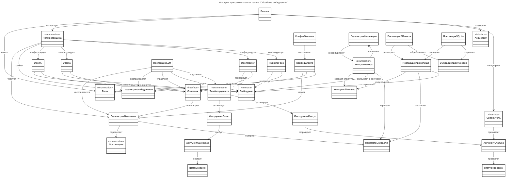

# 1. Исходная диаграмма классов

## Описание исходной диаграммы классов

| Класс    | Описание                                                                                                                                                                                                         |
| -------- | ---------------------------------------------------------------------------------------------------------------------------------------------------------------------------------------------------------------- |
| Менеджер | Координирующий компонент системы. Управляет взаимодействием между интерфейсом пользователя, Конвейером, обработчиком и миссиями. Отвечает за жизненный цикл приложения и распределение задач между компонентами. |
| ...      | ...                                                                                                                                                                                                              |
