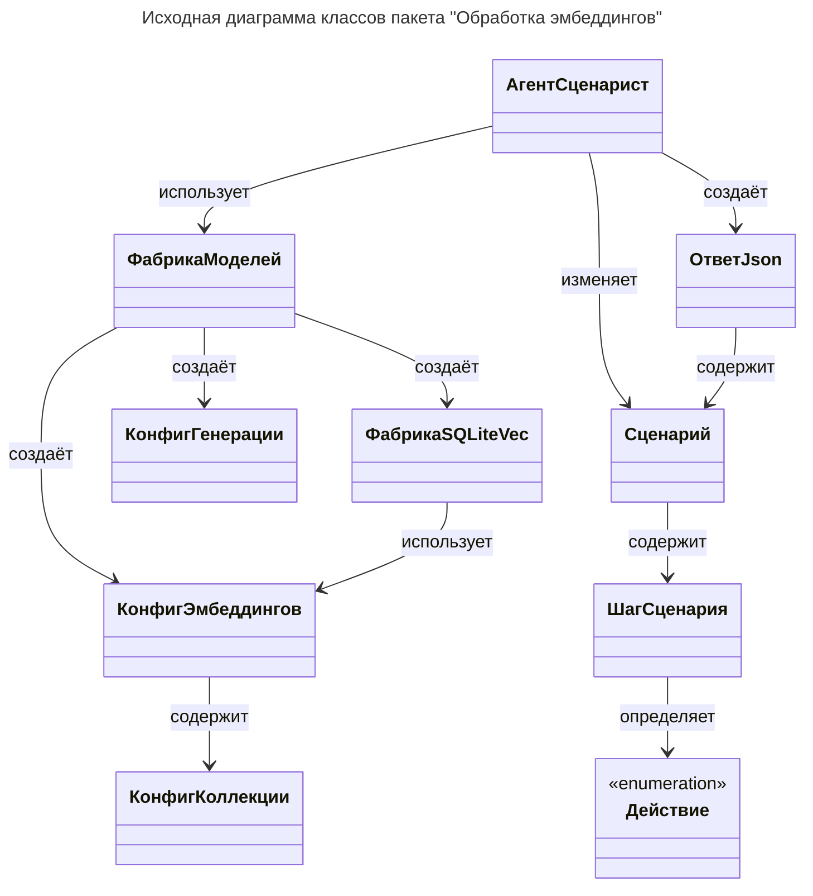

# 1. Исходная диаграмма классов

> **Задача**: Привести диаграмму в соответствие с логикой работы агента-Сценариста и ядра программы.
> Возьми названия классов из `src/agent/*.py`, переведи их на русский язык в нотации "НазваниеКласса".
> Укажи их на диаграмме, их направления связей.
> Каждую связь подпиши одним словом, обозначающим действие исходящего класса по отношению к целевому классу.
> Направление стрелки должно соответствовать направлению взаимодействия: от инициатора действия к его получателю.
> Составь таблицу описания назначений классов, бери описания только из их docstring в коде программы:
>     - Таблица описания должна содержать все классы и компоненты диаграммы.
>     - При отсутствии docstring составь описание исключительно на основании фактической реализации класса.
>     - Добавь сформированное описание в docstring соответствующего класса.
>     - Не допускается приписывать классу функциональность, не подтверждённую исходным кодом.

## Таблица ... / Описание назначений классов

| Класс             | Соответствующий элемент кода              | Описание                                                       |
| ----------------- | ----------------------------------------- | -------------------------------------------------------------- |
| АгентСценарист    | `ScenarAIstAgent` (`src/agent/agent.py`)  | Сборщик агента-Сценариста.                                     |
| ФабрикаМоделей    | `ScenarAIstModelFactory` (`src/agent/model.py`) | Фабрика провайдеров LLM и обработчиков эмбеддингов.       |
| ФабрикаSQLiteVec  | `SQLiteVecFactory` (`src/agent/model.py`) | Фабрика обработчика векторного хранилища базы данных SQLite.   |
| КонфигГенерации   | `CompletionConfig` (`src/agent/config.py`) | Конфигурация модели генерации (LLM-чата).                     |
| КонфигКоллекции   | `CollectionConfig` (`src/agent/config.py`) | Конфигурация одной коллекции документов для векторного поиска. |
| КонфигЭмбеддингов | `EmbeddingConfig` (`src/agent/config.py`) | Конфигурация модели эмбеддингов и векторного хранилища.        |
| Действие          | `Action` (`src/agent/schema.py`)          | Стандартизация Действий персонала производства.                |
| ШагСценария       | `ScenarioStep` (`src/agent/schema.py`)    | Структура Шага в Сценарии.                                     |
| Сценарий          | `Scenario` (`src/agent/schema.py`)        | Структура Сценария.                                            |
| ОтветJson         | `JsonResponse` (`src/agent/schema.py`)    | Структура ответа агента-Сценариста.                            |
