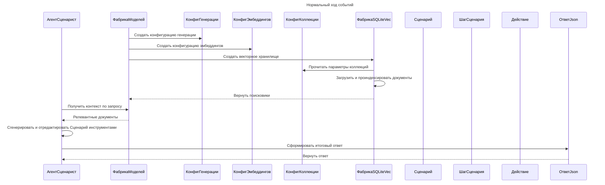
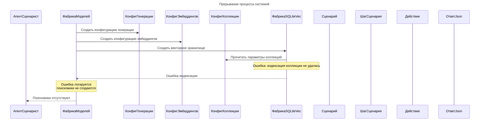
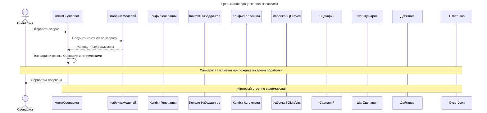

# Диаграмма последовательностей взаимодействия объектов классов пакета

> **Задача**: Привести диаграмму в соответствие с логикой работы агента-Сценариста и ядра программы.
> Возьми готовые названия классов из `diagrammy/Пакет Обработка эмбеддингов/1. Исходная диаграмма классов.md`.
> Должны быть три диаграммы: `Нормальный ход событий`, `Прерывание процесса системой`,`Прерывание процесса пользователем`.
> Все диаграммы одного стиля, они уже прописаны и не нужно их менять.
> На каждой диаграмме должны присутствовать ВСЕ классы из `diagrammy/Пакет Обработка эмбеддингов/1. Исходная диаграмма классов.md`.
> Наличие всех классов на каждой диаграмме не означает обязательного участия каждого класса в каждом взаимодействии.
> Классы, не участвующие в конкретном сценарии, должны присутствовать на диаграмме, но не должны иметь искусственно созданных взаимодействий.
> Подпиши операции исходя из того, что один класс делает с другим классом (не обязательно одним словом).
> Вспомогательные файлы:
>     - `src/agent/*`.

## Нормальный ход событий

## Прерывание процесса системой

## Прерывание процесса пользователем

