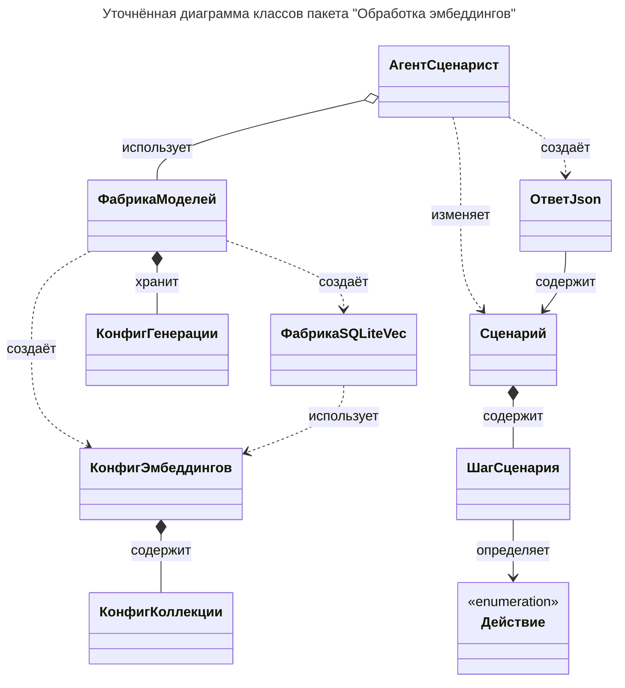

# Уточнённая диаграмма классов

## Обоснование типов отношений

| Связь | Тип | Обоснование по исходному коду |
| --- | --- | --- |
| АгентСценарист — ФабрикаМоделей | Агрегация | Экземпляр `ScenarAIstModelFactory` создаётся вне агента-Сценариста (в `main()`) и передаётся в конструктор `ScenarAIstAgent`, где хранится в поле `_model`. |
| АгентСценарист — ОтветJson | Зависимость | Метод `invoke` создаёт и возвращает `JsonResponse`; объект не хранится в поле агента-Сценариста. |
| АгентСценарист — Сценарий | Зависимость | Сценарий извлекается и изменяется в узлах графа и инструментах (`get_scenario`, `insert_step`, `update_step`, `delete_action`) через состояние графа. |
| ОтветJson — Сценарий | Ассоциация | Поле `scenario: Scenario | None` ссылается на внешний объект, передаваемый при формировании ответа. |
| Сценарий — ШагСценария | Композиция | Поле `steps: list[ScenarioStep]` — список шагов, создаваемых и управляемых самим Сценарием. |
| ШагСценария — Действие | Ассоциация | Поле `action: Action` ссылается на элемент перечисления. |
| ФабрикаМоделей — КонфигГенерации | Композиция | Поле `chat_cfg` создаётся фабрикой из валидации конфигурационного файла и хранится постоянно. |
| ФабрикаМоделей — КонфигЭмбеддингов | Зависимость | `EmbeddingConfig` создаётся в `__init__` локально и не сохраняется в поле. |
| ФабрикаМоделей — ФабрикаSQLiteVec | Зависимость | `SQLiteVecFactory` создаётся локально в `__init__`; сохраняются только его `retrievers`. |
| КонфигЭмбеддингов — КонфигКоллекции | Композиция | Поле `collections: list[CollectionConfig]` — коллекции являются частью конфигурации. |
| ФабрикаSQLiteVec — КонфигЭмбеддингов | Зависимость | `EmbeddingConfig` используется только в конструкторе и не хранится в поле. |
