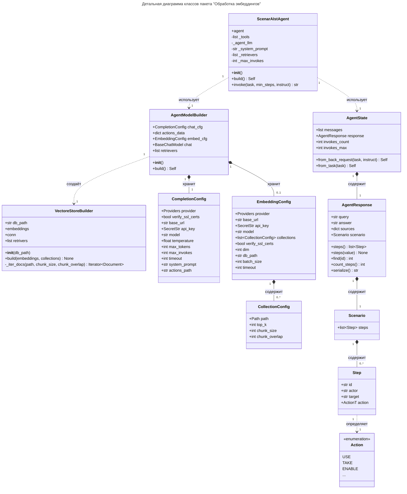

# Детальная диаграмма классов

> **Задача**: Привести диаграмму в соответствие с логикой работы агента-Сценариста и ядра программы.
> Возьми `diagrammy/Пакет Обработка эмбеддингов/3. Уточнённая диаграмма классов.md`.
> Каждому элементу диаграммы должен соответствовать ровно один класс Python из исходного кода программы (исключение: «КонфигурацияПрограммы», он на диаграмме разделяется на классы согласно коду).
> У каждой связи теперь должна быть мощность (кратность).
> Название класса теперь соответвует его оригинальному названию на английском языке из "Описание назначений классов" в `diagrammy/Пакет Обработка эмбеддингов/3. Уточнённая диаграмма классов.md`.
> Не допускается объединение нескольких элементов исходного кода в один элемент диаграммы.
> В конце составь описание класса, его полей и методов.
> Описание полей и методов должно соответствовать конкретным элементам исходного кода.
> Для каждого класса, поля и метода используй соответствующий docstring или комментарий рядом, описывающий назначение метода/переменной.
> Если комментарий отсутствует, ставь в описании `...`.
> Не используй реализацию кода для самостоятельного составления описаний.
> Параметр `self` из методов нужно убрать.
> Класс `Action` - это перечисление, но динамическое. Также не нужно перечислять все его элементы, достаточно первых трёх.
> Вспомогательные файлы: `src/agent/*`.

| Условные обозначения для диаграмм классов | Значение                      |
| ----------------------------------------- | ----------------------------- |
| `+`                                       | public                        |
| `-`                                       | private                       |
| `#`                                       | protected                     |
| `~`                                       | internal                      |
| `<<abstract>>`                            | абстрактный класс             |
| `<<interface>>`                           | интерфейс                     |
| `<<static>>`                              | статический класс             |
| `*`                                       | множество (`0..*` или `1..*`) |
| `1`                                       | ровно один                    |

## Таблица ... / Описание класса «ScenarAIstAgent»

Описание: АгентСценарист. Сборщик агента-Сценариста.

| Название         | Тип    | Видимость | Описание                                          |
| ---------------- | ------ | --------- | ------------------------------------------------- |
| `agent`          |        | `+`       | ...                                               |
| `_tools`         | `list` | `-`       | Инструменты агента.                               |
| `_agent_llm`     |        | `-`       | Агент-Сценарист.                                  |
| `_system_prompt` | `str`  | `-`       | Главные инструкции агента                         |
| `_retrievers`    | `list` | `-`       | Обработчики эмбеддингов документов.               |
| `_max_invokes`   | `int`  | `-`       | Максимальное число вызовов в одном ответе агента. |

| Название   | Параметры                                  | Возвр. знач. | Описание                              |
| ---------- | ------------------------------------------ | ------------ | ------------------------------------- |
| `__init__` | -                                          |              | ...                                   |
| `build`    | -                                          | `Self`       | Сборка LLM-агента.                    |
| `invoke`   | `task: str, min_steps: int, instruct: str` | `str`        | API для отправки запросов LLM-агенту. |

## Таблица ... / Описание класса «AgentState»

Описание: СостояниеАгента. База данных состояния агента-Сценариста.

| Название        | Тип                            | Видимость | Описание                           |
| --------------- | ------------------------------ | --------- | ---------------------------------- |
| `messages`      | `list[AnyMessage]`             | `+`       | История общения с агентом.         |
| `response`      | `AgentResponse`                | `+`       | Ответа агента.                     |
| `invokes_count` | `Annotated[int, operator.add]` | `+`       | Число вызовов агента.              |
| `invokes_max`   | `int`                          | `+`       | Максимальное число вызовов агента. |

| Название            | Параметры                  | Возвр. знач. | Описание                           |
| ------------------- | -------------------------- | ------------ | ---------------------------------- |
| `from_back_request` | `task: str, instruct: str` | `Self`       | Создать из существующего Сценария. |
| `from_task`         | `task: str`                | `Self`       | ...                                |

## Таблица ... / Описание класса «AgentModelBuilder»

Описание: Сборщик LLM и обработчиков эмбеддингов разных провайдеров.

| Название       | Тип                | Видимость | Описание |
| -------------- | ------------------ | --------- | -------- |
| `chat_cfg`     | `CompletionConfig` | `+`       | ...      |
| `actions_data` | `dict[str, str]`   | `+`       | ...      |
| `embed_cfg`    | `EmbeddingConfig`  | `+`       | ...      |
| `chat`         | `BaseChatModel`    | `+`       | ...      |
| `retrievers`   | `list`             | `+`       | ...      |

| Название   | Параметры | Возвр. знач. | Описание |
| ---------- | --------- | ------------ | -------- |
| `__init__` | -         |              | ...      |
| `build`    | -         | `Self`       | ...      |

## Таблица ... / Описание класса «VectoreStoreBuilder»

Описание: Сборщик обработчика векторного хранилища.

| Название     | Тип    | Видимость | Описание |
| ------------ | ------ | --------- | -------- |
| `db_path`    | `str`  | `+`       | ...      |
| `embeddings` |        | `+`       | ...      |
| `conn`       |        | `+`       | ...      |
| `retrivers`  | `list` | `+`       | ...      |

| Название     | Параметры                                                     | Возвр. знач.         | Описание                                     |
| ------------ | ------------------------------------------------------------- | -------------------- | -------------------------------------------- |
| `__init__`   | `db_path: str`                                                |                      | ...                                          |
| `build`      | `embeddings: Embeddings, collections: list[CollectionConfig]` | `None`               | ...                                          |
| `_iter_docs` | `path: Path, chunk_size: int, chunk_overlap: int`             | `Iterator[Document]` | Загрузить документы из указанной директории. |

## Таблица ... / Описание класса «CompletionConfig»

Описание: Конфигурация модели генерации (LLM-чата).

| Название           | Тип         | Видимость | Описание                                            |
| ------------------ | ----------- | --------- | --------------------------------------------------- |
| `provider`         | `Providers` | `+`       | Провайдер LLM.                                      |
| `verify_ssl_certs` | `bool`      | `+`       | Проверять ли SSL-сертификаты.                       |
| `base_url`         | `str`       | `+`       | Путь API провайдера.                                |
| `api_key`          | `SecretStr` | `+`       | Ключ API провайдера.                                |
| `model`            | `str`       | `+`       | Название модели чата.                               |
| `temperature`      | `float`     | `+`       | Температура выборки токенов (0..1).                 |
| `max_tokens`       | `int`       | `+`       | Максимальное число токенов в одном ответе агента.   |
| `max_invokes`      | `int`       | `+`       | Максимальное число вызовов в одном ответе агента.   |
| `timeout`          | `int`       | `+`       | Время ожидания ответа от запроса к API, в секундах. |
| `system_prompt`    | `str`       | `+`       | Системный промпт.                                   |
| `actions_path`     | `str`       | `+`       | Путь к Действиям персонала.                         |

## Таблица ... / Описание класса «CollectionConfig»

Описание: Конфигурация одной коллекции документов для векторного поиска.

| Название        | Тип    | Видимость | Описание                                    |
| --------------- | ------ | --------- | ------------------------------------------- |
| `path`          | `Path` | `+`       | Путь к папке с документами коллекции.       |
| `top_k`         | `int`  | `+`       | Сколько наиболее близких чанков возвращать. |
| `chunk_size`    | `int`  | `+`       | Размер чанка (в символах).                  |
| `chunk_overlap` | `int`  | `+`       | Перекрытие чанков для сохранения контекста. |

## Таблица ... / Описание класса «EmbeddingConfig»

Описание: Конфигурация LLM-эмбеддингов и векторного хранилища.

| Название           | Тип                      | Видимость | Описание                                            |
| ------------------ | ------------------------ | --------- | --------------------------------------------------- |
| `provider`         | `Providers`              | `+`       | Провайдер эмбеддингов.                              |
| `base_url`         | `str`                    | `+`       | Путь API провайдера LLM-эмбеддингов.                |
| `api_key`          | `SecretStr`              | `+`       | Ключ API провайдера эмбеддингов.                    |
| `model`            | `str`                    | `+`       | Название LLM-эмбеддингов.                           |
| `collections`      | `list[CollectionConfig]` | `+`       | Список путей к папкам.                              |
| `verify_ssl_certs` | `bool`                   | `+`       | Проверять ли SSL-сертификаты.                       |
| `dim`              | `int`                    | `+`       | Размерность вектора эмбеддинга.                     |
| `db_path`          | `str`                    | `+`       | Путь к файлу векторной базы данных.                 |
| `batch_size`       | `int`                    | `+`       | Сколько документов обрабатывается за один запрос.   |
| `timeout`          | `int`                    | `+`       | Время ожидания ответа от запроса к API, в секундах. |

## Таблица ... / Описание класса «Action»

Описание: Стандартизация Действий персонала производства.

| Значение  | Описание           |
| --------- | ------------------ |
| `USE`     | `"Использовать"`   |
| `TAKE`    | `"Взять"`          |
| `ENABLE`  | `"Включить"`       |
| `DISABLE` | `"Выключить"`      |
| `PUSH`    | `"Нажать"`         |
| `PLUG_IN` | `"Воткнуть"`       |
| `PULL`    | `"Потянуть"`       |
| `SWIPE`   | `"Провести"`       |
| `START`   | `"Запустить"`      |
| `STOP`    | `"Остановить"`     |
| `PUT`     | `"Положить"`       |
| `UNPLUG`  | `"Вытащить"`       |
| `ROTATE`  | `"Повернуть"`      |
| `OPEN`    | `"Открыть"`        |
| `CLOSE`   | `"Закрыть"`        |
| `CHECK`   | `"Проверить"`      |
| `INSPECT` | `"Осмотреть"`      |
| `CLEAN`   | `"Очистить"`       |
| `ADJUST`  | `"Отрегулировать"` |
| `INSTALL` | `"Установить"`     |
| `REMOVE`  | `"Снять"`          |
| `WAIT`    | `"Подождать"`      |
| `SCAN`    | `"Отсканировать"`  |
| `CONFIRM` | `"Подтвердить"`    |

## Таблица ... / Описание класса «Step»

Описание: ШагСценария

| Название | Тип       | Видимость | Описание                                                            |
| -------- | --------- | --------- | ------------------------------------------------------------------- |
| `id`     | `str`     | `+`       | Уникальный идентификатор шага.                                      |
| `actor`  | `str`     | `+`       | Название/UID персонала.                                             |
| `target` | `str`     | `+`       | Название/UID составной части целевого объекта.                      |
| `action` | `ActionT` | `+`       | Стандартное действие персонала над целевым объектом или его частью. |

## Таблица ... / Описание класса «Scenario»

Описание: Сценарий

| Название | Тип          | Видимость | Описание               |
| -------- | ------------ | --------- | ---------------------- |
| `steps`  | `list[Step]` | `+`       | Массив Шагов Сценария. |

## Таблица ... / Описание класса «AgentResponse»

Описание: ОтветАгента

| Название   | Тип                         | Видимость | Описание                     |
| ---------- | --------------------------- | --------- | ---------------------------- |
| `query`    | `str`                       | `+`       | Исходный запрос агенту.      |
| `answer`   | `str`                       | `+`       | Сообщение от агента.         |
| `sources`  | `dict[int, dict[str, str]]` | `+`       | Источники данных.            |
| `scenario` | `Scenario`                  | `+`       | Итоговый Сценарий от агента. |

| Название      | Параметры           | Возвр. знач.  | Описание                                       |
| ------------- | ------------------- | ------------- | ---------------------------------------------- |
| `steps` (get) | -                   | `list[Step]`  | Вернуть список Шагов из Сценария.              |
| `steps` (set) | `value: list[Step]` | `None`        | Перезаписать Шаги.                             |
| `find`        | `id: str`           | `int \| None` | Вернуть Шаг по его ID.                         |
| `count_steps` | -                   | `int`         | Вернуть число Шагов в Сценарии.                |
| `serialize`   | -                   | `str`         | Вернуть Сценарий с порядковыми номерами Шагов. |
