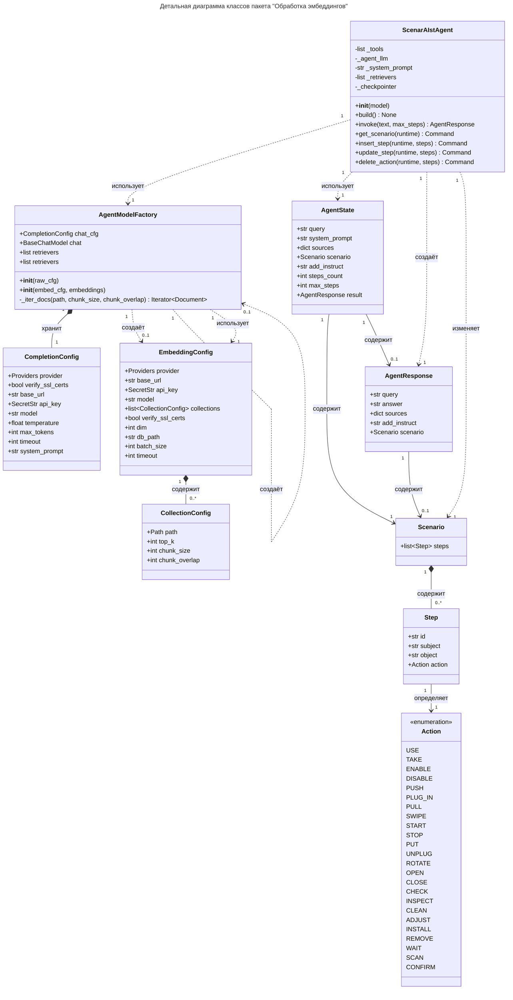

# Детальная диаграмма классов

> **Задача**: Привести диаграмму в соответствие с логикой работы агента-Сценариста и ядра программы.
> Возьми `diagrammy/Пакет Обработка эмбеддингов/3. Уточнённая диаграмма классов.md`.
> Каждому элементу диаграммы должен соответствовать ровно один класс Python из исходного кода программы.
> У каждой связи теперь должна быть мощность (кратность).
> Название класса теперь соответвует его оригинальному названию на английском языке из "Описание назначений классов" в `diagrammy/Пакет Обработка эмбеддингов/3. Уточнённая диаграмма классов.md`.
> Не допускается объединение нескольких элементов исходного кода в один элемент диаграммы.
> В конце составь описание класса, его полей и методов.
> Описание полей и методов должно соответствовать конкретным элементам исходного кода.
> Для каждого класса, поля и метода используй соответствующий docstring или комментарий рядом, описывающий назначение метода/переменной.
> Если комментарий отсутствует, ставь в описании `...`.
> Не используй реализацию кода для самостоятельного составления описаний.
> Параметр `self` из методов нужно убрать.
> Вспомогательные файлы: `src/agent/*`.

| Условные обозначения для диаграмм классов | Значение                      |
| ----------------------------------------- | ----------------------------- |
| `+`                                       | public                        |
| `-`                                       | private                       |
| `#`                                       | protected                     |
| `~`                                       | internal                      |
| `<<abstract>>`                            | абстрактный класс             |
| `<<interface>>`                           | интерфейс                     |
| `<<static>>`                              | статический класс             |
| `*`                                       | множество (`0..*` или `1..*`) |
| `1`                                       | ровно один                    |

## Таблица ... / Описание класса «ScenarAIstAgent»

Описание: Сборщик агента-Сценариста.

| Название         | Тип    | Видимость | Описание |
| ---------------- | ------ | --------- | -------- |
| `_tools`         | `list` | `-`       | ...      |
| `_agent_llm`     |        | `-`       | ...      |
| `_system_prompt` | `str`  | `-`       | ...      |
| `_retrievers`    | `list` | `-`       | ...      |
| `_checkpointer`  |        | `-`       | ...      |

| Название        | Параметры                   | Возвр. знач.    | Описание                                                                     |
| --------------- | --------------------------- | --------------- | ---------------------------------------------------------------------------- |
| `__init__`      | `model: AgentModelFactory`  |                 | ...                                                                          |
| `build`         | -                           | `None`          | Сборка LLM-агента.                                                           |
| `invoke`        | `text: str, max_steps: int` | `AgentResponse` | API для отправки запросов LLM-агенту.                                        |
| `get_scenario`  | `runtime`                   | `Command`       | Получить текущее актуальное состояние Сценария с порядковыми номерами шагов. |
| `insert_step`   | `runtime, steps`            | `Command`       | Добавить Шаги в Сценарий после указанных id Шагов.                           |
| `update_step`   | `runtime, steps`            | `Command`       | Изменить существующие Шаги Сценария.                                         |
| `delete_action` | `runtime, steps`            | `Command`       | Удалить Шаги из Сценария по их ids.                                          |

## Таблица ... / Описание класса «AgentState»

Описание: Состояние агента-Сценариста.

| Название        | Тип                            | Видимость | Описание |
| --------------- | ------------------------------ | --------- | -------- |
| `query`         | `str`                          | `+`       | ...      |
| `system_prompt` | `str`                          | `+`       | ...      |
| `sources`       | `dict[int, dict[str, str]]`    | `+`       | ...      |
| `scenario`      | `Scenario`                     | `+`       | ...      |
| `add_instruct`  | `str`                          | `+`       | ...      |
| `steps_count`   | `Annotated[int, operator.add]` | `+`       | ...      |
| `max_steps`     | `int`                          | `+`       | ...      |
| `result`        | `AgentResponse`                | `+`       | ...      |

## Таблица ... / Описание класса «AgentModelFactory»

Описание: Фабрика провайдеров LLM и обработчиков эмбеддингов.

| Название     | Тип                | Видимость | Описание |
| ------------ | ------------------ | --------- | -------- |
| `chat_cfg`   | `CompletionConfig` | `+`       | ...      |
| `chat`       | `BaseChatModel`    | `+`       | ...      |
| `retrievers` | `list`             | `+`       | ...      |

| Название   | Параметры | Возвр. знач. | Описание |
| ---------- | --------- | ------------ | -------- |
| `__init__` | `raw_cfg` |              | ...      |

## Таблица ... / Описание класса «AgentModelFactory»

Описание: Фабрика обработчика векторного хранилища базы данных SQLite.

| Название     | Тип    | Видимость | Описание |
| ------------ | ------ | --------- | -------- |
| `retrievers` | `list` | `+`       | ...      |

| Название     | Параметры                         | Возвр. знач.         | Описание                                            |
| ------------ | --------------------------------- | -------------------- | --------------------------------------------------- |
| `__init__`   | `embed_cfg, embeddings`           |                      | ...                                                 |
| `_iter_docs` | `path, chunk_size, chunk_overlap` | `Iterator[Document]` | Загрузить чанки документов из указанной директории. |

## Таблица ... / Описание класса «CompletionConfig»

Описание: Конфигурация модели генерации (LLM-чата).

| Название           | Тип         | Видимость | Описание                                            |
| ------------------ | ----------- | --------- | --------------------------------------------------- |
| `provider`         | `Providers` | `+`       | Провайдер LLM.                                      |
| `verify_ssl_certs` | `bool`      | `+`       | Проверять ли SSL-сертификаты.                       |
| `base_url`         | `str`       | `+`       | Путь API провайдера.                                |
| `api_key`          | `SecretStr` | `+`       | Ключ API провайдера.                                |
| `model`            | `str`       | `+`       | Название модели чата.                               |
| `temperature`      | `float`     | `+`       | Температура выборки токенов (0..1).                 |
| `max_tokens`       | `int`       | `+`       | Максимальное число токенов в одном ответе модели.   |
| `timeout`          | `int`       | `+`       | Время ожидания ответа от запроса к API, в секундах. |
| `system_prompt`    | `str`       | `+`       | Системный промпт.                                   |

## Таблица ... / Описание класса «CollectionConfig»

Описание: Конфигурация одной коллекции документов для векторного поиска.

| Название        | Тип    | Видимость | Описание                                    |
| --------------- | ------ | --------- | ------------------------------------------- |
| `path`          | `Path` | `+`       | Путь к папке с документами коллекции.       |
| `top_k`         | `int`  | `+`       | Сколько наиболее близких чанков возвращать. |
| `chunk_size`    | `int`  | `+`       | Размер чанка (в символах).                  |
| `chunk_overlap` | `int`  | `+`       | Перекрытие чанков для сохранения контекста. |

## Таблица ... / Описание класса «EmbeddingConfig»

Описание: Конфигурация LLM-эмбеддингов и векторного хранилища.

| Название           | Тип                      | Видимость | Описание                                            |
| ------------------ | ------------------------ | --------- | --------------------------------------------------- |
| `provider`         | `Providers`              | `+`       | Провайдер эмбеддингов.                              |
| `base_url`         | `str`                    | `+`       | Путь API провайдера LLM-эмбеддингов.                |
| `api_key`          | `SecretStr`              | `+`       | Ключ API провайдера эмбеддингов.                    |
| `model`            | `str`                    | `+`       | Название LLM-эмбеддингов.                           |
| `collections`      | `list[CollectionConfig]` | `+`       | Список путей к папкам.                              |
| `verify_ssl_certs` | `bool`                   | `+`       | Проверять ли SSL-сертификаты.                       |
| `dim`              | `int`                    | `+`       | Размерность вектора эмбеддинга.                     |
| `db_path`          | `str`                    | `+`       | Путь к файлу векторной базы данных.                 |
| `batch_size`       | `int`                    | `+`       | Сколько документов обрабатывается за один запрос.   |
| `timeout`          | `int`                    | `+`       | Время ожидания ответа от запроса к API, в секундах. |

## Таблица ... / Описание класса «Action»

Описание: Стандартизация Действий персонала производства.

| Значение  | Описание           |
| --------- | ------------------ |
| `USE`     | `"Использовать"`   |
| `TAKE`    | `"Взять"`          |
| `ENABLE`  | `"Включить"`       |
| `DISABLE` | `"Выключить"`      |
| `PUSH`    | `"Нажать"`         |
| `PLUG_IN` | `"Воткнуть"`       |
| `PULL`    | `"Потянуть"`       |
| `SWIPE`   | `"Провести"`       |
| `START`   | `"Запустить"`      |
| `STOP`    | `"Остановить"`     |
| `PUT`     | `"Положить"`       |
| `UNPLUG`  | `"Вытащить"`       |
| `ROTATE`  | `"Повернуть"`      |
| `OPEN`    | `"Открыть"`        |
| `CLOSE`   | `"Закрыть"`        |
| `CHECK`   | `"Проверить"`      |
| `INSPECT` | `"Осмотреть"`      |
| `CLEAN`   | `"Очистить"`       |
| `ADJUST`  | `"Отрегулировать"` |
| `INSTALL` | `"Установить"`     |
| `REMOVE`  | `"Снять"`          |
| `WAIT`    | `"Подождать"`      |
| `SCAN`    | `"Отсканировать"`  |
| `CONFIRM` | `"Подтвердить"`    |

## Таблица ... / Описание класса «Step»

Описание: Структура Шага в Сценарии.

| Название  | Тип      | Видимость | Описание                        |
| --------- | -------- | --------- | ------------------------------- |
| `id`      | `str`    | `+`       | Уникальный идентификатор шага.  |
| `subject` | `str`    | `+`       | Название/UID Субъекта.          |
| `object`  | `str`    | `+`       | Название/UID Объекта.           |
| `action`  | `Action` | `+`       | Действие Субъекта над Объектом. |

## Таблица ... / Описание класса «Scenario»

Описание: Структура итогового Сценария.

| Название | Тип          | Видимость | Описание               |
| -------- | ------------ | --------- | ---------------------- |
| `steps`  | `list[Step]` | `+`       | Массив Шагов Сценария. |

## Таблица ... / Описание класса «AgentResponse»

Описание: Структура ответа агента-Сценариста.

| Название       | Тип                         | Видимость | Описание                                             |
| -------------- | --------------------------- | --------- | ---------------------------------------------------- |
| `query`        | `str`                       | `+`       | Исходный запрос Сценариста.                          |
| `answer`       | `str`                       | `+`       | Необязательные пояснения.                            |
| `sources`      | `dict[int, dict[str, str]]` | `+`       | Источники данных.                                    |
| `add_instruct` | `str`                       | `+`       | Дополнительные инструкции, установленные для ответа. |
| `scenario`     | `Scenario`                  | `+`       | Итоговый Сценарий от LLM-агента.                     |
