# Детальная диаграмма классов

```mermaid
---
title: Детальная диаграмма классов пакета "Обработка эмбеддингов"
---
%%{init: {
  'theme': 'base',
  'themeVariables': {
    'primaryColor': '#fff',
    'primaryBorderColor': '#000',
    'fontSize': '16px',
    'activationBorderColor': '#000'
  }
}}%%
classDiagram
    %% Configuration
    class CrewConfig {
        +crew Vec~AgentConfig~
        +from_yaml(path) Result~Self~
    }

    class AgentConfig {
        +role CrewRole
        +completion CompletionParams
        +embedding Option~EmbeddingParams~
    }

    class CrewRole {
        <<enumeration>>
        Assistant
        Validator
    }

    class ProviderKind {
        <<enumeration>>
        OpenAI
        OpenRouter
        Ollama
        HuggingFace
    }

    class CompletionParams {
        +provider ProviderKind
        +params ModelParams
        +temperature f64
        +max_tokens u64
        +tools Vec~ToolKind~
        +system_prompt String
    }

    class EmbeddingParams {
        +provider ProviderKind
        +params ModelParams
        +dim usize
        +collections Vec~CollectionParams~
    }

    class ModelParams {
        +model String
        +api_key String
        +base_url String
    }

    class CollectionParams {
        +name String
        +top_k usize
        +path String
        +storage StorageKind
        +destination Option~String~
        +chunk_size usize
        +chunk_overlap usize
    }

    class StorageKind {
        <<enumeration>>
        Sqlite
        InMemory
    }

    %% Storage & Embeddings
    class VectorStoreIndexDyn {
        <<interface>>
        +top_n(req) WasmBoxedFuture~...~
        +top_n_ids(req) WasmBoxedFuture~...~
    }

    class AnyVectorIndex {
        +new(index) Self
        +top_n(req) WasmBoxedFuture~...~
        +top_n_ids(req) WasmBoxedFuture~...~
    }

    class EmbedDocs {
        +id Uuid
        +file_path String
        +context_chunk String
        +new(model, path, chunk_size, chunk_overlap) Result~Vec~(Self, OneOrMany~Embedding~)~
        -load_from(path) Result~Vec~(PathBuf, String)~
        -from_utf8_file(path, extention) Result~Vec~(PathBuf, String)~
        -from_pdf(path) Result~Vec~(PathBuf, String)~
    }

    %% Storage Providers
    class StorageProvider {
        <<interface>>
        +reindex(provider, params, dim, name, destination, path, chunk_size, chunk_overlap) Result~AnyVectorIndex~
        +index(provider, params, dim, name, destination) Result~AnyVectorIndex~
        +exists(destination, name) Result~bool~
    }

    class InMemoryProvider {
        <<struct>>
        +reindex(...) Result~AnyVectorIndex~
        +index(...) Result~AnyVectorIndex~
        +exists(...) Result~bool~
    }

    class SqliteProvider {
        <<struct>>
        +reindex(...) Result~AnyVectorIndex~
        +index(...) Result~AnyVectorIndex~
        +exists(...) Result~bool~
    }

    %% Tools
    class AnswerTool {
        <<struct>>
        +definition(prompt) ToolDefinition
        +call(args) Result~AnswerArgs~
    }

    class StatusTool {
        <<struct>>
        +definition(prompt) ToolDefinition
        +call(args) Result~StatusArgs~
    }

     class StatusArgs {
        +status ValidationStatus
        +reason String
    }

    class ValidationStatus {
        <<enumeration>>
        Ok
        NotOk
    }

    class ToolKind {
        <<enumeration>>
        Adder
        Answer
        Status
    }

    class AnswerArgs {
        +topic String
        +message String
        +steps Vec~AnswerStep~
        +file_paths Vec~String~
    }

    class AnswerStep {
        +order i32
        +action String
        +tag u8
    }

    %% Providers (implement AnyCompletion and AnyEmbedding)
    class OpenAI {
        <<struct>>
        +client_completion(api_key, base_url) Result~Client~
        +embedding_model(params, dim) Result~Model~
    }

    class Ollama {
        <<struct>>
        +client_completion(api_key, base_url) Result~Client~
        +embedding_model(params, dim) Result~Model~
    }

    class OpenRouter {
        <<struct>>
        +client_completion(api_key, base_url) Result~Client~
        +embedding_model(params, dim) Result~Model~
    }

    class HuggingFace {
        <<struct>>
        +client_completion(api_key, base_url) Result~Client~
        +embedding_model(params, dim) Result~Model~
    }

    %% Agents
    class AnyProviderAgent {
        <<enumeration>>
        OpenRouter(ProviderAgent~...~)
        Ollama(ProviderAgent~...~)
        OpenAI(ProviderAgent~...~)
        HuggingFace(ProviderAgent~...~)
        +prompt(prompt) Result~String~
        +from_config(completion, embedding) Result~Self~
    }

    class ProviderAgent {
        +prompt(text) Result~String~
        +new(completion, provider) Result~Self~
        +new_with_index(completion, embedding, provider_completion, provider_embedding) Result~Self~
    }

    %% Interfaces
    class AnyCompletion {
        <<interface>>
        +client_completion(api_key, base_url) Result~Client~
        +builder(params) Result~AgentBuilder~Model~~
    }

    class AnyEmbedding {
        <<interface>>
        +embedding_model(params, dim) Result~Model~
    }

    class Assistant {
        <<interface>>
        +prompt(prompt) Result~String~
    }

    class Validator {
        <<interface>>
        +validate(input, rules) Result~StatusArgs~
    }

    %% Main Entry Point
    class FunnyCrew {
        +crew Vec~(CrewRole, AnyProviderAgent)~
        +new(config_path) Result~Self~
        -get_agent(role) Result~&AnyProviderAgent~
        +prompt(prompt) Result~String~
        +validate(input, rules) Result~StatusArgs~
    }

    %% Relations
    CrewConfig "1" *-- "*" AgentConfig
    AgentConfig "1" --> "1" CompletionParams
    AgentConfig "1" --> "0..1" EmbeddingParams
    CompletionParams "1" --> "1" ModelParams
    CompletionParams "1" --> "1" ProviderKind
    CompletionParams "1" --> "*" ToolKind
    EmbeddingParams "1" --> "1" ModelParams
    EmbeddingParams "1" --> "1" ProviderKind
    EmbeddingParams "1" *-- "*" CollectionParams
    CollectionParams "1" --> "1" StorageKind

    StorageKind "1" --> "*" StorageProvider
    InMemoryProvider ..|> StorageProvider : implements
    SqliteProvider ..|> StorageProvider : implements

    EmbedDocs ..> AnyEmbedding : uses
    EmbedDocs ..> InMemoryProvider : uses
    EmbedDocs ..> SqliteProvider : uses

    ToolKind "1" --> "*" AnswerTool
    ToolKind "1" --> "*" StatusTool
    AnswerTool "1" --> "1" AnswerArgs
    AnswerArgs "1" *-- "*" AnswerStep
    StatusTool "1" --> "1" StatusArgs
    StatusArgs "1" --> "1" ValidationStatus

    AnyVectorIndex ..|> VectorStoreIndexDyn : implements

    AnyProviderAgent "1" --> "*" ProviderAgent
    ProviderAgent "1" --> "1" AnyCompletion
    ProviderAgent "1" --> "0..1" AnyVectorIndex

    OpenAI ..|> AnyCompletion : implements
    OpenAI ..|> AnyEmbedding : implements
    Ollama ..|> AnyCompletion : implements
    Ollama ..|> AnyEmbedding : implements
    OpenRouter ..|> AnyCompletion : implements
    OpenRouter ..|> AnyEmbedding : implements
    HuggingFace ..|> AnyCompletion : implements
    HuggingFace ..|> AnyEmbedding : implements

    FunnyCrew "1" *-- "*" AnyProviderAgent
    FunnyCrew ..|> Assistant : implements
    FunnyCrew ..|> Validator : implements
    FunnyCrew "1" --> "1" CrewConfig
    FunnyCrew "1" *-- "*" CrewRole
```

## Таблица ... / Описание полей класса «CrewConfig»

| Название | Тип              | Описание                     |
| -------- | ---------------- | ---------------------------- |
| crew     | Vec~AgentConfig~ | Вектор конфигураций агентов. |

## Таблица ... / Описание методов класса «CrewConfig»

| Название  | Параметры  | Возвр. знач. | Описание                              |
| --------- | ---------- | ------------ | ------------------------------------- |
| from_yaml | path: &str | Result~Self~ | Загрузить конфигурацию из YAML-файла. |

## Таблица ... / Описание полей класса «AgentConfig»

| Название   | Тип                     | Описание                            |
| ---------- | ----------------------- | ----------------------------------- |
| role       | CrewRole                | Роль агента (Assistant/Validator).  |
| completion | CompletionParams        | Параметры завершения (completion).  |
| embedding  | Option~EmbeddingParams~ | Опциональные параметры эмбеддингов. |

## Таблица ... / Описание полей класса «CompletionParams»

| Название      | Тип           | Описание                                          |
| ------------- | ------------- | ------------------------------------------------- |
| provider      | ProviderKind  | Провайдер LLM (OpenAI, Ollama и т.д.).            |
| params        | ModelParams   | Параметры модели (модель, API-ключ, базовый URL). |
| temperature   | f64           | Температура генерации (случайность).              |
| max_tokens    | u64           | Максимальное количество токенов в ответе.         |
| tools         | Vec~ToolKind~ | Список инструментов, доступных агенту.            |
| system_prompt | String        | Системный промпт для модели.                      |

## Таблица ... / Описание полей класса «EmbeddingParams»

| Название    | Тип                   | Описание                             |
| ----------- | --------------------- | ------------------------------------ |
| provider    | ProviderKind          | Провайдер эмбеддингов.               |
| params      | ModelParams           | Параметры модели эмбеддингов.        |
| dim         | usize                 | Размерность вектора эмбеддингов.     |
| collections | Vec~CollectionParams~ | Коллекции документов для индексации. |

## Таблица ... / Описание полей класса «ModelParams»

| Название | Тип    | Описание                        |
| -------- | ------ | ------------------------------- |
| model    | String | Идентификатор модели.           |
| api_key  | String | Ключ API для доступа к сервису. |
| base_url | String | Базовый URL API.                |

## Таблица ... / Описание полей класса «CollectionParams»

| Название      | Тип            | Описание                                    |
| ------------- | -------------- | ------------------------------------------- |
| name          | String         | Имя коллекции.                              |
| top_k         | usize          | Количество ближайших документов для поиска. |
| path          | String         | Путь к документам для индексации.           |
| storage       | StorageKind    | Тип хранилища (Sqlite/InMemory).            |
| destination   | Option~String~ | Путь к файлу хранилища (опционально).       |
| chunk_size    | usize          | Размер чанка для разбиения текста.          |
| chunk_overlap | usize          | Перекрытие чанков.                          |
