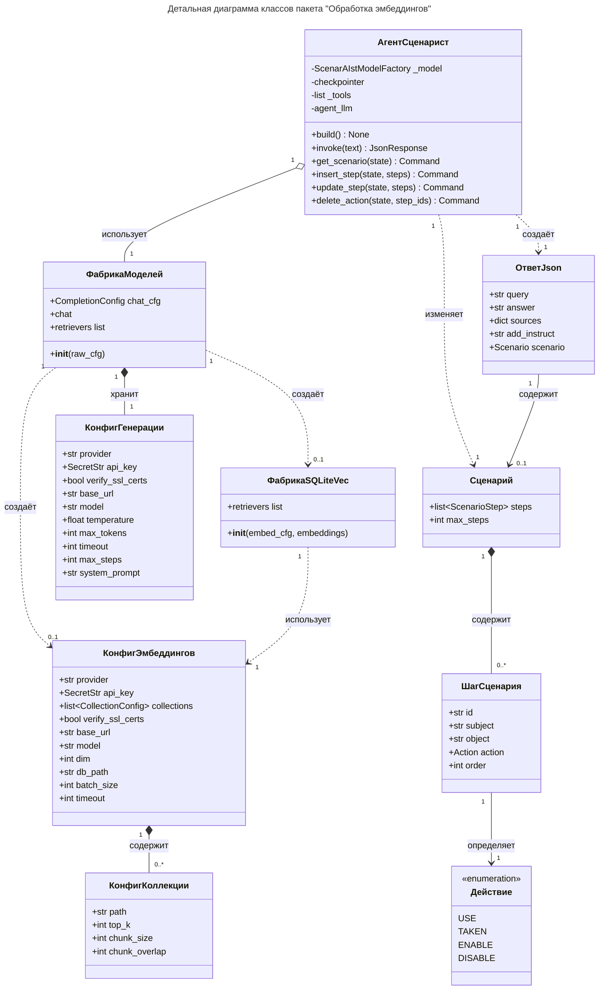

# Детальная диаграмма классов

> **Задача**: Привести диаграмму в соответствие с логикой работы агента-Сценариста и ядра программы.
> Возьми `diagrammy/Пакет Обработка эмбеддингов/3. Уточнённая диаграмма классов.md`.
> Каждому элементу диаграммы должен соответствовать ровно один класс Python из исходного кода программы.
> У каждой связи теперь должна быть мощность (кратность).
> Название класса теперь соответвует его оригинальному названию на английском языке из "Описание назначений классов" в `diagrammy/Пакет Обработка эмбеддингов/3. Уточнённая диаграмма классов.md`.
> Не допускается объединение нескольких элементов исходного кода в один элемент диаграммы.
> В конце составь описание класса, его полей и методов.
> Описание полей и методов должно соответствовать конкретным элементам исходного кода.
> Для каждого класса, поля и метода используй соответствующий docstring.
> Если docstring отсутствует, ставь в описании `...`.
> Не используй реализацию кода для самостоятельного составления описаний.
> Вспомогательные файлы:
>     - `src/agent/*`.

| Условные обозначения для диаграмм классов | Значение                      |
| ----------------------------------------- | ----------------------------- |
| `+`                                       | public                        |
| `-`                                       | private                       |
| `#`                                       | protected                     |
| `~`                                       | internal                      |
| `<<abstract>>`                            | абстрактный класс             |
| `<<interface>>`                           | интерфейс                     |
| `<<static>>`                              | статический класс             |
| `*`                                       | множество (`0..*` или `1..*`) |
| `0..1`                                    | ноль или один                 |
| `1`                                       | ровно один                    |

## Таблица ... / Описание класса «АгентСценарист»

Описание: Сборщик агента-Сценариста.

| Название        | Тип                      | Видимость | Описание |
| --------------- | ------------------------ | --------- | -------- |
| `_model`        | `ScenarAIstModelFactory` | `-`       | ...      |
| `_checkpointer` |                          | `-`       | ...      |
| `_tools`        | `list`                   | `-`       | ...      |
| `_agent_llm`    |                          | `-`       | ...      |

| Название        | Параметры                    | Возвр. знач. | Описание                                                         |
| --------------- | ---------------------------- | ------------ | ---------------------------------------------------------------- |
| `__init__`      | `model: ScenarAIstModelFactory` |           | ...                                                              |
| `build`         | -                            | `None`       | Сборка LLM-агента.                                               |
| `invoke`        | `text: str`                  | `JsonResponse` | Метод-обёртка (API) для отправки запросов LLM-агенту.          |
| `get_scenario`  | `state`                      | `Command`    | Возвращает текущий Сценарий целиком с актуальными порядковыми номерами. |
| `insert_step`   | `state, steps`               | `Command`    | Добавляет Шаги в Сценарий после указанных id Шагов.              |
| `update_step`   | `state, steps`               | `Command`    | Изменяет существующие Шаги Сценария.                             |
| `delete_action` | `state, step_ids`            | `Command`    | Удаляет Шаги из Сценария.                                        |

## Таблица ... / Описание класса «ФабрикаМоделей»

Описание: Фабрика провайдеров LLM и обработчиков эмбеддингов.

| Название     | Тип                | Видимость | Описание |
| ------------ | ------------------ | --------- | -------- |
| `chat_cfg`   | `CompletionConfig` | `+`       | ...      |
| `chat`       |                    | `+`       | ...      |
| `retrievers` | `list`             | `+`       | ...      |

| Название  | Параметы   | Возвр. знач. | Описание |
| --------- | ---------- | ------------ | -------- |
| `__init__`| `raw_cfg`  |              | ...      |

## Таблица ... / Описание класса «ФабрикаSQLiteVec»

Описание: Фабрика обработчика векторного хранилища базы данных SQLite.

| Название     | Тип    | Видимость | Описание |
| ------------ | ------ | --------- | -------- |
| `retrievers` | `list` | `+`       | ...      |

| Название   | Параметы                  | Возвр. знач. | Описание |
| ---------- | ------------------------- | ------------ | -------- |
| `__init__` | `embed_cfg, embeddings`   |              | ...      |

## Таблица ... / Описание класса «КонфигГенерации»

Описание: Конфигурация модели генерации (LLM-чата).

| Название          | Тип         | Описание                                        |
| ----------------- | ----------- | ----------------------------------------------- |
| `provider`        | `str`       | Провайдер LLM.                                  |
| `api_key`         | `SecretStr` | Ключ API для доступа к провайдеру.              |
| `verify_ssl_certs`| `bool`      | Проверять ли SSL-сертификаты.                   |
| `base_url`        | `str`       | Путь API для OpenAI-провайдеров.                |
| `model`           | `str`       | Название модели чата.                           |
| `temperature`     | `float`     | Температура выборки токенов (0..1).             |
| `max_tokens`      | `int`       | Максимальное число токенов в одном ответе модели.|
| `timeout`         | `int`       | Время ожидания ответа от запроса к API, в секундах.|
| `max_steps`       | `int`       | Максимальное число шагов агента-Сценариста.                |
| `system_prompt`   | `str`       | Системный промпт.                               |

## Таблица ... / Описание класса «КонфигКоллекции»

Описание: Конфигурация одной коллекции документов для векторного поиска.

| Название        | Тип   | Описание                                          |
| --------------- | ----- | ------------------------------------------------- |
| `path`          | `str` | Путь к папке с документами коллекции.             |
| `top_k`         | `int` | Сколько наиболее близких чанков возвращать.       |
| `chunk_size`    | `int` | Размер чанка (в символах).                        |
| `chunk_overlap` | `int` | Перекрытие чанков для сохранения контекста.       |

## Таблица ... / Описание класса «КонфигЭмбеддингов»

Описание: Конфигурация модели эмбеддингов и векторного хранилища.

| Название           | Тип                        | Описание                                          |
| ------------------ | -------------------------- | ------------------------------------------------- |
| `provider`         | `str`                      | Провайдер эмбеддингов: 'openai' и совместимые.    |
| `api_key`          | `SecretStr`                | Ключ API провайдера эмбеддингов.                  |
| `collections`      | `list[CollectionConfig]`   | Список путей к папкам.                            |
| `verify_ssl_certs` | `bool`                     | Проверять ли SSL-сертификаты.                     |
| `base_url`         | `str`                      | Путь API для OpenAI-провайдеров.                  |
| `model`            | `str`                      | Название модели эмбеддингов.                      |
| `dim`              | `int`                      | Размерность вектора эмбеддинга.                   |
| `db_path`          | `str`                      | Путь к файлу векторной базы данных.               |
| `batch_size`       | `int`                      | Сколько документов обрабатывается за один запрос. |
| `timeout`          | `int`                      | Время ожидания ответа от запроса к API, в секундах.|

## Таблица ... / Описание класса «Действие»

Описание: Стандартизация Действий персонала производства.

| Значение | Описание |
| -------- | -------- |
| `USE`    | ...      |
| `TAKEN`  | ...      |
| `ENABLE` | ...      |
| `DISABLE`| ...      |

## Таблица ... / Описание класса «ШагСценария»

Описание: Структура Шага в Сценарии.

| Название | Тип        | Описание                             |
| -------- | ---------- | ------------------------------------ |
| `id`     | `str`      | Уникальный идентификатор шага.       |
| `subject`| `str`      | ...                                  |
| `object` | `str`      | ...                                  |
| `action` | `Action`   | Действие над объектом.               |
| `order`  | `int\|None`| Порядковый номер Шага в очереди Сценария. |

## Таблица ... / Описание класса «Сценарий»

Описание: Структура Сценария.

| Название    | Тип                    | Описание                                  |
| ----------- | ---------------------- | ----------------------------------------- |
| `steps`     | `list[ScenarioStep]`   | Массив Шагов итогового Сценария.          |
| `max_steps` | `int`                  | Максимальное количество шагов в Сценарии. |

## Таблица ... / Описание класса «ОтветJson»

Описание: Структура ответа агента-Сценариста.

| Название       | Тип                         | Описание                                              |
| -------------- | --------------------------- | ----------------------------------------------------- |
| `query`        | `str`                       | Исходный запрос Сценариста.                           |
| `answer`       | `str`                       | Итоговый ответ LLM-агента.                            |
| `sources`      | `dict[int, dict[str, str]]` | Источники данных.                                     |
| `add_instruct` | `str`                       | Дополнительные инструкции, установленные для ответа.  |
| `scenario`     | `Scenario \| None`          | Сценарий.                                             |
