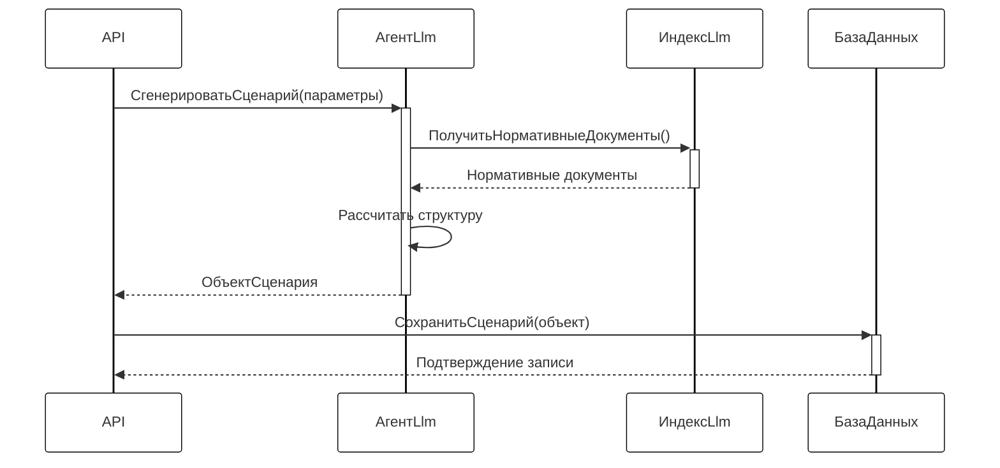
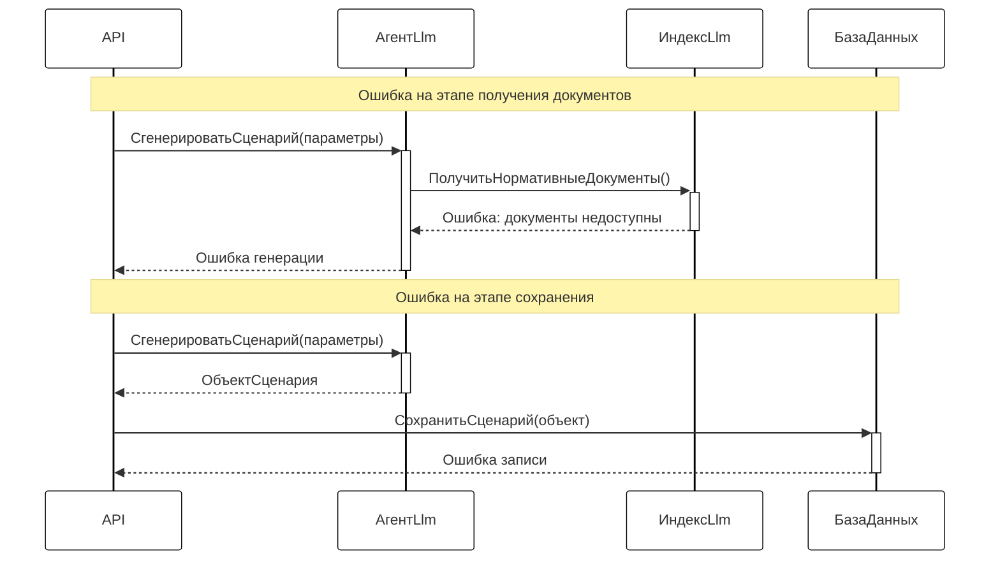
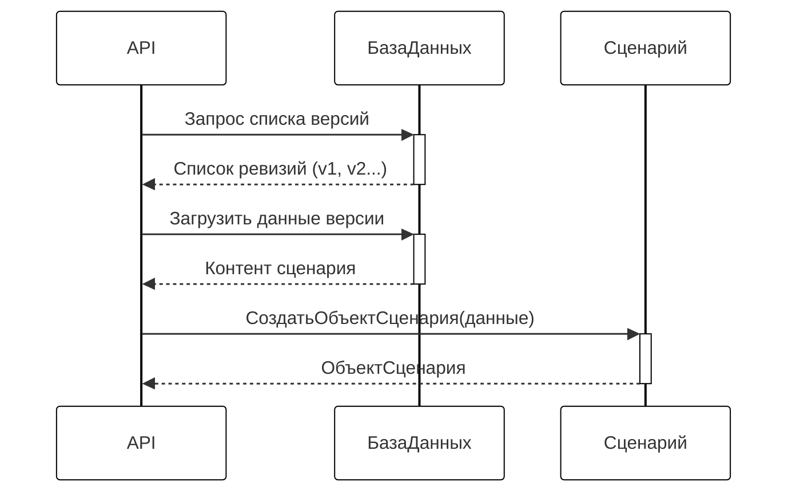
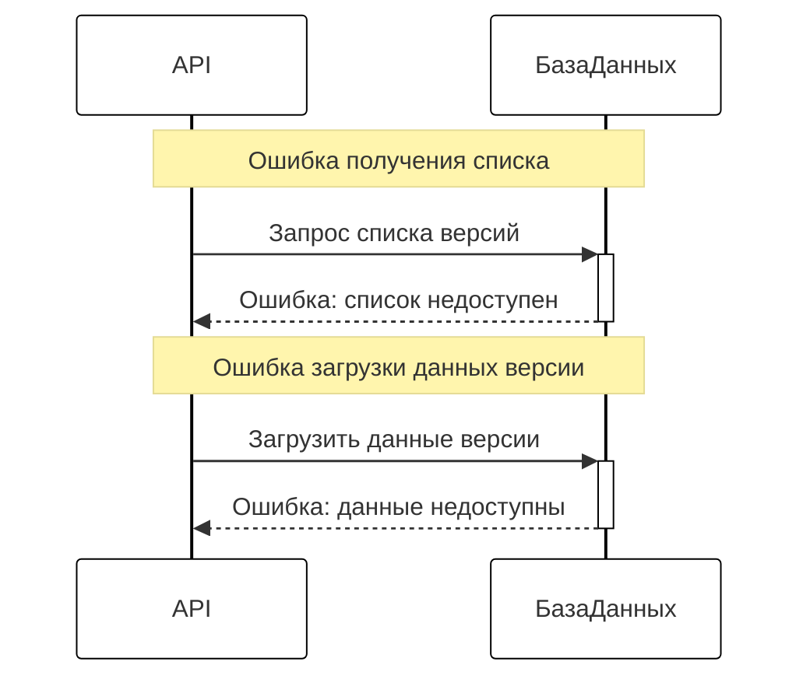
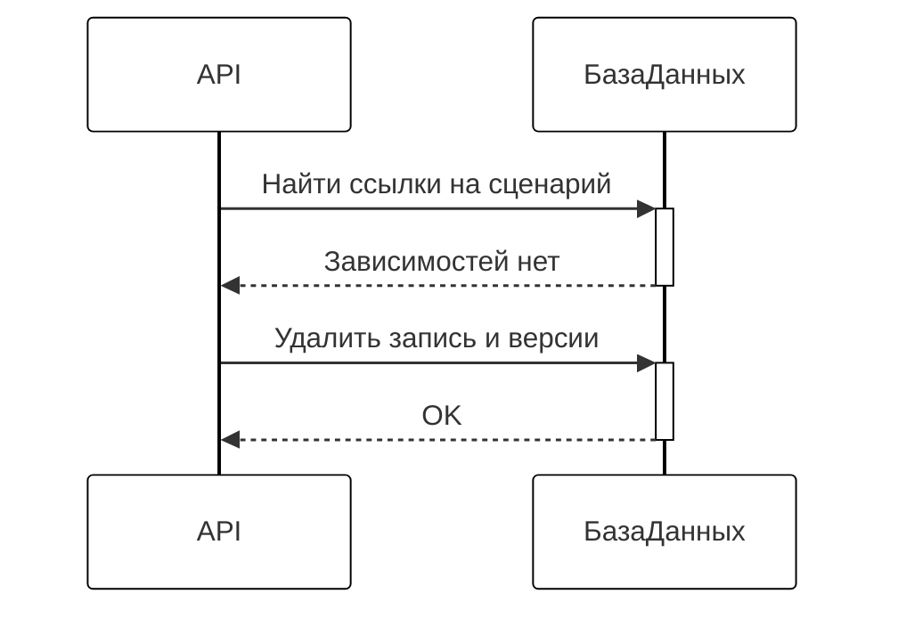
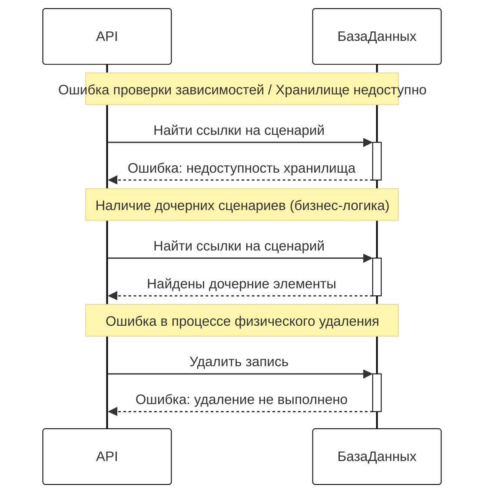

## Создание нового сценария/Изменение существующего сценария

### Нормальный ход событий

### Прерывание процесса системой

## Получение сценария определённой версии

### Нормальный ход событий

### Прерывание процесса системой

## Удаление сценария

### Нормальный ход событий

### Прерывание процесса системой

